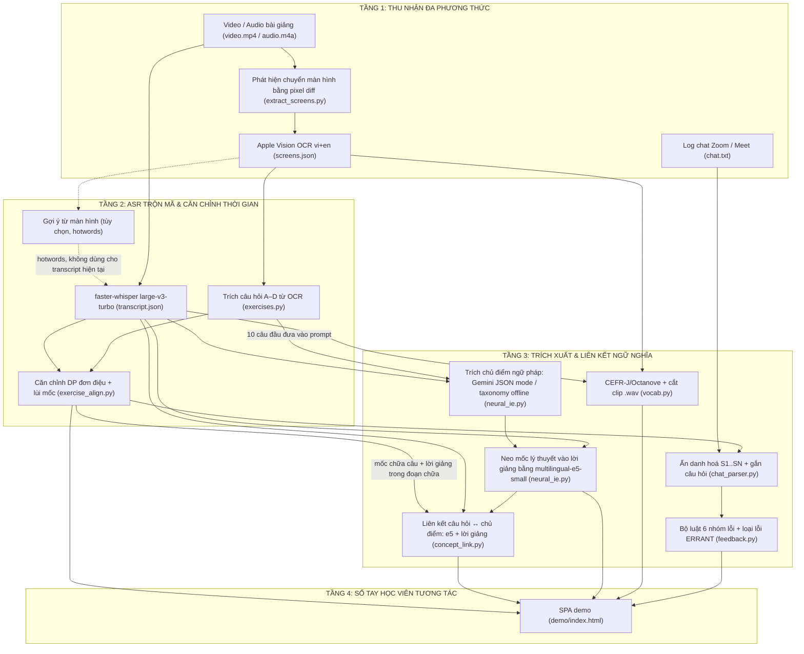

# CƠ SỞ LÝ THUYẾT NLP, KIẾN TRÚC ĐA PHƯƠNG THỨC & TỔNG QUAN NGHIÊN CỨU
## EDUSYNC: ĐỒNG BỘ & PHÂN TÍCH BÀI GIẢNG LUYỆN THI TIẾNG ANH (thực nghiệm trên TOEIC; IELTS là hướng mở rộng)
**Môn học:** Xử lý Ngôn ngữ Tự nhiên Nâng cao (NLP501 - Master of Software Engineering)  
**Nhánh phát triển:** `edusync-v2`  
**Cập nhật:** 10/11/2026  
**Nguồn số liệu duy nhất:** [docs/10_evaluation_results.md](10_evaluation_results.md) (tái tạo bằng `python eval/run_all.py`)

---

## 💡 Điểm nhấn Trình bày với Giảng viên (Executive Summary)

> Dữ liệu thực nghiệm: 3 bài ECE TOEIC Starter (YouTube, CC BY), một giáo viên, giảng tiếng Việt xen tiếng Anh. Unit 4 (58 phút) dùng để phát triển, Unit 5 (58 phút) để kiểm tra độc lập. Mọi nhãn chuẩn (gold) hiện là **bản nháp do AI gán, chưa được nhóm kiểm tra** (`verified: false`). Bảy điểm kỹ thuật chính:
> 1. **ASR trộn mã (`transcribe.py`):** faster-whisper `large-v3-turbo` đa ngữ. Có tùy chọn đưa từ tiếng Anh trên màn hình (OCR) vào tham số `hotwords`. **Chưa đo được WER** vì bản chép tham chiếu chưa sửa tay; chỉ số gián tiếp cho thấy gợi ý tăng tỉ lệ từ trên màn hình được chép ra (48% → 52%) nhưng cũng tăng số đoạn lặp, nên pipeline vẫn dùng bản không gợi ý.
> 2. **Gán nhãn ngôn ngữ và lọc từ đồng âm (`transcribe.py`, `vocab.py`):** nhãn `vi/en/mixed` theo mật độ chữ có dấu; danh sách `VI_HOMOPHONES` (41 âm tiết tiếng Việt không dấu như *hay, con, cho*) bị loại khỏi danh sách từ vựng. Cả hai là heuristic, chưa được đánh giá.
> 3. **Căn chỉnh câu hỏi ↔ lời giảng bằng quy hoạch động đơn điệu (`exercise_align.py`):** khẩu lệnh "câu N" được xác minh bằng ngữ cảnh, lùi mốc về đầu đoạn chữa. Trên bài kiểm tra độc lập U5: **80,0%** câu lệch ≤10 s, **88,6%** lệch ≤30 s, sai số trung bình 8,1 s, 0 lần đảo thứ tự (v1: 57,1% / 71,4% / 28,5 s).
> 4. **Liên kết câu hỏi ↔ chủ điểm ngữ pháp (`concept_link.py`):** bi-encoder đa ngữ `multilingual-e5-small`, kết hợp câu hỏi với **lời giảng của cô trong đoạn chữa**. Độ chính xác 91,2% trên 34 câu U4 (leave-one-out), nhưng mô hình và ngưỡng được chọn trên chính tập này nên kết quả lạc quan; chưa có tập kiểm tra độc lập.
> 5. **Hồ sơ từ vựng CEFR (`vocab.py`):** lemmatizer 2 lớp + từ điển CEFR-J/Octanove (8.845 mục). U4: 80 từ, 52 từ có nghĩa tiếng Việt khai thác từ lời giảng, 79 clip `.wav` 0,7–2,2 s. Chỉ có thống kê, chưa đánh giá chất lượng.
> 6. **Trích chủ điểm ngữ pháp bằng LLM + neo thời gian (`neural_ie.py`):** Gemini (`gemini-3.5-flash-lite`) ở chế độ JSON, phương án dự phòng offline là bộ phân loại chủ điểm TOEIC chung. Mốc lý thuyết được neo lại vào lời giảng bằng `multilingual-e5-small`: sai số trung bình giảm từ 882,5 s xuống 11,2 s (4 chủ điểm U4).
> 7. **Phát hiện lỗi người học trong chat (`feedback.py`):** bộ **luật** cho 6 nhóm lỗi chuyển di L1, mỗi lỗi kèm loại lỗi ERRANT (Bryant và cộng sự, ACL 2017) đã kiểm chứng bằng errant 3.0.2. Trên 70 câu viết độc lập với luật: precision 100%, recall 72,7%, F1 84,2%. Tên học viên được ẩn danh hoá (S1…SN). Chat của U4 là dữ liệu mô phỏng.

---

## 1. Phát biểu Bài toán dưới Góc nhìn Toán học & NLP

Cho một buổi học luyện thi tiếng Anh trực tuyến (thực nghiệm hiện tại: TOEIC) gồm 3 luồng dữ liệu đầu vào:
1. **Luồng nghe – nhìn:** video màn hình bài giảng $V$ và âm thanh lời giảng trộn mã Việt–Anh $A$, độ dài $T$ giây.
2. **Luồng màn hình đề bài:** tập màn hình trích tự động từ video $C = \{c_1, \dots, c_K\}$ (hoặc tập trang PDF $S = \{s_1, \dots, s_M\}$ khi có slide gốc).
3. **Luồng chat lớp học:** chuỗi tin nhắn của học viên $\mathcal{M} = \{m_1, \dots, m_L\}$ (trả lời đáp án, đặt câu hỏi).

### Bốn Bài toán Con (NLP Sub-tasks) Cần Giải quyết:
- **Bài toán 1 — Căn chỉnh đơn điệu câu hỏi & lời giảng:**
  Trích tập câu hỏi $\mathcal{E} = \{e_1, \dots, e_N\}$ (đề bài và các lựa chọn A–D) từ $C$, và tìm $f: \mathcal{E} \to [0, T]$ là thời điểm giáo viên bắt đầu chữa $e_k$, giữ thứ tự xuất hiện trên màn hình:
  $$\forall k < j: \quad f(e_k) \le f(e_j) \quad (\text{chặt với các câu khớp được lời giảng})$$
- **Bài toán 2 — Liên kết câu hỏi với chủ điểm ngữ pháp:**
  Cho tập chủ điểm $\mathcal{G} = \{g_1, \dots, g_M\}$ trích từ lời giảng, tìm $\phi: \mathcal{E} \to \mathcal{G} \cup \{\text{None}\}$ sao cho câu thực hành $e_k$ được gắn đúng chủ điểm mà nó luyện tập, kể cả khi $\text{Tokens}(e_k) \cap \text{Tokens}(g_j) = \emptyset$; câu từ vựng/đọc hiểu phải được gắn None.
- **Bài toán 3 — Hồ sơ từ vựng song ngữ & phân bậc CEFR:**
  Trích tập từ trọng tâm $\mathcal{V} = \{v_1, \dots, v_P\}$, đưa về lemma, gán $\text{CEFR}(v) \in \{\text{A1}, \dots, \text{C2}\}$, khai phá nghĩa tiếng Việt $D_{\text{vi}}(v)$ từ lời giảng và cắt đoạn âm thanh $\text{AudioClip}(v)$ ngắn (0,7–2,2 s) nơi giáo viên đọc từ đó.
- **Bài toán 4 — Phát hiện lỗi người học & báo cáo sư phạm:**
  Ẩn danh hoá người gửi ($S_1 \dots S_N$), phát hiện và phân loại lỗi trong $\mathcal{M}$ (mỗi lỗi kèm loại lỗi **ERRANT**), tính tỉ lệ thời gian nói giáo viên/học viên ($\text{TTT}/\text{STT}$) khi bản ghi có nhiều người nói, và đưa ra gợi ý cho buổi sau bằng các câu mẫu điền từ dữ liệu.

---

## 2. Kiến trúc Đường ống 4 Tầng (4-Layer NLP Pipeline Architecture)



Ghi chú: mọi bước giao tiếp qua tệp JSON trong thư mục bài học; `pipeline.py` chạy các bước theo thứ tự và bỏ qua bước đã có đầu ra.

---

## 3. Phân tích 7 Điểm Áp dụng Kỹ thuật NLP (Technical NLP Deep-Dive)

### 3.1. Nhận dạng Tiếng nói (ASR) & Gợi ý Ngữ cảnh từ Màn hình
- **Thách thức:** giáo viên nói tiếng Việt xen từ và câu tiếng Anh đọc nhanh. Lỗi quan sát được trong `transcript.json` của U4 (quan sát, không phải số đo): *"mệnh đề phân từ"* → *"bệnh đề phân từ"*, *"verb-ing"* → *"verb in"*.
- **Mô hình:** faster-whisper `large-v3-turbo`, chế độ đa ngữ (nhận lại ngôn ngữ cho từng cửa sổ 30 s), VAD bật. `initial_prompt` là một câu mô tả bài học **cố định** lấy từ `lesson.json`. Theo ghi chú phát hành của OpenAI, `large-v3` được huấn luyện trên khoảng 1 triệu giờ dữ liệu gán nhãn yếu và 4 triệu giờ nhãn giả (con số 680.000 giờ là của Whisper v1/v2); bản `turbo` giữ encoder của `large-v3` và rút decoder còn 4 tầng.
- **Gợi ý từ màn hình (tùy chọn `--screen-hints words|lines`):** audio được cắt theo từng màn hình; từ tiếng Anh OCR của màn hình đang chiếu $H$ (bỏ dòng có dấu tiếng Việt, bỏ stopword, tối đa 60 từ) được truyền qua tham số **`hotwords`** của faster-whisper, không phải `initial_prompt`. Token gợi ý được đặt vào phần ngữ cảnh "văn bản trước đó" của decoder:
  $$P(Y \mid X, H) = \prod_{t=1}^{|Y|} P(y_t \mid H, y_{<t}, \text{Encoder}(X))$$
  Token của $H$ tác động qua **self-attention của decoder**; cross-attention chỉ nhìn các trạng thái encoder của audio $X$, không nhìn token gợi ý.
- **Kết quả hiện có (U4, toàn bài) — chỉ số gián tiếp, chưa phải WER** (docs/10 §7):

| Cấu hình `transcribe.py` | Số đoạn | Lặp liên tiếp | Từ trên màn hình được nói ra (proxy) |
|---|---|---|---|
| Không gợi ý (đang dùng làm `transcript.json`) | 2.606 | 6 | 47% |
| Cắt theo màn hình, không gợi ý (đối chứng) | 545 | 3 | 48% |
| Gợi ý từ OCR (hotwords = từ) | 484 | 20 | 52% |
| Gợi ý từ OCR (hotwords = dòng) | 559 | 27 | 52% |

  Gợi ý tăng proxy khoảng 4 điểm so với đối chứng nhưng tăng số đoạn lặp (dấu hiệu ảo giác), và proxy có thể tăng chỉ vì Whisper chép lại từ gợi ý dù cô không nói. **Chưa kết luận được**; pipeline dùng bản không gợi ý.
- **Việc còn lại:** sửa tay 5 clip × 2 phút trong `gold/asr/`, đặt `"corrected": true`, rồi chạy `eval/wer.py` để có WER thật cho từng cấu hình.

### 3.2. Đo lường Sai số ASR bằng Quy hoạch động Levenshtein (WER)
Module `eval/wer.py` cài đặt quy hoạch động tính khoảng cách chỉnh sửa tối thiểu giữa chuỗi từ tham chiếu $R$ (độ dài $N$) và chuỗi ASR $H$ (độ dài $M$), sau khi chuẩn hoá (chữ thường, Unicode NFC, bỏ dấu câu, giữ dấu tiếng Việt):
$$D(i, j) = \min \begin{cases}
D(i-1, j) + 1 & \text{(xoá — từ bị sót)} \\
D(i, j-1) + 1 & \text{(chèn — từ thừa)} \\
D(i-1, j-1) + \mathbb{I}(r_i \neq h_j) & \text{(thay thế)}
\end{cases}$$
$$\text{WER} = \frac{S + D + I}{N}$$
Ngoài WER tổng, script tính độ chính xác trên các từ tham chiếu là từ tiếng Anh của màn hình đang chiếu (đúng nhóm từ mà gợi ý nhắm tới). Script đã có kiểm thử đơn vị (`tests/test_wer.py`, 5 test) nhưng **chưa chạy được trên dữ liệu thật** vì bản tham chiếu chưa sửa tay.

### 3.3. Xử lý Chuyển mã (Code-Switching) & Lọc Từ Đồng âm Việt–Anh
- **Nhãn ngôn ngữ theo mật độ chữ có dấu:** với mỗi đoạn $W$,
  $$\text{Density}_{\text{vi}}(W) = \frac{\sum_{w \in W} \mathbb{I}(w \text{ chứa ký tự có dấu tiếng Việt})}{|W|}$$
  - $\text{Density}_{\text{vi}}(W) > 0.3 \implies \text{vi}$; $= 0 \implies \text{en}$; còn lại $\implies \text{mixed}$.
  - Trên U4: 73% đoạn `vi`, 26% đoạn `en`, 5 đoạn `mixed`. **Heuristic này chưa được đánh giá** với nhãn ngôn ngữ chuẩn; nó gán sai khi đoạn tiếng Việt chỉ gồm âm tiết không dấu (vd. *"cho ba con"* → `en`) hoặc khi ASR chép tiếng Việt mất dấu.
- **Lọc từ đồng âm (`VI_HOMOPHONES`):** khi OCR/ASR mất dấu, nhiều âm tiết tiếng Việt trùng mặt chữ với từ tiếng Anh trong từ điển CEFR (*hay* "cỏ khô", *con* "lừa gạt", *cho*, *ra*, *to*…). `vocab.py` giữ một danh sách cố định 41 âm tiết như vậy và **luôn loại** chúng khỏi ứng viên từ vựng (cả từ màn hình lẫn lời giảng) và khỏi bước khai phá nghĩa; bộ lọc không xét ngữ cảnh, nên cũng bỏ mất trường hợp đó thật sự là từ tiếng Anh. Tác dụng của bộ lọc chưa được đo.

### 3.4. Quy hoạch Động Đơn điệu Căn chỉnh Câu hỏi (`exercise_align.py`)
- **Vì sao tìm "câu N" đầu tiên không đủ:** số câu bắt đầu lại ở mỗi phần bài tập, giáo viên nhắc lại câu cũ, và trên màn hình có "Text 2", "Part 5", "trang 105". Ở U4 cô còn chữa Exercise A trong sách ("câu số 1, 2") trong khi màn hình chiếu Exercise B. Phương pháp "regex 'câu N' đầu tiên" chỉ đạt 71,4% (±10 s) và gây 2 lần đảo thứ tự trên U5.
- **Ký hiệu:** câu $e_k$ có cửa sổ màn hình $[\tau_k^{s}, \tau_k^{e}]$; đoạn lời giảng $j$ bắt đầu ở $t(j)$; $W(\cdot)$ là tập từ nội dung (chữ thường, dài hơn 2 ký tự, bỏ stopword Anh–Việt) của đề bài + các lựa chọn.
- **Khẩu lệnh:** regex cho câu số $n$ ($n$ viết bằng số hoặc chữ: "hai", "thứ tư"…):
  ```regex
  (?<!text\s)(?<!page\s)(?<!part\s)(?<!trang\s)\b(?:câu\s+hỏi\s+số|câu\s+số|câu\s+thứ|câu|question|number|bài\s+tập|số)\s*(n|<chữ số của n>)\b
  ```
- **Điểm của cặp (câu $k$, đoạn $j$):**
  $$s(k,j) = w_{\text{trig}}(k,j) + 2\,\big|W(e_k) \cap W(\text{seg}_j)\big| + 3\,\mathbb{I}\big(\text{trung điểm của seg}_j \in [\tau_k^{s}, \tau_k^{e}]\big)$$
  $$w_{\text{trig}}(k,j) = \begin{cases} 25 & \text{regex khớp và } W(e_k) \cap W(\text{lời giảng trong 60 s từ } t(j)) \neq \emptyset \\ 2 & \text{regex khớp nhưng 60 s sau đó không có từ nào của câu hỏi} \\ 0 & \text{không khớp} \end{cases}$$
  Bước **xác minh khẩu lệnh bằng ngữ cảnh** này xử lý trường hợp "câu N" thuộc một bài tập khác. Chỉ xét đoạn có $t(j) \in [\tau_k^{s} - 30, \tau_k^{e} + 120]$ và $s(k,j) \ge 3$; một lượng nhỏ $0{,}01 \cdot$(vị trí tương đối trong cửa sổ) được trừ để ưu tiên lần nhắc đầu tiên khi bằng điểm.
- **Bộ giải mã quy hoạch động (tối ưu toàn cục, cho phép bỏ qua câu):**
  $$D[k][j] = s(k,j) + \max\Big(0,\; \max\{D[k'][j'] : k' < k,\; t(j') < t(j)\}\Big)$$
  Nghiệm là trạng thái có $D$ lớn nhất, truy vết ngược để lấy dãy cặp $(k, j)$ với thời điểm tăng chặt; câu không nằm trên đường đi tối ưu là "không khớp". Phần $\max$ bên trong được tính bằng bảng max tiền tố trên các trạng thái đã sắp theo thời gian (tìm vị trí bằng `bisect`).
- **Lùi mốc về đầu đoạn chữa:** từ đoạn được chọn, lùi qua các đoạn liền trước (khoảng nghỉ ≤3 s, tổng ≤30 s, không vượt mốc của câu trước) còn chung ít nhất một từ nội dung với câu hỏi, vì cô thường đọc đề trước rồi mới nói số câu.
- **Câu không khớp:** lấy thời điểm màn hình xuất hiện, kẹp giữa mốc của câu trước và câu khớp kế tiếp, nên đầu ra không bao giờ đảo thứ tự (`"matched": false`). Trên U4 có 33/34 bản ghi khớp được lời giảng.
- **Kết quả** (docs/10 §3; nhãn là bản nháp AI, `verified: false`; U4 = phát triển, U5 = kiểm tra độc lập chạy một lần sau khi chốt thuật toán):

| Phương pháp | Dev U4: ±10 s | ±30 s | Sai số TB | Test U5: ±10 s | ±30 s | Sai số TB | Đảo thứ tự (U5) |
|---|---|---|---|---|---|---|---|
| Thời điểm màn hình xuất hiện | 18,8% | 21,9% | 91,7 s | 48,6% | 62,9% | 33,3 s | 0 |
| Regex "câu N" đầu tiên | 71,9% | 78,1% | 28,1 s | 71,4% | 80,0% | 21,3 s | 2 |
| v1 (commit 73d9a62) | 65,6% | 81,2% | 24,6 s | 57,1% | 71,4% | 28,5 s | 2 |
| Greedy (điểm số mới) | 68,8% | 84,4% | 10,5 s | 77,1% | 88,6% | 8,6 s | 0 |
| DP (điểm số mới) | 68,8% | 84,4% | 10,5 s | 77,1% | 88,6% | 8,6 s | 0 |
| **DP + lùi mốc (bản hiện tại)** | **68,8%** | **84,4%** | **10,0 s** | **80,0%** | **88,6%** | **8,1 s** | **0** |

- **Nhận xét trung thực:** trên cả hai bài, **DP chọn giống hệt greedy**; cải thiện so với v1 đến từ cách tính điểm (xác minh khẩu lệnh, bỏ stopword, số đọc bằng chữ), bước lùi mốc và cách xử lý câu không khớp. DP chỉ khác greedy khi có xung đột giữa các câu (minh hoạ bằng `tests/test_exercises.py::test_dp_finds_global_optimum_where_greedy_fails`). Lỗi còn lại chủ yếu ở chỗ trống trong đoạn văn (Part 6/7), nơi cô đọc liền cả đoạn nên "lúc bắt đầu câu" vốn không rõ.

### 3.5. Liên kết Câu hỏi với Chủ điểm Ngữ pháp bằng Bi-encoder Đa ngữ (`concept_link.py`)
- **Lệch từ vựng (vocabulary mismatch):** câu *"The movie was very... (A) move (B) moving (C) moved (D) movement"* không có từ chung với tên chủ điểm *"Participles as Adjectives"*. Thêm vào đó, phần giải thích chủ điểm và lời giảng chủ yếu bằng tiếng Việt, còn đề bài bằng tiếng Anh.
- **Biểu diễn:** mô hình `intfloat/multilingual-e5-small` (384 chiều, chuẩn hoá $L_2$, tiền tố `query:` / `passage:`) mã hoá ba văn bản:
  - câu hỏi $Q_k$ = đề bài + các lựa chọn (OCR);
  - lời giảng $Sp_k$ = những gì cô nói từ mốc chữa câu $k$ (từ `exercise_alignment.json`) đến câu kế tiếp, tối đa 90 s — tín hiệu đa phương thức (cô nói "thêm ing hay ed để làm tính từ", "công thức nhờ vả");
  - chủ điểm $GP_j$ = tên + công thức + ví dụ tiếng Anh + giải thích tiếng Việt (từ `grammar_points.json`).
  $$\text{score}(k, j) = \tfrac{1}{2}\big(\cos(\vec{q}_k, \vec{g}_j) + \cos(\vec{sp}_k, \vec{g}_j)\big), \qquad \phi(e_k) = \begin{cases} \arg\max_j \text{score}(k,j) & \text{nếu } \max_j \text{score}(k,j) \ge 0{,}835 \\ \text{None} & \text{ngược lại} \end{cases}$$
  Độ tin cậy: HIGH khi được gắn và hơn chủ điểm thứ hai ≥0,01; MEDIUM khi được gắn nhưng sát nhau; LOW khi không gắn. Không có `sentence-transformers` thì dùng TF-IDF (ngưỡng 0,10).
- **Ablation trên 34 câu U4** (docs/10 §4; ngưỡng chọn bằng leave-one-out; 12 câu có chủ điểm, 22 câu none):

| Phương pháp | Độ chính xác (34 câu) | Link precision | Link recall | acc@1 (12 câu có chủ điểm) |
|---|---|---|---|---|
| Luôn trả lời "none" | 73,5% | — | — | — |
| TF-IDF | 82,4% | 85,7% | 58,3% | 83,3% |
| BM25 | 70,6% | 57,1% | 41,7% | 91,7% |
| MiniLM + từ khoá viết tay (v1) | 76,5% | 72,7% | 58,3% | 66,7% |
| MiniLM, bỏ từ khoá viết tay | 61,8% | 33,3% | 25,0% | 50,0% |
| paraphrase-multilingual-MiniLM | 76,5% | 71,4% | 50,0% | 75,0% |
| multilingual-e5-small | 85,3% | 80,0% | 75,0% | 91,7% |
| **multilingual-e5-small + lời giảng (bản hiện tại)** | **91,2%** | **83,3%** | **83,3%** | **91,7%** |

  Đầu ra thực tế với ngưỡng cố định 0,835 (đúng như demo): độ chính xác 91,2%, link precision 90,0%, link recall 75,0%, 10 badge (v1: 58,8% / 39,1% / 66,7%, 23 badge).
- **Vì sao v1 "rò" đáp án:** v1 dùng `all-MiniLM-L6-v2` (chỉ tiếng Anh) và nối thêm danh sách `KEYWORD_CUES` viết tay vào văn bản chủ điểm; danh sách này chứa cả từ đáp án của chính bài (`central`, `luxury`, `shined`…). Bỏ danh sách đó thì MiniLM tụt từ 76,5% xuống 61,8%, tức phần lớn kết quả cũ đến từ từ khoá viết tay chứ không từ mô hình. Bản hiện tại đã xoá `KEYWORD_CUES` (có test `test_no_hand_written_keyword_cues`).
- **Hạn chế:** mô hình và ngưỡng được chọn trên chính 34 câu này nên kết quả lạc quan; điểm của nhóm "có chủ điểm" và "none" rất sát nhau (0,81–0,86) nên sang bài mới phải hiệu chỉnh lại ngưỡng; chưa có tập kiểm tra độc lập. Ngoài ra, ví dụ tiếng Anh trong `grammar_points.json` do Gemini viết sau khi đã thấy 10 câu hỏi đầu (prompt của `neural_ie.py`), nên có ví dụ gần trùng nguyên văn câu hỏi (vd. *"The movie was very moving."*); ảnh hưởng của yếu tố này chưa được tách riêng.

### 3.6. Hình thái học, Phân bậc CEFR & Khai phá Nghĩa Song ngữ (`vocab.py`)
1. **Lemmatization 2 lớp (`resolve_lemma`):**
   - *Lớp 1 — bảng bất quy tắc:* *wrote/written → write, bought → buy, taught → teach*…
   - *Lớp 2 — bỏ hậu tố:* `-ies → -y`, `-es`, `-s`, `-ied → -y`, `-ed`, `-ing` (thử cả dạng thêm `e`), chỉ chấp nhận khi từ gốc có trong từ điển (tránh cắt nhầm *process*, *analysis*).
2. **Phân bậc CEFR:** tra từ điển CEFR-J + Octanove (8.845 mục, A1–C2). Hệ thống chỉ gán bậc CEFR; nó không quy đổi sang điểm thi. Để tham khảo, ngưỡng CEFR của ETS cho TOEIC Listening & Reading là A1 120, A2 225, B1 550, B2 785, C1 945; tương ứng IELTS theo Cambridge là B1 4.0–5.0, B2 5.5–6.5, C1 7.0–8.0, C2 8.5+.
3. **Khai phá nghĩa tiếng Việt bằng mẫu:** trong một đoạn: `X (có nghĩa là | nghĩa là | là) <cụm tiếng Việt>` hoặc `(từ | động từ | danh từ | tính từ) X là …`; giữa hai đoạn liên tiếp: đoạn 1 chỉ có 1–2 từ tiếng Anh, đoạn 2 là tiếng Việt và bắt đầu trong vòng 2,5 s. Bộ lọc `BAD_DEF` loại các cụm không phải định nghĩa (*"cộng với"*, *"câu số"*…).
4. **Clip phát âm:** transcript không có timestamp từng từ, nên clip được cắt theo **ranh giới đoạn ASR** chứa từ đó (ưu tiên đoạn chỉ có một từ, rồi cụm 1–3 từ, rồi câu ngắn), thêm 0,15 s trước / 0,25 s sau, tối đa 2,2 s, lưu thành `vocab_audio/<lemma>.wav` (16 kHz).
5. **Kết quả U4 (chỉ thống kê, chưa đánh giá chất lượng — docs/10 §7b):** 80 từ (A1 26, A2 26, B1 18, B2 9, C1 1); 52/80 từ có nghĩa tiếng Việt khai thác được, **độ đúng của nghĩa chưa được kiểm tra**; 79 clip `.wav` dài 0,7–2,2 s.

### 3.7. Phát hiện Lỗi Người học & Gán Loại lỗi ERRANT (`feedback.py`)
- **Bối cảnh:** học viên gõ câu trả lời và câu hỏi vào chat; người Việt hay mắc lỗi **chuyển di L1** (dịch từng từ). Chat của U4 (17 tin nhắn, 5 học viên) là **dữ liệu mô phỏng** do nhóm soạn, vì video YouTube không có chat.
- **Phương pháp:** bộ **luật** (regex + từ điển nhỏ) cho đúng 6 nhóm lỗi, sinh câu sửa và lời giải thích tiếng Việt. Đây **không phải mô hình GEC tổng quát**: mọi lỗi ngoài 6 nhóm đều bị bỏ qua.
- **ERRANT** (Bryant, Felice & Briscoe, ACL 2017) gán loại lỗi dạng `Thao tác:Loại` với thao tác `M` (thiếu), `U` (thừa), `R` (thay thế). Mỗi lỗi mang nhóm của EduSync và một loại ERRANT. Loại mặc định của từng nhóm là kết quả của thư viện chính thức **errant 3.0.2** trên cặp câu mẫu (`eval/errant_check.py`, kết quả ở `eval/results/errant_check.txt`); nếu máy có cài `errant`, `feedback.py` tự gán loại cho từng lỗi.

| Nhóm EduSync | Ví dụ → sửa | Loại ERRANT mặc định |
|---|---|---|
| BE_VERB | *I am agree* → *I agree* | `U:VERB:TENSE` |
| PARTICIPLE | *The movie was moved* → *The movie was moving* | `R:VERB:FORM` |
| CAUSATIVE | *have my car repair* → *have my car repaired* | `R:VERB:FORM` |
| MODAL_TO | *should to increase* → *should increase* | `U:VERB:FORM` |
| SVA | *it make me cry* → *it makes me cry* | `R:VERB:SVA` |
| WH_DO | *Why we use -ing?* → *Why do we use -ing?* | `M:VERB:TENSE` |

  errant có thể cho loại lân cận với cặp câu khác (vd. `R:MORPH` cho *confusing → confused*, `R:OTHER` cho *don't → doesn't*).
- **Kết quả trên 70 câu viết độc lập với luật** (`eval/gold/gec_heldout.json`, bản nháp AI, `verified: false`; docs/10 §6): precision cấp câu 100%, recall 72,7%, F1 84,2% (v1 khớp nguyên văn: 90,0% / 20,5% / 33,3%). Recall theo nhóm: BE_VERB 50,0%, PARTICIPLE 87,5%, CAUSATIVE 75,0%, MODAL_TO 100%, SVA 62,5%, WH_DO 42,9%. Sửa đúng nguyên câu 65,9%. Tập 70 câu đã được xem một lần để sửa 3 lỗi cài đặt (không thêm luật mới).
- **Ẩn danh hoá:** `chat_parser.py` thay tên người gửi bằng S1…SN (giáo viên = T). Đây là ẩn danh hoá tên người gửi, không phải tuân thủ một bộ luật cụ thể; tên xuất hiện bên trong nội dung tin nhắn không được xoá.

---

## 4. Tổng quan Nghiên cứu Khoa học Quốc tế (Literature Review)

| Công trình & Nơi công bố | Phương pháp & Đóng góp | EduSync dùng gì, khác gì |
| :--- | :--- | :--- |
| **Anderer et al. (2024)**<br>*MaViLS: Benchmark Dataset for Video-to-Slide Alignment* (`arXiv:2409.16765`) | Kết hợp ASR, OCR và đặc trưng hình ảnh với quy hoạch động để căn chỉnh video bài giảng với slide PDF. | Mượn ý tưởng DP đơn điệu. Khác: video quay màn hình không có slide gốc, và căn chỉnh tới **từng câu hỏi** thay vì từng slide. Kết quả trên U5: 80,0% câu lệch ≤10 s (nhãn nháp). |
| **Radford et al. (2023)**<br>*Robust Speech Recognition via Large-Scale Weak Supervision* (`ICML 2023`) | Whisper: Transformer encoder–decoder đa ngữ huấn luyện giám sát yếu; decoder có thể điều kiện hoá theo văn bản "trước đó" (prompt). | Dùng `large-v3-turbo` qua faster-whisper, prompt cố định theo bài, tùy chọn `hotwords` từ OCR màn hình. Tác dụng của gợi ý chưa kết luận (chỉ có proxy, chưa có WER). |
| **Peng et al. (2023)**<br>*Prompting the Hidden Talent of Web-Scale Speech Models for Zero-Shot Task Generalization* (`Interspeech 2023`) | Thiết kế prompt cho Whisper để làm các tác vụ chưa huấn luyện, gồm ASR có ngữ cảnh hình ảnh và ASR chuyển mã. | Cơ sở cho việc đưa ngữ cảnh màn hình vào decoder dưới dạng văn bản. EduSync mới chỉ có proxy, và thấy gợi ý đi kèm tăng số đoạn lặp. |
| **Reimers & Gurevych (2019)**<br>*Sentence-BERT: Sentence Embeddings using Siamese BERT-Networks* (`EMNLP 2019`) | Bi-encoder (Siamese) cho câu, so khớp bằng cosine thay vì cross-encoder từng cặp. | Nền tảng của `concept_link.py`. v1 dùng `all-MiniLM-L6-v2` (nay là baseline trong ablation). |
| **Reimers & Gurevych (2020)**<br>*Making Monolingual Sentence Embeddings Multilingual using Knowledge Distillation* (`EMNLP 2020`) | Chưng cất mô hình câu tiếng Anh sang không gian đa ngữ. | Baseline `paraphrase-multilingual-MiniLM` (76,5%) trong ablation liên kết chủ điểm. |
| **Wang et al. (2022)**<br>*Text Embeddings by Weakly-Supervised Contrastive Pre-training* (`arXiv:2212.03533`) | E5: huấn luyện tương phản trên cặp văn bản giám sát yếu, tiền tố `query:`/`passage:`. Bản đa ngữ mô tả trong *Multilingual E5 Text Embeddings: A Technical Report* (Wang et al., 2024). | Mô hình hiện tại `multilingual-e5-small` cho liên kết chủ điểm (91,2% trên U4, lạc quan) và neo mốc lý thuyết (sai số TB 11,2 s). |
| **Capel (2012); dự án CEFR-J (Tono và cộng sự)**<br>*English Vocabulary Profile & CEFR-J Wordlist* | Danh sách từ phân bậc A1–C2 theo khung CEFR. | Tra từ điển CEFR-J + Octanove (8.845 mục) sau lemmatizer 2 lớp; chưa đánh giá độ đúng của việc chọn từ. |
| **Bryant, Felice & Briscoe (2017)**<br>*Automatic Annotation and Evaluation of Error Types for Grammatical Error Correction* (`ACL 2017`) | ERRANT: tự động trích và phân loại lỗi (khoảng 25 loại chính, kèm thao tác M/U/R) từ cặp câu gốc–sửa. | Gán loại lỗi ERRANT cho 6 nhóm lỗi của bộ luật, kiểm chứng bằng errant 3.0.2. EduSync không phải hệ GEC tổng quát. |

Ghi chú: ERRANT cũng là công cụ chấm của *The BEA-2019 Shared Task on Grammatical Error Correction* (Bryant, Felice, Andersen & Briscoe, BEA workshop 2019); khi trích dẫn ERRANT cần dùng bài ACL 2017 ở trên. EduSync không đánh giá trên dữ liệu của BEA-2019.

---

## 5. Phân tích SWOT & Lộ trình Mở rộng Học thuật

| Điểm mạnh (Strengths) | Điểm yếu & Thách thức (Weaknesses) |
| :--- | :--- |
| • **Đánh giá tái tạo được:** `python eval/run_all.py` sinh lại mọi con số, có baseline và so sánh với v1 (commit 73d9a62).<br>• **Có tập kiểm tra độc lập cho căn chỉnh:** thuật toán chỉnh trên U4, chạy một lần trên U5: 80,0% (±10 s), 88,6% (±30 s), 0 lần đảo thứ tự.<br>• **Có kiểm tra tổng quát hóa sang giáo viên khác** (`eval/eval_multisource.py`, docs/10 §3b): 8 video TOEIC tiếng Việt của 6 kênh YouTube (CC BY), 68 câu. Hệ thống đóng băng chỉ đúng 17,8% (±10 s) trên 6 bài giảng, so với 80,0% trên U5 cùng nguồn; khi cho trước danh sách câu đúng, DP đúng 57,8% (greedy 24,4%), nên lỗi chính nằm ở bước trích câu từ màn hình.<br>• **Dùng tín hiệu đa phương thức có đo được lợi ích:** thêm lời giảng của cô nâng liên kết chủ điểm từ 85,3% lên 91,2%; neo mốc lý thuyết giảm sai số từ 882,5 s xuống 11,2 s.<br>• **Chạy được offline:** TF-IDF, taxonomy chủ điểm và chế độ một người nói thay thế khi thiếu mô hình/API.<br>• **75/75 test** pass, test không ghi vào `lessons/`. | • **Đánh giá nhỏ:** 2 bài (34 + 35 câu), 4 chủ điểm, 70 câu GEC; thuật toán chỉnh trên **một giáo viên**, trên video của kênh khác căn chỉnh chỉ đúng 17,8%.<br>• **Nhãn chuẩn là bản nháp do AI gán**, chưa được nhóm kiểm tra (`verified: false`).<br>• **Chưa đo WER**; gợi ý từ màn hình chưa kết luận được.<br>• **Ngưỡng liên kết chủ điểm chọn trên tập phát triển**, chưa có tập kiểm tra độc lập; ví dụ do Gemini viết có thể trùng câu hỏi.<br>• **Chat là dữ liệu mô phỏng**; bộ phát hiện lỗi là **luật** cho 6 nhóm, recall 72,7%.<br>• Nghĩa tiếng Việt và danh sách từ vựng chưa được đánh giá; nhãn ngôn ngữ là heuristic chưa kiểm chứng.<br>• OCR dùng Apple Vision (chỉ chạy trên macOS); xử lý sau buổi học, chưa chạy thời gian thực. |

### Hướng Mở rộng (chưa thực hiện):
1. **Hoàn thiện đánh giá:** nhóm kiểm tra lại mọi nhãn nháp, sửa tay 5 clip ASR để có WER, thêm bài kiểm tra độc lập cho liên kết chủ điểm, thu chat thật (có đồng ý) và bản ghi tách kênh từng người để đo TTT/STT.
2. **Mở rộng sang IELTS:** chưa có dữ liệu IELTS nào được dùng. Các hướng có thể thử: chấm luyện nói (độ trôi chảy, độ đa dạng từ vựng CEFR, lỗi ngữ pháp) trên bản ghi tách người nói; liên kết câu hỏi Reading với câu chứa bằng chứng trong bài đọc dài bằng mô hình nhúng hỗ trợ ngữ cảnh dài (vd. `BAAI/bge-m3`).
3. **Thay bộ luật GEC bằng mô hình GEC** (đánh giá bằng ERRANT trên dữ liệu người học thật) và giữ bộ luật làm phần giải thích tiếng Việt.
