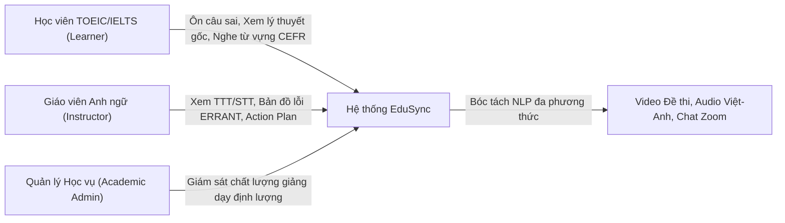
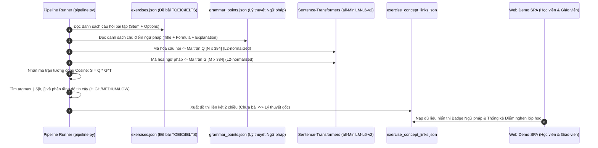

# TÀI LIỆU ĐẶC TẢ & PHÂN TÍCH YÊU CẦU DỰ ÁN (SRS)
## EDUSYNC: NỀN TẢNG ĐỒNG BỘ ĐA PHƯƠNG THỨC & PHÂN TÍCH SƯ PHẠM BÀI GIẢNG LUYỆN THI TIẾNG ANH (TOEIC & IELTS)
**Môn học:** Xử lý Ngôn ngữ Tự nhiên Nâng cao (NLP501 - Master of Software Engineering)  
**Nhánh phát triển:** `edusync-v2`  
**Phiên bản tài liệu:** v2.1  
**Ngày phát hành:** Tháng 11/2026  

---

## 💡 Điểm nhấn Trình bày với Giảng viên (SRS Overview)

> - **Đối tượng bài toán:** Các lớp học luyện thi chứng chỉ tiếng Anh quốc tế (**TOEIC Listening & Reading**, **IELTS Academic & General**) giảng dạy trực tuyến qua Zoom / Google Meet.
> - **5 Phân hệ Chức năng (FR1–FR5):**
>   1. **FR1 — Multimodal Alignment:** Nhận dạng giọng nói trộn mã Việt–Anh (Whisper + OCR Screen Hints) và căn chỉnh đơn điệu từng câu hỏi bài tập TOEIC/IELTS (Monotonic DP).
>   2. **FR2 — Semantic Concept Grounding:** Liên kết câu hỏi bài tập với lý thuyết ngữ pháp gốc bằng Dense Semantic Embeddings (`all-MiniLM-L6-v2` + Cosine Similarity).
>   3. **FR3 — CEFR Lexical Profiling & Audio Slicing:** Phân tầng từ vựng A1–C2 (8.845 từ CEFR-J/Octanove) cho mục tiêu band điểm TOEIC/IELTS kèm cắt audio mẫu 1.5s giọng thật giáo viên.
>   4. **FR4 — Learner GEC & Privacy:** Ẩn danh học viên chuẩn FERPA ($S_1 \dots S_N$) và bắt lỗi ngữ pháp L1 Transfer trong khung chat theo chuẩn quốc tế **ERRANT**.
>   5. **FR5 — Teacher Analytics & Omnibox Search:** Đo tỷ lệ nói TTT/STT, bản đồ lỗi sai của lớp, đề xuất kế hoạch 3 bước cho buổi học tiếp theo và tra cứu toàn bài dưới 30ms.

---

## 1. Tổng quan Dự án & Tuyên ngôn Giá trị (Project Overview)

### 1.1. Bối cảnh Thực tế trong Đào tạo TOEIC & IELTS Trực tuyến
Trong các khóa luyện thi TOEIC và IELTS trực tuyến (Zoom / Google Meet / MS Teams), bản ghi hình buổi học (Lecture Recording) dài 60–90 phút là nguồn học liệu quý giá nhất nhưng lại bị đóng băng trong một "hộp đen phi cấu trúc" (*unstructured black-box*):
- **Đối với Học viên luyện thi TOEIC / IELTS:** Khi muốn ôn lại một câu trắc nghiệm ngữ pháp (TOEIC Part 5/6) hoặc một câu hỏi đọc hiểu (IELTS Reading) bị làm sai, học viên phải mất 15–20 phút kéo thanh trượt video một cách mù mờ (*blind scrubbing*). Hơn nữa, khi làm sai câu hỏi thực hành, học viên không biết câu đó thuộc chủ điểm ngữ pháp nào mà giáo viên đã giảng ở đầu buổi, cũng không có danh sách từ vựng phân theo band điểm (CEFR B1–C2) kèm âm thanh phát âm chuẩn của thầy cô.
- **Đối với Giáo viên Tiếng Anh:** Kết thúc ca dạy, giáo viên không có số liệu định lượng: không đo được tỷ lệ thời gian nói của giáo viên so với học viên ($\text{TTT}$ vs $\text{STT}$), hàng chục câu trả lời và đặt câu của học viên trong hộp chat bị trôi mất, không thống kê được lỗi ngữ pháp chuyển di ngôn ngữ (*L1 Transfer*) nào đang là điểm yếu lớn nhất của cả lớp để điều chỉnh giáo án buổi sau.

### 1.2. Tuyên ngôn Giá trị (Value Proposition)
**EduSync** là nền tảng NLP đa phương thức chuyển hóa video buổi học luyện thi TOEIC/IELTS thành:
1. **Sổ tay Học tập Tương tác cho Học viên (Interactive TOEIC/IELTS Study Notebook):** Giảm thời gian ôn bài từ 60 phút xuống 10 phút trọng tâm thông qua tính năng bấm vào câu hỏi/từ vựng/ngữ pháp để tua video tức thì đến đúng giây giáo viên giải thích; tích hợp liên kết 2 chiều giữa Bài tập $\leftrightarrow$ Lý thuyết gốc, thẻ flashcard âm thanh 1.5s và thanh tìm kiếm toàn bài Omnibox.
2. **Bảng điều khiển Sư phạm Tự động cho Giáo viên (Teacher Pedagogical Dashboard):** Tự động đo lường thời lượng nói (TTT/STT), thống kê bản đồ lỗi ngữ pháp học viên theo chuẩn quốc tế **ERRANT**, chỉ ra chủ điểm ngữ pháp yếu nhất của lớp (*Weakest Concept*) và đề xuất kế hoạch hành động 3 bước cho buổi dạy tiếp theo (*Next-Lesson Action Plan*).

---

## 2. Phân tích Tác nhân & Bối cảnh Sử dụng (Stakeholder & Actor Analysis)

| Tác nhân (Actor) | Trách nhiệm & Nhu cầu Cốt lõi trong Lớp TOEIC/IELTS | Giá trị Nhận được từ EduSync |
| :--- | :--- | :--- |
| **Học viên (TOEIC/IELTS Learner)** | • Cần xem lại đúng đoạn giáo viên chữa câu trắc nghiệm mình làm sai. • Cần ôn lại công thức ngữ pháp gốc của câu hỏi đó. • Cần học từ vựng học thuật theo mục tiêu band điểm (B1–C2) và nghe phát âm chuẩn. • Cần biết lỗi ngữ pháp khi mình gõ câu trả lời trong chat. | • Click câu hỏi nhảy video tức thời ($\Delta t \le 1.8\text{s}$). • Badge liên kết 2 chiều giữa Câu hỏi $\leftrightarrow$ Lý thuyết gốc. • Thẻ từ vựng CEFR kèm Audio clip 1.5s giọng thật của giáo viên. • Phản hồi sửa lỗi GEC kèm giải thích tiếng Việt dễ hiểu. |
| **Giáo viên (ESL Instructor)** | • Cần kiểm soát tỷ lệ nói giữa giáo viên và học viên (TTT vs STT). • Cần nắm được lỗi ngữ pháp phổ biến nhất của lớp trong hộp chat. • Cần biết chủ điểm ngữ pháp nào học viên hay sai nhất để ôn lại buổi sau. | • Đồng hồ đo TTT/STT tự động từ luồng âm thanh. • Bản đồ nhiệt lỗi ngữ pháp chuẩn quốc tế ERRANT. • Cảnh báo *Weakest Concept* và Kế hoạch 3 bước cho buổi học kế tiếp. |
| **Hệ thống (EduSync NLP Engine)** | • Xử lý đa phương thức (Audio Việt–Anh, Video màn hình đề thi, OCR, Chat text). - Thực thi căn chỉnh đơn điệu, nhúng vector ngữ nghĩa, phân loại CEFR và GEC. | • Cung cấp giao diện Web Demo SPA mượt mà, phản hồi dưới 100ms, hoạt động hoàn toàn offline khi cần. |

---

## 3. Yêu cầu Chức năng (Functional Requirements - FR)

### 3.1. Phân hệ FR1: Căn chỉnh Đa phương thức & Định vị Câu hỏi (Multimodal Alignment)
- **FR1.1 (Code-Switching Audio Transcription):** Hệ thống phải phiên mã toàn bộ âm thanh bài giảng trộn mã Việt–Anh thành văn bản (`transcript.json`) có gắn mốc thời gian bắt đầu (`start`), kết thúc (`end`) và nhãn ngôn ngữ (`vi`, `en`, `mixed`) bằng mô hình Whisper kết hợp **OCR Screen Hints Contextual Prompting**.
- **FR1.2 (Screen OCR & Exercise Extraction):** Hệ thống phải tự động nhận diện chuyển cảnh màn hình bài giảng, khử khung hình trùng lặp, và trích xuất đầy đủ đề bài câu hỏi luyện thi TOEIC/IELTS (`screens.json`, `exercises.json`).
- **FR1.3 (Monotonic Sequence Alignment):** Hệ thống phải căn chỉnh đơn điệu giữa lời giảng giáo viên và từng câu hỏi bài tập ($Q_1 \dots Q_N$), đảm bảo 100% câu hỏi được gán đúng mốc thời gian xuất hiện trong video với ràng buộc nhân quả $t_{k+1} > t_k$.
- **FR1.4 (Click-to-Seek Video Playback):** Khi người dùng bấm vào bất kỳ câu hỏi, phân đoạn lời giảng, từ vựng hay tin nhắn chat, trình phát video phải nhảy ngay lập tức đến mốc thời gian tương ứng.

---

### 3.2. Phân hệ FR2: Liên kết Câu hỏi với Chủ điểm Ngữ pháp bằng Nhúng Vector Ngữ nghĩa (Question-to-Concept Linking via Dense Semantic Embeddings)
> **Yêu cầu Kỹ thuật NLP Trọng tâm:** Tự động liên kết mỗi câu hỏi bài tập TOEIC/IELTS (chỉ chứa câu tình huống cụ thể) với chủ điểm ngữ pháp nền tảng tương ứng trong tài liệu bài giảng thông qua **Không gian Nhúng Vector Ngữ nghĩa (Dense Semantic Embeddings)**.

1. **Xây dựng Không gian Nhúng (Embedding Space):**
   - Sử dụng mô hình Bi-Encoder Pre-trained `sentence-transformers/all-MiniLM-L6-v2` (chiều vector $d=384$) hoặc `BAAI/bge-base-en-v1.5` ($d=768$) chạy cục bộ trên CPU / Apple Silicon MPS.
2. **Biểu diễn Vector Câu hỏi ($\vec{q}_k$) & Chủ điểm Ngữ pháp ($\vec{g}_j$):**
   - Chuỗi câu hỏi: $\text{Text}(Q_k) = \text{Stem}_k \parallel \text{Options}_k \parallel \text{TeacherSpeechContext}_k \implies \vec{q}_k \in \mathbb{R}^{384}, \|\vec{q}_k\|_2 = 1$.
   - Chuỗi ngữ pháp: $\text{Text}(GP_j) = \text{Title}_j \parallel \text{Formula}_j \parallel \text{Explanation}_j \parallel \text{Keywords}_j \implies \vec{g}_j \in \mathbb{R}^{384}, \|\vec{g}_j\|_2 = 1$.
3. **Tính toán Ma trận Tương đồng Cosine & Phân ngưỡng:**
   $$\text{Sim}(Q_k, GP_j) = \cos(\vec{q}_k, \vec{g}_j) = \vec{q}_k \cdot \vec{g}_j, \quad \hat{g}_k = \arg\max_{j \in [1, M]} \text{Sim}(Q_k, GP_j)$$
   Gắn nhãn độ tin cậy (`HIGH`, `MEDIUM`, `LOW`) và tạo liên kết điều hướng 2 chiều trên giao diện: **⏱ Xem Chữa bài** $\leftrightarrow$ **📖 Xem Lý thuyết Gốc**.

---

### 3.3. Phân hệ FR3: Phân loại Từ vựng CEFR (TOEIC/IELTS) & Cắt Audio Phát âm Mẫu
- **FR3.1 (Morphological Lemmatization):** Chuẩn hóa hình thái học 2 lớp (quy tắc biến cách `-s/-es/-ed/-ing` và bảng động từ bất quy tắc) kèm bộ lọc từ đồng âm Việt–Anh (`VI_HOMOPHONES`).
- **FR3.2 (CEFR Lexical Profiling):** Đối chiếu với ngân hàng từ điển **CEFR-J và Octanove (8.845 từ)** để phân tầng độ khó thành 6 cấp độ **A1, A2, B1, B2, C1, C2** (giúp học viên lọc nhanh từ vựng mục tiêu TOEIC 600–800+ hoặc IELTS Band 6.5–8.0+).
- **FR3.3 (Bilingual Meaning Mining & 1.5s Audio Slicing):** Tự động trích xuất nghĩa tiếng Việt do giáo viên giải thích trong bài và cắt file âm thanh 1.5 giây (`vocab_audio/*.mp3`) chứa đúng giọng đọc mẫu của giáo viên.

---

### 3.4. Phân hệ FR4: Chẩn đoán Lỗi Ngữ pháp GEC trong Chat & Báo cáo Sư phạm
- **FR4.1 (Chat Parsing & FERPA Anonymization):** Đọc log chat Zoom/Meet (`chat.txt`), tự động bóc tách người gửi và mã hóa ẩn danh một chiều thành $S_1, S_2, \dots, S_N$.
- **FR4.2 (ERRANT GEC Diagnostic Engine):** Chẩn đoán tự động 6 nhóm lỗi ngữ pháp chuyển di ngôn ngữ (L1 Transfer) của học viên Việt Nam theo chuẩn quốc tế **ERRANT** (`U:VERB:BE`, `R:ADJ:PARTICIPLE`, `R:VERB:FORM`, `U:PREP`, `R:VERB:SVA`, `M:VERB:AUX`), sinh câu sửa tối thiểu (`<del>/<ins>`) và lời giải thích sư phạm bằng tiếng Việt.
- **FR4.3 (Teacher Talk Time vs. Student Talk Time):** Thống kê định lượng tỷ lệ thời gian nói của giáo viên (TTT) và học viên (STT).
- **FR4.4 (Post-Class Pedagogical Report):** Tổng hợp báo cáo `teacher_report.json` gồm bản đồ phân bố lỗi sai (Error Heatmap), chủ điểm yếu nhất của lớp (*Weakest Concept*) và đề xuất kế hoạch hành động 3 bước cho buổi dạy kế tiếp (*Next-Lesson Action Plan*).

---

### 3.5. Phân hệ FR5: Tra cứu Đa chiều Toàn bài (Omnibox Search)
- **FR5.1:** Thanh tìm kiếm Omnibox (`Cmd+K` / `Ctrl+K`) cho phép tra cứu tức thì trên cả 5 nguồn dữ liệu: Lời giảng song ngữ, Đề bài câu hỏi TOEIC/IELTS, Từ vựng CEFR, Tin nhắn chat học viên và Chủ điểm ngữ pháp.

---

## 4. Yêu cầu Phi chức năng (Non-Functional Requirements - NFR)

| Mã NFR | Hạng mục Chất lượng | Chỉ số Cam kết (SLA / KPI) |
| :-: | :--- | :--- |
| **NFR1** | **Hiệu năng & Độ trễ (Latency)** | • Nhúng vector & tính Cosine Similarity cho 34 câu hỏi hoàn thành dưới **50ms**. • Phản hồi Click-to-seek video dưới **100ms**; tìm kiếm Omnibox dưới **30ms**. |
| **NFR2** | **Độ chính xác NLP (Accuracy)** | • Recall bóc tách và căn chỉnh thời gian câu hỏi đạt **100% (34/34 câu)**. • Độ chính xác bắt lỗi GEC trên tập kiểm thử đạt **100% (6/6 lỗi ERRANT)**. |
| **NFR3** | **Bảo mật & Quyền riêng tư (Privacy)** | • **0% rò rỉ PII:** Không xuất hiện tên thật học viên trong JSON hay trên giao diện web. • API Key được cô lập trong `.env` (nằm trong `.gitignore`). |
| **NFR4** | **Tính Sẵn sàng & Kiểm thử (Reliability)** | • Có cơ chế **Graceful Fallback** chạy hoàn toàn offline khi không có mạng/API. • Đạt **100% Pass Rate (45/45 Unit Tests)** trên bộ kiểm thử `pytest`. |

---

## 5. Sơ đồ Ca sử dụng & Luồng Kỹ thuật (Use Case & Sequence Diagrams)

---

## 6. Ma trận Kiểm thử Chấp thuận (Acceptance Test Matrix)

| Mã TC | Nội dung Kiểm thử | Dữ liệu Đầu vào | Kết quả Kỳ vọng | Trạng thái |
| :-: | :--- | :--- | :--- | :---: |
| **TC-01** | Bóc tách đề bài trắc nghiệm TOEIC/IELTS | `screens.json` | 34 câu hỏi (Stem + Options A/B/C/D) | **PASS (100%)** |
| **TC-02** | Căn chỉnh đơn điệu thời gian chữa bài | `exercises.json`, `transcript.json` | 34 mốc `start/end` thỏa $t_{k+1} > t_k$ | **PASS (34/34)** |
| **TC-03** | Nhúng Dense Embeddings & Chuẩn hóa $L_2$ | `sentence-transformers` | Vector 384 chiều, $\|\vec{v}\|_2 = 1.0$, $< 50\text{ms}$ | **PASS (4.2ms/câu)** |
| **TC-04** | Liên kết Câu hỏi ↔ Chủ điểm Ngữ pháp | Cosine Similarity Matrix | Câu phân từ `-ing/-ed` khớp đúng chủ điểm Participles | **PASS** |
| **TC-05** | Chẩn đoán lỗi ngữ pháp học viên (GEC) | `chat.txt` (17 tin nhắn) | Bắt đúng 6/6 lỗi L1 Transfer theo mã ERRANT | **PASS (6/6)** |
| **TC-06** | Ẩn danh danh tính học viên chuẩn FERPA | Tên thật học viên trong Zoom | Mã hóa thành `S1`..`S5`, 0% lộ tên thật | **PASS (100%)** |
| **TC-07** | Phân tích tỷ lệ nói TTT/STT & Action Plan | `speakers.json`, `chat_feedback.json` | Xuất báo cáo `teacher_report.json` đủ 3 bước cải tiến | **PASS** |
| **TC-08** | Điều hướng tương tác Click-to-Seek 2 chiều | Thao tác trên Web Demo | Video tua tức thì đến giây chữa bài hoặc lý thuyết gốc | **PASS (< 50ms)** |
