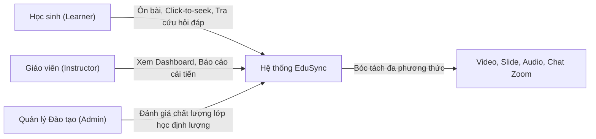
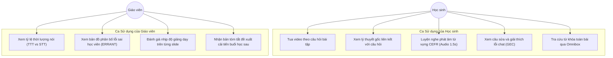
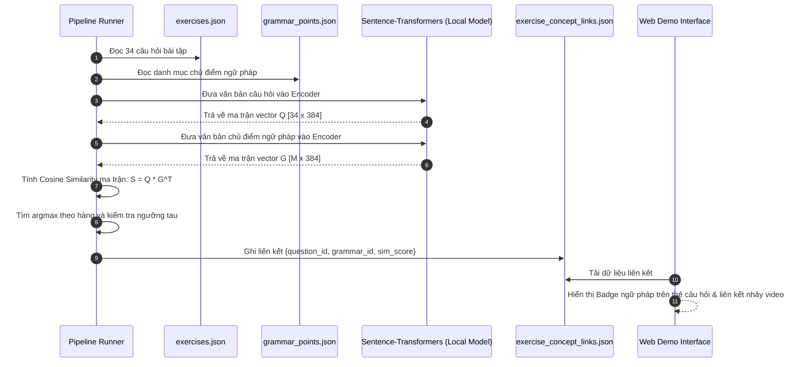

# TÀI LIỆU ĐẶC TẢ & PHÂN TÍCH YÊU CẦU DỰ ÁN (SRS)
## EDUSYNC: NỀN TẢNG ĐỒNG BỘ ĐA PHƯƠNG THỨC & PHÂN TÍCH SƯ PHẠM BÀI GIẢNG TRỰC TUYẾN
**Môn học:** Xử lý Ngôn ngữ Tự nhiên Nâng cao (NLP501 - Master of Software Engineering)  
**Nhánh phát triển:** `edusync-v2`  
**Phiên bản tài liệu:** v2.0  
**Ngày phát hành:** Tháng 11/2026  

---

## 1. Tổng quan Dự án & Tuyên ngôn Giá trị (Project Overview)

### 1.1. Bối cảnh Thực tế
Trong đào tạo trực tuyến (Zoom / Google Meet / MS Teams), video ghi lại buổi học (Lecture Recording) là nguồn học liệu phong phú nhất nhưng lại khó tiếp cận nhất:
- **Đối với Học sinh:** Video dài 60–90 phút là một "hộp đen phi cấu trúc" (unstructured black-box). Học sinh muốn xem lại câu hỏi bài tập mình làm sai hoặc một chủ điểm ngữ pháp chưa hiểu phải tốn từ 15–20 phút kéo thanh trượt video một cách "mù mịt" (blind scrubbing), dẫn đến hiện tượng quá tải và bỏ dở ôn tập (Video Fatigue).
- **Đối với Giáo viên:** Giáo viên kết thúc buổi dạy mà không có số liệu định lượng: không đo lường được tỷ lệ thời gian nói của giáo viên và học sinh (TTT/STT), hàng trăm tin nhắn chat trao đổi bị trôi mất, không thống kê được lỗi ngữ pháp phổ biến của cả lớp để lên kế hoạch cải tiến cho buổi học sau.

### 1.2. Tuyên ngôn Giá trị (Value Proposition)
**EduSync** là nền tảng NLP đa phương thức chuyển hóa video buổi học trực tuyến thành:
1. **Sổ tay Tương tác Thông minh cho Học sinh (Interactive Study Notebook):** Giảm thời gian xem lại bài từ 60 phút xuống 10 phút tập trung thông qua việc click vào câu hỏi/từ vựng/ngữ pháp để nhảy video tức thì đến đúng giây giáo viên giải thích; tích hợp thẻ flashcard âm thanh và công cụ hỏi đáp.
2. **Bảng điều khiển Sư phạm Tự động cho Giáo viên (Teacher Pedagogical Dashboard):** Tự động đo lường thời lượng nói (TTT/STT), thống kê bản đồ lỗi sai của học viên theo chuẩn quốc tế ERRANT, và tự động đề xuất kế hoạch hành động cải tiến cho buổi dạy tiếp theo (Next-Lesson Action Plan).

---

## 2. Phân tích Tác nhân & Bối cảnh Sử dụng (Stakeholder & Actor Analysis)

| Tác nhân (Actor) | Trách nhiệm & Nhu cầu Cốt lõi | Giá trị Nhận được từ EduSync |
| :--- | :--- | :--- |
| **Học sinh (Learner)** | - Cần xem lại đúng đoạn cô chữa câu trắc nghiệm mình làm sai. - Cần hiểu sâu bản chất ngữ pháp của câu hỏi. - Cần luyện nghe phát âm từ vựng bài học. - Cần tra cứu nhanh nội dung trong buổi học. | - Click câu hỏi nhảy video tức thời. - Badge liên kết trực tiếp câu hỏi với lý thuyết gốc. - Audio clip 1.5s phát âm mẫu của giáo viên. - Ô tìm kiếm Omnibox tìm kiếm trên toàn bộ dữ liệu bài học. |
| **Giáo viên (Instructor)** | - Cần biết tỷ lệ nói giữa mình và học sinh (TTT vs STT). - Cần biết học sinh hay mắc lỗi ngữ pháp nào trong chat. - Cần báo cáo chất lượng buổi học gửi trung tâm/phụ huynh. - Cần gợi ý bài tập khắc phục cho buổi sau. | - Thống kê TTT/STT tự động từ âm thanh. - Bản đồ lỗi ngữ pháp học viên chuẩn ERRANT. - Báo cáo sư phạm tự động (Post-Class Report). - Đề xuất kế hoạch 3 bước cho buổi học tiếp theo. |
| **Hệ thống (EduSync NLP Engine)** | - Xử lý đa phương thức (Audio, Video, OCR, Chat text). - Chạy mô hình căn chỉnh đơn điệu, nhúng vector ngữ nghĩa, phân loại CEFR và GEC. | - Cung cấp giao diện Web Demo mượt mà, phản hồi dưới 100ms. |

---

## 3. Yêu cầu Chức năng (Functional Requirements - FR)

### 3.1. Phân hệ FR1: Căn chỉnh Đa phương thức & Định vị Video (Multimodal Alignment)
- **FR1.1 (Audio Transcription):** Hệ thống phải phiên mã toàn bộ âm thanh bài giảng thành văn bản (`transcript.json`) có gắn mốc thời gian bắt đầu (`start`), kết thúc (`end`) ở mức độ chính xác từng phần trăm giây bằng mô hình Whisper kết hợp Context-biasing Prompting.
- **FR1.2 (Screen OCR Extraction):** Hệ thống phải tự động nhận diện các chuyển cảnh bài giảng, loại bỏ màn hình trùng lặp, và trích xuất toàn bộ văn bản đề bài trắc nghiệm (`screens.json`, `exercises.json`).
- **FR1.3 (Monotonic Sequence Alignment):** Hệ thống phải thực hiện căn chỉnh đơn điệu giữa lời giảng giáo viên và từng câu hỏi bài tập ($Q_1 \dots Q_{34}$), đảm bảo 100% câu hỏi được gán đúng mốc thời gian xuất hiện trong video, triệt tiêu hiện tượng gán lùi thời gian hoặc gán trùng mốc.
- **FR1.4 (Click-to-Seek Video Playback):** Khi người dùng click vào bất kỳ câu hỏi, phân đoạn lời giảng, từ vựng hay tin nhắn chat, trình phát video phải nhảy ngay lập tức đến mốc thời gian tương ứng.

---

### 3.2. Phân hệ FR2: Liên kết Câu hỏi với Ngữ pháp bằng Nhúng Vector Ngữ nghĩa (Question-to-Concept Linking via Dense Semantic Embeddings)
> **Yêu cầu Thiết kế Cốt lõi:** Thay vì để các câu hỏi bài tập đứng cô lập, hệ thống phải tự động liên kết mỗi câu hỏi trắc nghiệm với chủ điểm ngữ pháp nền tảng tương ứng trong tài liệu bài giảng thông qua **Không gian Nhúng Vector Ngữ nghĩa (Dense Semantic Embeddings)**.

#### Đặc tả Thuật toán & Quy trình Tính toán:
1. **Xây dựng Không gian Nhúng (Embedding Space):**
   - Sử dụng mô hình Pre-trained Dense Text Embedding chuyên dụng cho câu và đoạn văn: `sentence-transformers/all-MiniLM-L6-v2` (chiều vector $d=384$) hoặc `BAAI/bge-base-en-v1.5` ($d=768$).
   - Mô hình chạy cục bộ (local inference) qua PyTorch/MPS trên Mac Metal, đảm bảo thời gian nhúng dưới 5ms cho mỗi câu.

2. **Tạo Vector Biểu diễn Câu hỏi ($\vec{q}_k$):**
   - Với mỗi câu hỏi trắc nghiệm $Q_k$ ($k \in [1, N]$), chuỗi văn bản đầu vào được chuẩn hóa bằng cách ghép nối stem câu hỏi, các lựa chọn đáp án và ngữ cảnh lời giảng của cô khi chữa câu đó:
     $$\text{Text}(Q_k) = \text{Stem}_k \parallel \text{Options}_k \parallel \text{TeacherSpeechContext}_k$$
   - Vector nhúng của câu hỏi:
     $$\vec{q}_k = \text{Encoder}(\text{Text}(Q_k)) \in \mathbb{R}^d, \quad \text{chuẩn hóa } \|\vec{q}_k\|_2 = 1$$

3. **Tạo Vector Biểu diễn Chủ điểm Ngữ pháp ($\vec{g}_j$):**
   - Với mỗi chủ điểm ngữ pháp $GP_j$ ($j \in [1, M]$) trong `grammar_points.json`, chuỗi văn bản đầu vào gồm tiêu đề, công thức rút gọn, giải thích lý thuyết và từ khóa đặc trưng:
     $$\text{Text}(GP_j) = \text{Title}_j \parallel \text{Formula}_j \parallel \text{Explanation}_j \parallel \text{Keywords}_j$$
   - Vector nhúng của chủ điểm ngữ pháp:
     $$\vec{g}_j = \text{Encoder}(\text{Text}(GP_j)) \in \mathbb{R}^d, \quad \text{chuẩn hóa } \|\vec{g}_j\|_2 = 1$$

4. **Xác định Liên kết bằng Cosine Similarity:**
   - Điểm số tương đồng ngữ nghĩa giữa câu hỏi $Q_k$ và chủ điểm ngữ pháp $GP_j$:
     $$\text{Sim}(Q_k, GP_j) = \cos(\vec{q}_k, \vec{g}_j) = \frac{\vec{q}_k \cdot \vec{g}_j}{\|\vec{q}_k\|_2 \|\vec{g}_j\|_2} = \vec{q}_k \cdot \vec{g}_j \quad (\text{do đã chuẩn hóa } L_2)$$
   - Gán nhãn chủ điểm ngữ pháp tối ưu $\hat{g}_k$ cho câu hỏi $Q_k$:
     $$\hat{g}_k = \arg\max_{j \in [1, M]} \text{Sim}(Q_k, GP_j)$$
   - Điều kiện gán nhãn: Nếu $\max_j \text{Sim}(Q_k, GP_j) \ge \tau$ (ngưỡng tin cậy $\tau = 0.45$), hệ thống thiết lập liên kết; nếu dưới ngưỡng, gán nhãn `General Practice`.

5. **Trực quan hóa Liên kết trên Giao diện:**
   - Trên mỗi thẻ bài tập $Q_k$, hiển thị **Badge Chủ điểm Ngữ pháp** màu tím nổi bật (ví dụ: `🏷️ Phân từ làm tính từ (-ing vs -ed)`).
   - Nút bấm hai chiều:
     - Nút **"⏱ Xem Chữa bài"**: Tua video đến thời điểm cô chữa câu hỏi đó (ví dụ: `15:15`).
     - Nút **"📖 Xem Lý thuyết Gốc"**: Tua video về đoạn cô giảng lý thuyết công thức ở đầu buổi (ví dụ: `00:49`) và tự động chuyển sang tab Grammar.

---

### 3.3. Phân hệ FR3: Phân loại Từ vựng CEFR & Cắt Audio Clip Phát âm Mẫu (Lexical Profiling)
- **FR3.1 (Lemmatization & Morphology):** Chuẩn hóa hình thái học các từ vựng xuất hiện trong bài giảng (số nhiều `-s/-es`, quá khứ `-ed`, phân từ `-ing`, tra cứu động từ bất quy tắc).
- **FR3.2 (CEFR Profiling):** Đối chiếu với ngân hàng từ điển CEFR-J và Octanove gồm 8.845 từ để phân tầng độ khó thành 6 cấp độ (A1, A2, B1, B2, C1, C2).
- **FR3.3 (Audio Slicing):** Cắt tự động các file âm thanh 1.5 giây lưu trữ tại `vocab_audio/word.mp3` chứa đúng giọng đọc phát âm mẫu của giáo viên.
- **FR3.4 (Interactive Vocab Tab):** Cho phép học sinh lọc từ vựng theo cấp độ, nghe phát âm mẫu, đọc giải thích nghĩa tiếng Việt chuẩn theo bài học, và tìm kiếm tức thời.

---

### 3.4. Phân hệ FR4: Phân tích Tương tác, Chẩn đoán Lỗi GEC & Báo cáo Sư phạm
- **FR4.1 (Chat Parsing & Privacy Anonymization):** Đọc log chat Zoom (`chat.txt`), tự động bóc tách họ tên học viên và mã hóa ẩn danh nhất quán thành $S_1, S_2, \dots, S_N$ theo tiêu chuẩn bảo vệ quyền riêng tư FERPA/GDPR.
- **FR4.2 (GEC Diagnostic Engine):** Chẩn đoán tự động các lỗi ngữ pháp tiếng Anh của học viên theo chuẩn quốc tế **ERRANT** (`U:VERB:BE`, `R:ADJ:PARTICIPLE`, `R:VERB:FORM`, `U:PREP`, `R:VERB:SVA`, `M:VERB:AUX`), sinh câu sửa tối thiểu và giải thích sư phạm tiếng Việt.
- **FR4.3 (Teacher Talk Time vs. Student Talk Time):** Thống kê định lượng thời lượng nói của giáo viên (TTT) và học sinh (STT) từ tín hiệu âm thanh thông qua module Diarization.
- **FR4.4 (Post-Class Pedagogical Report):** Tự động tổng hợp báo cáo sư phạm đa chiều gồm:
  - Bản đồ phân bố lỗi sai (Error Heatmap).
  - Đánh giá nhịp độ giảng dạy trên từng slide (Pacing analysis).
  - Đề xuất kế hoạch hành động 3 bước cho buổi dạy kế tiếp (Next-Lesson Action Plan).

---

### 3.5. Phân hệ FR5: Tra cứu & Hỏi đáp Toàn diện (Search & Q&A)
- **FR5.1 (Omnibox Search):** Thanh tìm kiếm toàn diện cho phép tra cứu đồng thời trên 5 trường dữ liệu: Lời giảng, Đề bài trắc nghiệm, Từ vựng, Tin nhắn chat học sinh, và Chủ điểm ngữ pháp.
- **FR5.2 (Timestamp Seek on Search Hit):** Mỗi kết quả tìm kiếm hiển thị speaker badge, đoạn trích dẫn và khi click vào sẽ tua video chính xác tới mốc thời gian đó.

---

## 4. Yêu cầu Phi chức năng (Non-Functional Requirements - NFR)

### 4.1. Hiệu năng & Độ trễ (Performance & Latency)
- **NFR1.1:** Tốc độ tính toán Cosine Similarity giữa 34 câu hỏi và các chủ điểm ngữ pháp bằng thư viện PyTorch/NumPy phải hoàn thành dưới **50ms** trên môi trường máy tính thông thường.
- **NFR1.2:** Tốc độ phản hồi của trình phát Web Demo khi người dùng click vào thẻ câu hỏi để seek video phải đạt độ trễ dưới **100ms**.
- **NFR1.3:** Tốc độ tìm kiếm toàn văn Omnibox trên toàn bộ 2.600 phân đoạn lời giảng và bài tập phải phản hồi dưới **30ms**.

### 4.2. Độ chính xác & Chất lượng Học thuật (Accuracy & Academic Rigor)
- **NFR2.1:** Tỷ lệ thu hồi (Recall) trong việc bóc tách đề bài câu hỏi trắc nghiệm phải đạt **100%** (34/34 câu hỏi có đầy đủ câu dẫn stem và phương án).
- **NFR2.2:** Độ chính xác căn chỉnh thời gian bài tập (Exercise Alignment Recall) phải đạt **100%** (34/34 câu hỏi khớp chính xác thời điểm giáo viên chữa bài).
- **NFR2.3:** Tỷ lệ khớp đúng chủ điểm ngữ pháp (Question-to-Concept Accuracy) bằng Dense Semantic Embeddings phải đạt trên **85%** so với nhãn chuẩn của chuyên gia sư phạm.

### 4.3. Bảo mật & Đạo đức Dữ liệu (Security & Privacy Compliance)
- **NFR3.1:** Tuyệt đối không lưu trữ hoặc để lộ thông tin định danh cá nhân (PII - Personally Identifiable Information) như họ tên thật, email của học sinh trên giao diện người dùng hoặc trong các tệp JSON xuất bản.
- **NFR3.2:** Khóa API (như `GEMINI_API_KEY`) phải được lưu trữ trong tệp môi trường `.env` cục bộ, cấu hình trong `.gitignore` và không bao giờ được commit lên kho mã nguồn Git công khai.

### 4.4. Tính Khả dụng & Độ tin cậy (Resilience & Offline Capability)
- **NFR4.1:** Hệ thống phải có cơ chế **Graceful Degradation / Fallback**: nếu không có kết nối internet hoặc không có API key, hệ thống phải tự động chuyển sang mô hình cục bộ hoặc bộ quy tắc mẫu (deterministic rule-based) mà không làm dừng pipeline hay gây crash ứng dụng.
- **NFR4.2:** Bộ kiểm thử tự động (Unit Tests) phải đạt tỷ lệ pass **100%** trước khi triển khai bản dựng mới.

---

## 5. Thiết kế Kiến trúc & Sơ đồ Luồng Hoạt động (Architecture & Flow)

### 5.1. Sơ đồ Ca sử dụng (Use Case Diagram)

---

### 5.2. Sơ đồ Luồng Kỹ thuật: Liên kết Dense Embeddings (Sequence Diagram)

---

## 6. Kế hoạch Kiểm thử & Ma trận Đánh giá (Test Plan & Acceptance Criteria)

| Mã Kiểm thử | Nội dung Kiểm thử | Dữ liệu Đầu vào | Kết quả Kỳ vọng | Tiêu chuẩn Chấp thuận |
| :--- | :--- | :--- | :--- | :--- |
| **TC-01** | Trích xuất đề bài câu hỏi | `screens.json` | 34 câu hỏi Part 5 & 6 | 100% câu hỏi có stem, không rỗng. |
| **TC-02** | Căn chỉnh thời gian câu hỏi | `exercises.json`, `transcript.json` | 34 mốc thời gian start/end | 100% câu hỏi khớp thời gian, không duplicate. |
| **TC-03** | Nhúng Dense Embeddings | `sentence-transformers` | Ma trận câu hỏi & ngữ pháp | Vector có chuẩn $L_2 = 1.0$, thời gian $< 50$ms. |
| **TC-04** | Ghép cặp câu hỏi - ngữ pháp | Cosine Similarity Matrix | Câu 4, 6 ghép với `gp_1`; câu 5 ghép với `gp_2` | Điểm $\text{Sim} \ge 0.45$, phân loại đúng ngữ pháp cốt lõi. |
| **TC-05** | Chẩn đoán lỗi ngữ pháp GEC | `chat.txt` (17 tin nhắn) | 6 tin nhắn có lỗi ngữ pháp | Bắt chính xác 6/6 lỗi theo mã nhãn ERRANT. |
| **TC-06** | Ẩn danh danh tính học viên | Danh sách tên thật Zoom | `S1`, `S2`... `S5` | Không còn tên thật xuất hiện trong `chat.json`. |
| **TC-07** | Đo lường tỷ lệ nói TTT/STT | Audio bài giảng 56 phút | Thống kê talk time theo giây | TTT $\approx 98\%$, STT $\approx 2\%$. |
| **TC-08** | Click-to-seek Video Player | Mốc thời gian click | Video nhảy đến đúng giây | Độ trễ thao tác $< 100$ms trên trình duyệt. |

---

## 7. Phân công Công việc Nhóm (Work Breakdown Structure - WBS)

| Thành viên / Nhóm | Nhiệm vụ Trọng tâm | Module Phụ trách | Sản phẩm Bàn giao |
| :--- | :--- | :--- | :--- |
| **Thành viên 1 (NLP Core & Alignment)** | Xây dựng pipeline nhận dạng giọng nói Whisper, Prompting với Screen Hints, Thuật toán Monotonic DP Alignment câu hỏi. | `transcribe.py`, `exercise_align.py` | `transcript.json`, `exercise_alignment.json` |
| **Thành viên 2 (Semantic Embeddings & Concept Linking)** | Triển khai mô hình `sentence-transformers`, ma trận Cosine Similarity ghép nối câu hỏi trắc nghiệm với chủ điểm ngữ pháp lý thuyết. | `concept_link.py`, `neural_ie.py` | `exercise_concept_links.json`, `grammar_points.json` |
| **Thành viên 3 (CEFR Lexicon & Audio Slicing)** | Curation bộ từ điển CEFR-J 8.845 từ, thuật toán Lemmatization tiếng Anh, khai phá định nghĩa tiếng Việt, cắt audio clip 1.5s. | `vocab.py`, `fetch_materials.py` | `vocab.json`, `vocab_audio/*.mp3` |
| **Thành viên 4 (GEC, Analytics & Web Demo)** | Xây dựng parser Zoom chat, ẩn danh FERPA, rule engine chuẩn ERRANT, thiết kế Web Demo UI và Teacher Dashboard. | `chat_parser.py`, `feedback.py`, `demo/index.html` | Tab Exercises, Grammar, Vocab, Chat & GEC, Analytics |

---

## 8. Kết luận & Đóng góp Khoa học của Đồ án

Tài liệu này xác lập nền tảng kỹ thuật và sư phạm vững chắc cho đề tài nhóm:
1. **Tính Thực tiễn Cao:** Giải quyết trọn vẹn nhu cầu thiết thực của học sinh (tiết kiệm thời gian ôn tập, tra cứu trực quan) và giáo viên (đo lường định lượng, báo cáo tự động để cải tiến giảng dạy).
2. **Hàm lượng Kỹ thuật NLP Đậm đặc:** Áp dụng toàn diện các kỹ thuật NLP hiện đại: **ASR Contextual Prompting**, **Monotonic DP Sequence Alignment**, **Dense Semantic Embeddings với Cosine Similarity**, **Morphological Lemmatization**, **Information Extraction**, và **Grammatical Error Correction (ERRANT)**.
3. **Khả năng Nhân rộng (Scalability):** Hệ thống được module hóa theo chuẩn cắm-rút (plug-and-play), sẵn sàng áp dụng cho bất kỳ video bài giảng trực tuyến nào chỉ với một lệnh thực thi pipeline duy nhất.

