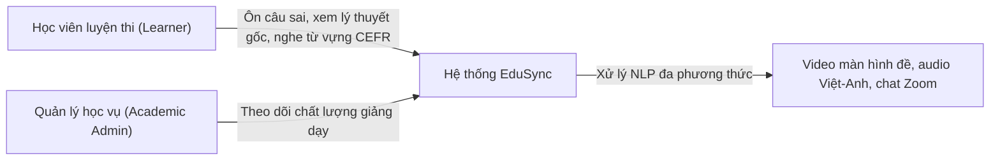
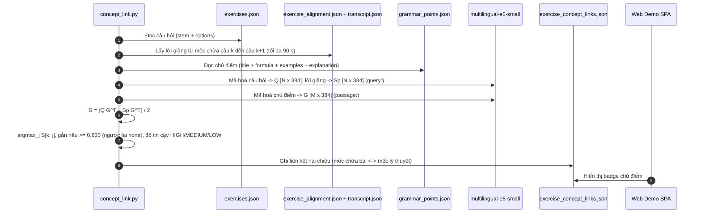

# TÀI LIỆU ĐẶC TẢ & PHÂN TÍCH YÊU CẦU DỰ ÁN (SRS)
## EDUSYNC: ĐỒNG BỘ ĐA PHƯƠNG THỨC & PHÂN TÍCH SƯ PHẠM BÀI GIẢNG LUYỆN THI TIẾNG ANH (thực nghiệm trên TOEIC; IELTS là hướng mở rộng)
**Môn học:** Xử lý Ngôn ngữ Tự nhiên Nâng cao (NLP501 - Master of Software Engineering)  
**Nhánh phát triển:** `edusync-v2`  
**Phiên bản tài liệu:** v2.2  
**Ngày cập nhật:** 10/11/2026  

> Tài liệu này mô tả **yêu cầu** (mục tiêu). Trạng thái "đạt / chưa đạt / chưa đo" của từng yêu cầu chỉ được ghi theo [docs/10_evaluation_results.md](10_evaluation_results.md), nguồn số liệu duy nhất của dự án.

---

## 💡 Điểm nhấn Trình bày với Giảng viên (SRS Overview)

> - **Đối tượng bài toán:** lớp luyện thi tiếng Anh trực tuyến (Zoom / Google Meet) do giáo viên Việt Nam giảng. Dữ liệu thực nghiệm hiện có: 3 bài **TOEIC** Starter của ECE (YouTube, CC BY, một giáo viên). Chưa có dữ liệu IELTS.
> - **5 Phân hệ Chức năng (FR1–FR5):**
>   1. **FR1 — Căn chỉnh đa phương thức:** ASR trộn mã Việt–Anh (Whisper) và căn chỉnh đơn điệu từng câu hỏi bài tập với lời giảng (quy hoạch động).
>   2. **FR2 — Liên kết câu hỏi ↔ chủ điểm ngữ pháp:** bi-encoder đa ngữ `multilingual-e5-small`, kết hợp câu hỏi với lời giảng trong đoạn chữa.
>   3. **FR3 — Hồ sơ từ vựng CEFR & clip phát âm:** phân bậc A1–C2 (CEFR-J/Octanove, 8.845 mục), nghĩa tiếng Việt khai thác từ lời giảng, clip `.wav` 0,7–2,2 s giọng giáo viên.
>   4. **FR4 — Lỗi người học & quyền riêng tư:** ẩn danh hoá tên người gửi ($S_1 \dots S_N$) và phát hiện 6 nhóm lỗi chuyển di L1 bằng luật, mỗi lỗi kèm loại lỗi **ERRANT**.
>   5. **FR5 — Tìm kiếm toàn diện:** ô tìm kiếm tức thời trên toàn bộ bài giảng (lời giảng, bài tập, từ vựng, chat và chủ điểm ngữ pháp).

---

## 1. Tổng quan Dự án & Tuyên ngôn Giá trị (Project Overview)

### 1.1. Bối cảnh Thực tế trong Đào tạo Luyện thi Trực tuyến
Bản ghi một buổi học luyện thi trực tuyến dài khoảng 60 phút là nguồn ôn tập tốt nhưng khó khai thác:
- **Đối với học viên:** muốn xem lại đoạn giáo viên chữa một câu trắc nghiệm (TOEIC Part 5/6/7) thì phải tua video thủ công; không biết câu đó thuộc chủ điểm ngữ pháp nào đã giảng trong buổi; không có danh sách từ vựng của bài theo bậc CEFR kèm giọng đọc của giáo viên.

### 1.2. Tuyên ngôn Giá trị (Value Proposition)
**EduSync** chuyển video buổi học thành:
1. **Sổ tay học tập tương tác cho học viên:** bấm vào câu hỏi / từ vựng / chủ điểm để tua video tới đoạn giáo viên giải thích; liên kết hai chiều Bài tập ↔ Lý thuyết; thẻ từ vựng có clip phát âm; ô tìm kiếm toàn bài. Việc tiết kiệm thời gian ôn bài là **mục tiêu, chưa được đo** bằng nghiên cứu người dùng.

---

## 2. Phân tích Tác nhân & Bối cảnh Sử dụng (Stakeholder & Actor Analysis)

| Tác nhân (Actor) | Trách nhiệm & Nhu cầu Cốt lõi | Giá trị Nhận được từ EduSync |
| :--- | :--- | :--- |
| **Học viên** | • Xem lại đúng đoạn giáo viên chữa câu mình làm sai. • Ôn lại chủ điểm ngữ pháp của câu đó. • Học từ vựng theo bậc CEFR, nghe phát âm. • Biết lỗi ngữ pháp khi gõ câu trả lời trong chat. | • Bấm câu hỏi để tua video tới mốc chữa (trên bài kiểm tra U5: 80,0% mốc lệch ≤10 s so với nhãn nháp). • Badge liên kết Câu hỏi ↔ Lý thuyết. • Thẻ từ vựng CEFR kèm clip `.wav` 0,7–2,2 s cắt từ giọng giáo viên. • Câu sửa kèm giải thích tiếng Việt cho 6 nhóm lỗi. |
| **Hệ thống (EduSync NLP Engine)** | • Xử lý audio Việt–Anh, video màn hình đề, OCR, chat. • Căn chỉnh đơn điệu, nhúng vector, phân bậc CEFR, phát hiện lỗi. | • Web demo SPA tĩnh (`demo/index.html`); các bước có phương án dự phòng khi không có mạng/API. Độ trễ giao diện **chưa đo**. |

---

## 3. Yêu cầu Chức năng (Functional Requirements - FR)

### 3.1. Phân hệ FR1: Căn chỉnh Đa phương thức & Định vị Câu hỏi
- **FR1.1 (Phiên âm lời giảng trộn mã):** phiên âm toàn bộ audio thành `transcript.json` gồm `start`, `end`, `text` và nhãn `lang` (`vi`, `en`, `mixed`, theo mật độ chữ có dấu) bằng faster-whisper `large-v3-turbo` đa ngữ. Gợi ý từ màn hình (OCR → `hotwords`) là **tùy chọn**; bản `transcript.json` đang dùng không có gợi ý. *Trạng thái:* đã cài đặt; **WER chưa đo** (bản tham chiếu chưa sửa tay).
- **FR1.2 (Trích màn hình & câu hỏi):** phát hiện chuyển màn hình (pixel diff), OCR tiếng Việt + Anh, trích câu hỏi (số câu, đề bài, lựa chọn A–D) vào `screens.json`, `exercises.json`. *Trạng thái:* U4 trích được 34 bản ghi (2 bản ghi là đoạn văn, không phải câu hỏi), U5 trích được 35; độ chính xác trích xuất chưa được đo riêng.
- **FR1.3 (Căn chỉnh đơn điệu):** mỗi câu hỏi có đúng một mốc bắt đầu chữa, các mốc không đảo thứ tự ($t_{k+1} \ge t_k$, chặt với câu khớp được lời giảng). *Mục tiêu đo bằng* `eval/eval_alignment.py`: tỉ lệ câu lệch ≤10 s / ≤30 s so với nhãn. *Trạng thái:* U5 (kiểm tra độc lập) 80,0% / 88,6%, sai số TB 8,1 s, 0 lần đảo thứ tự; U4 (phát triển) 68,8% / 84,4%; nhãn là bản nháp AI.
- **FR1.4 (Click-to-seek):** bấm vào câu hỏi, đoạn lời giảng, từ vựng, chủ điểm hoặc tin nhắn chat thì video nhảy tới mốc tương ứng. *Trạng thái:* có trong demo; kiểm tra thủ công, độ trễ chưa đo.

---

### 3.2. Phân hệ FR2: Liên kết Câu hỏi với Chủ điểm Ngữ pháp (Question-to-Concept Linking)
> **Yêu cầu NLP trọng tâm:** gắn mỗi câu hỏi với chủ điểm ngữ pháp mà nó luyện tập, hoặc "none" nếu là câu từ vựng/đọc hiểu, kể cả khi câu hỏi và tên chủ điểm không có từ chung.

1. **Mô hình nhúng:** bi-encoder đa ngữ `intfloat/multilingual-e5-small` (384 chiều, chuẩn hoá $L_2$, tiền tố `query:`/`passage:`), chạy cục bộ. Không có `sentence-transformers` thì dùng TF-IDF.
2. **Ba văn bản đầu vào:**
   - Câu hỏi: $\text{Text}(Q_k) = \text{Stem}_k \parallel \text{Options}_k$.
   - Lời giảng: $\text{Text}(Sp_k)$ = lời cô nói từ mốc chữa câu $k$ (trong `exercise_alignment.json`) đến câu kế tiếp, tối đa 90 s.
   - Chủ điểm: $\text{Text}(GP_j) = \text{Title}_j \parallel \text{Formula}_j \parallel \text{Examples}_j \parallel \text{Explanation}_j$ (không có từ khoá viết tay).
3. **Điểm & ngưỡng:**
   $$\text{score}(k,j) = \tfrac12\big(\vec{q}_k \cdot \vec{g}_j + \vec{sp}_k \cdot \vec{g}_j\big), \quad \hat{g}_k = \arg\max_j \text{score}(k,j) \text{ nếu } \max_j \text{score}(k,j) \ge 0{,}835, \text{ ngược lại none}$$
   Độ tin cậy: `HIGH` (được gắn, hơn chủ điểm thứ hai ≥0,01), `MEDIUM` (được gắn, sát nhau), `LOW` (không gắn). Giao diện tạo liên kết hai chiều: **⏱ Xem chữa bài** ↔ **📖 Xem lý thuyết**.
4. *Trạng thái* (`eval/eval_concepts.py`, 34 câu U4): độ chính xác 91,2% (leave-one-out), đầu ra với ngưỡng cố định: 91,2% / link precision 90,0% / link recall 75,0%. Mô hình và ngưỡng chọn trên chính tập này nên kết quả lạc quan; **chưa có tập kiểm tra độc lập**.

---

### 3.3. Phân hệ FR3: Phân bậc Từ vựng CEFR & Clip Phát âm
- **FR3.1 (Lemmatization):** chuẩn hoá hình thái 2 lớp (bảng bất quy tắc + bỏ hậu tố `-s/-es/-ies/-ed/-ied/-ing`, chỉ chấp nhận khi từ gốc có trong từ điển) và loại danh sách âm tiết tiếng Việt trùng mặt chữ tiếng Anh (`VI_HOMOPHONES`).
- **FR3.2 (Phân bậc CEFR):** tra từ điển **CEFR-J + Octanove (8.845 mục)** để gán A1–C2. Hệ thống không quy đổi sang điểm thi; nếu cần tham khảo, ngưỡng CEFR của ETS cho TOEIC L&R là A1 120, A2 225, B1 550, B2 785, C1 945.
- **FR3.3 (Nghĩa tiếng Việt & clip phát âm):** khai phá nghĩa tiếng Việt từ lời giảng bằng mẫu ("X là / nghĩa là …") và cắt clip `vocab_audio/<lemma>.wav` 0,7–2,2 s theo ranh giới đoạn ASR chứa từ (transcript không có timestamp từng từ). *Trạng thái* (U4): 80 từ, 52 từ có nghĩa, 79 clip; **chất lượng chưa được đánh giá**.

---

### 3.4. Phân hệ FR4: Lỗi Người học trong Chat & Báo cáo Sư phạm
- **FR4.1 (Đọc chat & ẩn danh hoá):** đọc log chat Zoom/Meet (`chat.txt`), thay tên người gửi bằng $S_1, S_2, \dots, S_N$ (giáo viên = T), nhận số câu ("câu 4") và đáp án ("em chọn C"), gắn tin nhắn với câu gần nhất có số đó theo mốc đã căn chỉnh (số câu bắt đầu lại ở mỗi phần). Chỉ tên người gửi được ẩn danh hoá; tên nằm trong nội dung tin nhắn không được xoá.
- **FR4.2 (Phát hiện lỗi bằng luật + loại ERRANT):** phát hiện 6 nhóm lỗi chuyển di L1 — BE_VERB, PARTICIPLE, CAUSATIVE, MODAL_TO, SVA, WH_DO — sinh câu sửa và giải thích tiếng Việt. Mỗi lỗi kèm loại ERRANT; loại mặc định đã kiểm chứng bằng errant 3.0.2: `U:VERB:TENSE`, `R:VERB:FORM`, `R:VERB:FORM`, `U:VERB:FORM`, `R:VERB:SVA`, `M:VERB:TENSE`. *Trạng thái* (`eval/eval_gec.py`, 70 câu độc lập, nhãn nháp): precision 100%, recall 72,7%, F1 84,2%.
- **FR5.1:** ô tìm kiếm trong demo tra cùng lúc 5 nguồn: lời giảng, đề bài câu hỏi, từ vựng, tin nhắn chat và chủ điểm ngữ pháp; bấm kết quả để tua video. Phím tắt `Cmd+K` / `Ctrl+K` **chưa cài đặt**; độ trễ tìm kiếm chưa đo.

---

## 4. Yêu cầu Phi chức năng (Non-Functional Requirements - NFR)

| Mã NFR | Hạng mục Chất lượng | Chỉ số mục tiêu | Trạng thái hiện tại (theo docs/10) |
| :-: | :--- | :--- | :--- |
| **NFR1** | **Hiệu năng & Độ trễ** | • Nhúng + tính điểm cho 34 câu < 50 ms. • Click-to-seek < 100 ms; tìm kiếm < 30 ms. | **Chưa đo** (cả ba chỉ số). |
| **NFR2** | **Độ chính xác NLP** | • Căn chỉnh câu hỏi: mọi câu có mốc, không đảo thứ tự, và tốt hơn các baseline trên bài kiểm tra độc lập. • Phát hiện lỗi: không báo nhầm câu đúng, recall cao hơn v1 trên tập độc lập. • Liên kết chủ điểm: tốt hơn baseline trên tập kiểm tra độc lập. • ASR: có WER đo trên clip tham chiếu đã sửa tay. | • Căn chỉnh U5: 80,0% (±10 s), 88,6% (±30 s), 0 đảo thứ tự (baseline tốt nhất 71,4% / 80,0%). • Phát hiện lỗi: precision 100%, recall 72,7% (v1: 20,5%), 70 câu. • Liên kết chủ điểm: 91,2% trên tập phát triển; **chưa có tập kiểm tra độc lập**. • WER: **chưa đo**. Mọi nhãn là bản nháp AI (`verified: false`). |
| **NFR3** | **Quyền riêng tư** | • Không có tên thật người gửi trong JSON đầu ra và trên giao diện (ẩn danh hoá S1…SN). • API key chỉ nằm trong `.env` (có trong `.gitignore`). • Không đưa video, audio, chat thô và nội dung đề bài lên git. | • Ẩn danh hoá tên người gửi có test đơn vị; tên trong nội dung tin nhắn chưa được xử lý. • `.env`, video/audio và nội dung trích từ bài ECE nằm trong `.gitignore`; riêng `chat.txt` mô phỏng của U4 được đưa lên git. |
| **NFR4** | **Tính sẵn sàng & Kiểm thử** | • Có phương án dự phòng chạy offline (TF-IDF, taxonomy chủ điểm, chế độ một người nói). • Toàn bộ `pytest` pass; test không ghi vào `lessons/`. | • Đã có các phương án dự phòng. • **75/75 test pass**, test dùng `tmp_path`. |

---

## 5. Sơ đồ Ca sử dụng & Luồng Kỹ thuật (Use Case & Sequence Diagrams)

---

## 6. Ma trận Kiểm thử Chấp thuận (Acceptance Test Matrix)

Nhãn chuẩn dùng trong các phép đo dưới đây đều là bản nháp do AI gán (`verified: false`); kết quả cần chạy lại sau khi nhóm kiểm tra nhãn. Tái tạo toàn bộ: `python eval/run_all.py`.

| Mã TC | Nội dung Kiểm thử | Cách kiểm tra | Tiêu chí chấp thuận | Kết quả hiện tại |
| :-: | :--- | :--- | :--- | :---: |
| **TC-01** | Trích câu hỏi trắc nghiệm từ màn hình | `exercises.py`; `tests/test_exercises.py` (parser) | Mỗi câu có số, đề bài, lựa chọn A–D | U4: 34 bản ghi (2 là đoạn văn); U5: 35. Độ chính xác trích xuất chưa đo |
| **TC-02** | Căn chỉnh câu hỏi ↔ lời giảng | `eval/eval_alignment.py` (dev U4, test U5) | Trên test U5: tốt hơn các baseline (thời điểm màn hình, regex "câu N" đầu tiên, v1) và 0 đảo thứ tự | **Đạt (nhãn nháp):** 80,0% / 88,6% / 8,1 s / 0 đảo thứ tự (baseline tốt nhất: 71,4% / 80,0% / 21,3 s / 2) |
| **TC-03** | Mã hoá câu hỏi & chủ điểm | `tests/test_concept_link.py` | Chạy được trên bản sao U4, có fallback TF-IDF | Pass. Độ trễ < 50 ms: **chưa đo** |
| **TC-04** | Liên kết câu hỏi ↔ chủ điểm | `eval/eval_concepts.py` (34 câu U4) | Hơn baseline "luôn none" (73,5%) và TF-IDF (82,4%) | 91,2% (leave-one-out). Lạc quan: chọn trên chính tập này, chưa có tập test |
| **TC-05** | Mốc thời gian phần lý thuyết | `eval/eval_concepts.py --theory <grammar_points.json>` (4 chủ điểm U4) | Mỗi chủ điểm lệch ≤30 s (cùng ngưỡng với căn chỉnh câu hỏi) | Đạt: 2,3–20,0 s, trung bình 11,2 s (v1: 882,5 s) |
| **TC-06** | Phát hiện lỗi người học | `eval/eval_gec.py` (70 câu độc lập) | Không báo nhầm câu đúng; F1 cao hơn v1 (khớp nguyên văn) | **Đạt (nhãn nháp):** P 100%, R 72,7%, F1 84,2% (v1: 90,0% / 20,5% / 33,3%) |
| **TC-07** | Loại lỗi ERRANT đúng chuẩn | `eval/errant_check.py` (errant 3.0.2) | Loại mặc định trùng loại errant gán cho cặp câu mẫu | Đạt; kết quả ở `eval/results/errant_check.txt` |
| **TC-08** | Ẩn danh hoá tên người gửi | `tests/test_feedback.py::test_anonymize_student_names` | Tên người gửi → `S1`..`SN` | Pass (chỉ tên người gửi) |
| **TC-10** | WER của ASR | `eval/wer.py` trên 5 clip `gold/asr/` | Có WER cho từng cấu hình ASR | **Chưa chạy được**: bản tham chiếu chưa sửa tay |
| **TC-11** | Click-to-seek trên giao diện | Kiểm tra thủ công trên demo | Video tua tới mốc chữa bài hoặc lý thuyết | Đạt (thủ công). Độ trễ chưa đo |
