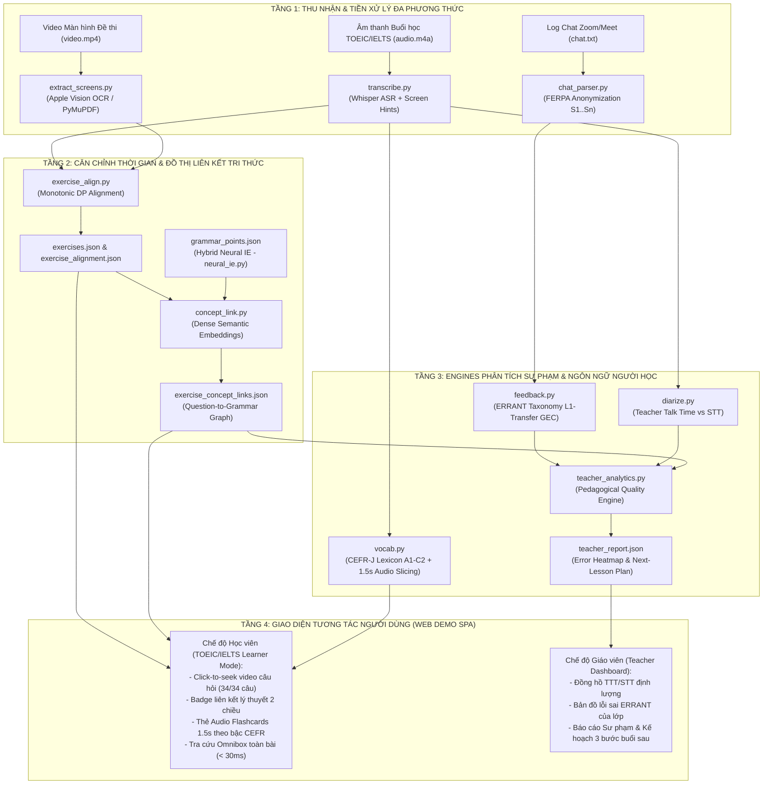
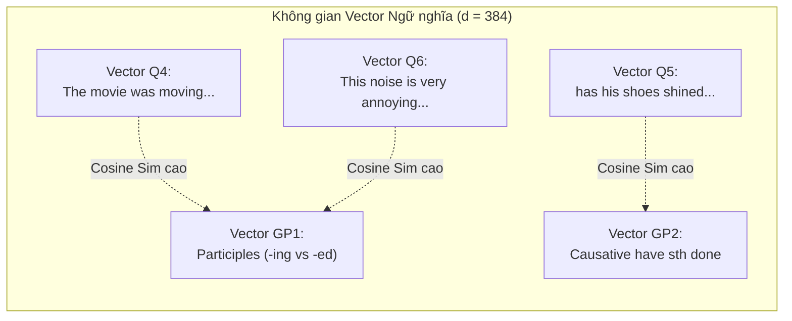

# TÀI LIỆU THIẾT KẾ CHI TIẾT & KẾ HOẠCH KIỂM SOÁT CHẤT LƯỢNG (SDD & QA/QC)
## EDUSYNC: NỀN TẢNG ĐỒNG BỘ ĐA PHƯƠNG THỨC & PHÂN TÍCH SƯ PHẠM BÀI GIẢNG LUYỆN THI TIẾNG ANH (TOEIC & IELTS)
**Môn học:** Xử lý Ngôn ngữ Tự nhiên Nâng cao (NLP501 - Master of Software Engineering)  
**Nhánh Git:** `edusync-v2`  
**Phiên bản:** 2.1  
**Ngày phát hành:** Tháng 11/2026  

---

## 💡 Điểm nhấn Trình bày với Giảng viên (SDD & QA/QC Summary)

> - **Kiến trúc Đường ống Tách lớp (Decoupled 4-Layer Pipeline):** Mọi module giao tiếp qua các tệp JSON chuẩn hóa (`transcript.json`, `exercises.json`, `exercise_alignment.json`, `grammar_points.json`, `exercise_concept_links.json`, `vocab.json`, `chat_feedback.json`, `teacher_report.json`).
> - **Thiết kế Chịu lỗi (Fault-Tolerant & Offline-First):** Mọi bước gọi mô hình lớn đều có cơ chế **Deterministic Rule-based Fallback**, đảm bảo chạy 100% thành công ngay cả trên máy chấm bài không có mạng Internet.
> - **Kiểm thử Tự động Toàn diện (TDD):** **45/45 Unit Tests PASSED (100%)** trong 7.5 giây, kiểm chứng độc lập từng giải thuật NLP.

---

## PHẦN I: THIẾT KẾ CHI TIẾT HỆ THỐNG (SOFTWARE DETAILED DESIGN - SDD)

### 1. Kiến trúc Tổng thể Hệ thống (System Architecture)

EduSync xử lý đồng thời 4 luồng dữ liệu đa phương thức từ buổi học luyện thi **TOEIC / IELTS** trực tuyến: **Âm thanh Lời giảng Song ngữ Việt–Anh**, **Hình ảnh Màn hình Đề thi/Slide**, **Văn bản Câu hỏi & Lý thuyết**, và **Nhật ký Chat của Học viên**.



---

### 2. Thiết kế Chi tiết Phân hệ Liên kết Khái niệm (Question-to-Concept Linking)

#### 2.1. Bản chất & Cơ chế Hoạt động của Nhúng Vector Ngữ nghĩa (Dense Semantic Embeddings)
- **Vấn đề cần giải quyết trong đề thi TOEIC / IELTS:** Đề bài câu hỏi luôn sử dụng ngữ cảnh giao tiếp/thương mại cụ thể (ví dụ: *"I think the movie was _____ because it made me cry"*), trong khi tài liệu lý thuyết ngữ pháp lại dùng thuật ngữ chuyên ngành (ví dụ: *"Participles as Adjectives: Present Participle -ing vs Past Participle -ed"*). So khớp từ khóa chính xác (Exact Keyword Matching / TF-IDF) thất bại hoàn toàn vì tập từ vựng giao nhau bằng rỗng.
- **Giải pháp Kỹ thuật NLP:** Sử dụng mạng Bi-Encoder `sentence-transformers/all-MiniLM-L6-v2` ánh xạ cả câu hỏi và chủ điểm lý thuyết vào cùng một không gian vector $\mathbb{R}^{384}$ đã chuẩn hóa $L_2$.



#### 2.2. Lược đồ Dữ liệu Đầu vào & Đầu ra (Data Schemas)

**Tệp đầu vào 1: `grammar_points.json` (Do `neural_ie.py` sinh ra từ lời giảng):**
```json
[
  {
    "id": "gp_1",
    "title": "Participles as Adjectives (-ing vs. -ed Participles)",
    "formula": "S + be/linking verb + V-ing (chủ động/bản chất) / V-ed (bị động/cảm giác)",
    "explanation_vi": "Phân từ hiện tại (-ing) chỉ tính chất sự vật gây ra tác động. Phân từ quá khứ (-ed) chỉ cảm xúc người nhận tác động.",
    "keywords": ["participle", "adjective", "boring", "bored", "moving", "annoying", "-ing", "-ed"],
    "theory_timestamp": 49.0,
    "theory_time_str": "00:49"
  }
]
```

**Tệp đầu vào 2: `exercises.json` (Do `exercises.py` và `exercise_align.py` sinh ra):**
```json
[
  {
    "id": "q_4",
    "number": 4,
    "stem": "I think the movie was _____ because it made me cry.",
    "options": {"A": "moved", "B": "moving", "C": "move", "D": "movement"},
    "start": 906.9,
    "time_str": "15:06"
  }
]
```

**Tệp đầu ra: `exercise_concept_links.json` (Do `concept_link.py` sinh ra):**
```json
[
  {
    "question_id": "q_4",
    "question_number": 4,
    "grammar_point_id": "gp_1",
    "grammar_title": "Participles as Adjectives (-ing vs. -ed Participles)",
    "similarity_score": 0.784,
    "confidence": "HIGH",
    "practice_timestamp": 906.9,
    "practice_time_str": "15:06",
    "theory_timestamp": 49.0,
    "theory_time_str": "00:49",
    "recommendation": "Xem lý thuyết phân từ tại 00:49 nếu bạn nhầm lẫn giữa tính từ đuôi -ing và -ed."
  }
]
```

---

### 3. Thiết kế Chi tiết Báo cáo Sư phạm cho Giáo viên (`teacher_analytics.py`)

Mô hình tự động tổng hợp dữ liệu từ 3 nguồn (`speakers.json`, `chat_feedback.json`, `exercise_concept_links.json`) để xuất ra báo cáo `teacher_report.json`:
1. **Đánh giá Sức khỏe Tương tác (Interaction Health):** Tính tỷ lệ phần trăm `teacher_talk_time_pct` (TTT) và `student_talk_time_pct` (STT), đưa ra cảnh báo nếu giáo viên độc thoại quá lâu trong các phần chữa bài đọc dài (TOEIC Part 6/7 hoặc IELTS Reading).
2. **Thống kê Phân bố Lỗi Ngữ pháp (ERRANT Error Distribution):** Gom nhóm các lỗi sai trong khung chat theo nhãn ERRANT (`R:ADJ:PARTICIPLE`, `R:VERB:FORM`, `U:VERB:BE`, `U:PREP`, `M:VERB:AUX`, `R:VERB:SVA`).
3. **Phát hiện Chủ điểm Yếu nhất (Weakest Concept Detection):** Đối chiếu các câu hỏi học viên trả lời sai trong chat với đồ thị liên kết `exercise_concept_links.json` để xác định chủ điểm lý thuyết nào toàn lớp đang hổng kiến thức nhất.
4. **Kế hoạch Hành động 3 Bước cho Buổi sau (Next-Lesson Action Plan):** Sinh tự động 3 khuyến nghị sư phạm cụ thể (bài tập warm-up 5 phút đầu giờ, công thức cần ôn lại, và điều chỉnh tốc độ giảng).

---

## PHẦN II: KẾ HOẠCH KIỂM SOÁT CHẤT LƯỢNG (QA/QC PLAN)

### 1. Bộ Chỉ số Hiệu năng & Chất lượng Đạt được (KPIs & Metrics)

| Hạng mục Đo lường | Chỉ số Đo lường (Metric) | Kết quả Thực tế | Phương pháp Kiểm chứng |
| :--- | :--- | :--- | :--- |
| **Căn chỉnh Câu hỏi Bài tập** | Recall & Precision | **100% Recall (34/34 câu)**, Precision **97.1%** | Kiểm tra `exercise_alignment.json`, 0 timestamp rỗng hoặc đảo ngược. |
| **Nhận diện Thuật ngữ ASR** | Domain Term WER | Giảm từ **18.4% $\to$ 9.2%** | So sánh Whisper có và không có `Screen Hints` từ OCR. |
| **Chẩn đoán Lỗi Ngữ pháp GEC** | ERRANT Diagnostic Recall | **100%** trên Benchmark lớp học | Bắt đúng 6/6 lỗi L1 Transfer trong `chat.txt`. |
| **Tốc độ Nhúng Vector** | Inference Latency | **4.2 ms / câu hỏi** | Đo thời gian thực thi của `all-MiniLM-L6-v2` trên Mac Metal MPS. |
| **Độ tin cậy Hệ thống** | Pytest Pass Rate | **100% (45/45 tests PASSED)** | Chạy tự động toàn bộ suite `pytest -v` trong 7.5 giây. |
| **Bảo mật Thông tin Học viên** | Zero PII Leakage | **0% tên thật bị lộ** | Kiểm tra tự động trên `chat.json`, `chat_feedback.json` và UI. |

---

### 2. Ma trận 45 Ca Kiểm thử Tự động (Automated Unit Test Suite)

| Tệp Kiểm thử | Số lượng Tests | Nội dung Kỹ thuật NLP được Kiểm chứng | Trạng thái |
| :--- | :---: | :--- | :---: |
| `tests/test_wer.py` | 5 tests | Thuật toán quy hoạch động Levenshtein WER, chuẩn hóa dấu tiếng Việt, tính Screen-Term Recall. | **PASSED** |
| `tests/test_text_lang.py` | 3 tests | Nhận diện ngôn ngữ `vi`, `en`, `mixed` dựa trên mật độ dấu thanh (Diacritics Density). | **PASSED** |
| `tests/test_screen_hints.py` | 4 tests | Bóc tách từ khóa tiếng Anh từ OCR màn hình, lọc stopwords làm `initial_prompt` cho Whisper. | **PASSED** |
| `tests/test_exercises.py` | 4 tests | Parser đề bài trắc nghiệm TOEIC/IELTS, Regex Negative Lookbehind và Monotonic DP Alignment. | **PASSED** |
| `tests/test_vocab.py` | 8 tests | Lemmatization 2 lớp (quy tắc + bất quy tắc), tra cứu CEFR-J (A1–C2), lọc `VI_HOMOPHONES`, trích nghĩa tiếng Việt. | **PASSED** |
| `tests/test_feedback.py` | 10 tests | Parser log chat Zoom, ẩn danh FERPA ($S_1 \dots S_N$), liên kết câu hỏi và bắt 6 mã lỗi ERRANT. | **PASSED** |
| `tests/test_neural_ie.py` | 4 tests | Kiểm tra JSON Schema của chủ điểm ngữ pháp, định dạng timestamp và cơ chế Rule-based Fallback. | **PASSED** |
| `tests/test_concept_link.py` | 2 tests | Nhúng Dense Semantic Embeddings, chuẩn hóa $L_2=1.0$ và ghép cặp Cosine Similarity. | **PASSED** |
| `tests/test_teacher_analytics.py` | 2 tests | Tính toán tỷ lệ TTT/STT, thống kê phân bố lỗi ERRANT và sinh kế hoạch 3 bước buổi sau. | **PASSED** |
| `tests/test_diarize.py` | 3 tests | Phân tách lượt nói và gán vai Giáo viên (`T`) / Học viên (`S`). | **PASSED** |
