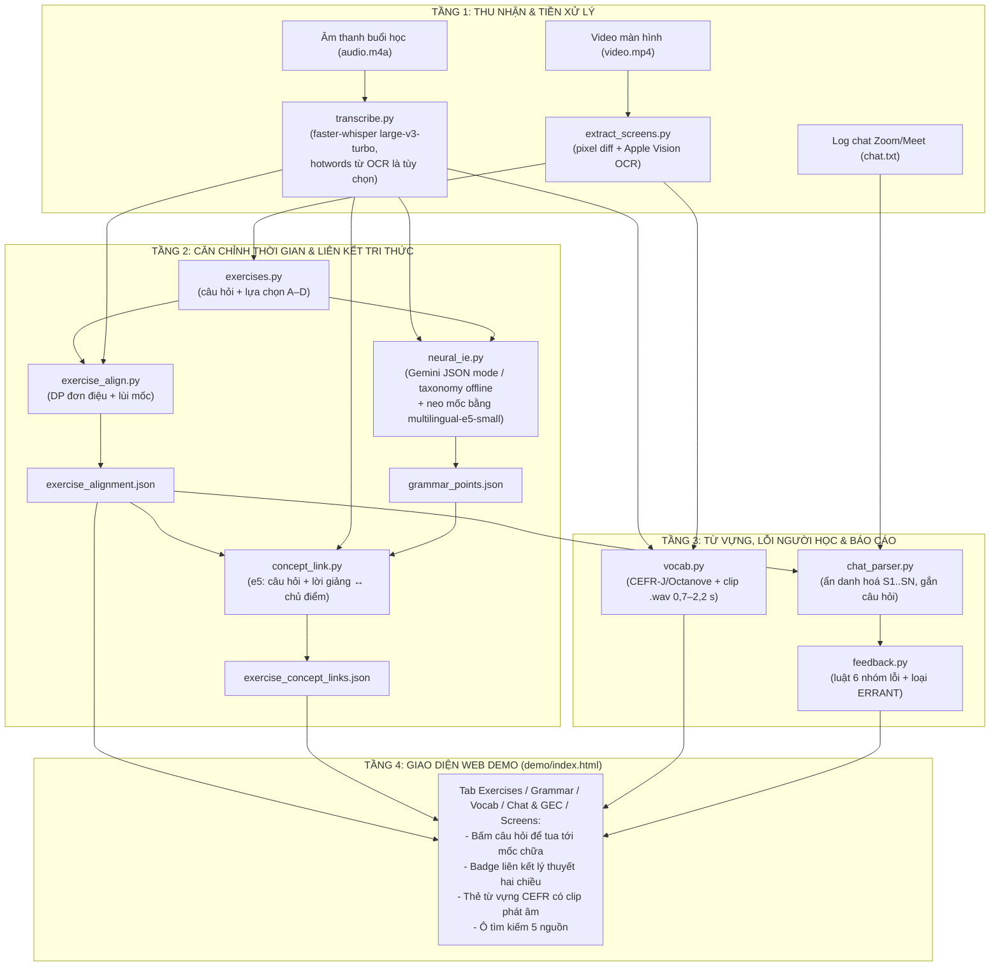
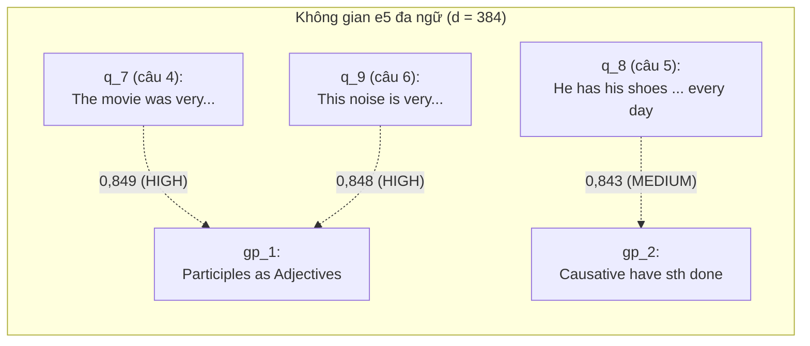

# TÀI LIỆU THIẾT KẾ CHI TIẾT & KẾ HOẠCH KIỂM SOÁT CHẤT LƯỢNG (SDD & QA/QC)
## EDUSYNC: ĐỒNG BỘ ĐA PHƯƠNG THỨC & PHÂN TÍCH SƯ PHẠM BÀI GIẢNG LUYỆN THI TIẾNG ANH (thực nghiệm trên TOEIC; IELTS là hướng mở rộng)
**Môn học:** Xử lý Ngôn ngữ Tự nhiên Nâng cao (NLP501 - Master of Software Engineering)  
**Nhánh Git:** `edusync-v2`  
**Phiên bản:** 2.2  
**Ngày cập nhật:** 10/11/2026  
**Nguồn số liệu duy nhất:** [docs/10_evaluation_results.md](10_evaluation_results.md)

---

## 💡 Điểm nhấn Trình bày với Giảng viên (SDD & QA/QC Summary)

> - **Đường ống tách lớp qua tệp JSON:** mỗi bước đọc/ghi tệp có tên cố định trong thư mục bài học (`screens.json`, `transcript.json`, `exercises.json`, `exercise_alignment.json`, `grammar_points.json`, `exercise_concept_links.json`, `vocab.json`, `chat.json`, `chat_feedback.json`); `pipeline.py` bỏ qua bước đã có đầu ra.
> - **Có phương án dự phòng khi thiếu mạng/API/mô hình:** taxonomy chủ điểm offline thay Gemini, TF-IDF thay bi-encoder, chế độ một người nói thay diarization. Riêng OCR màn hình cần macOS (Apple Vision).
> - **Kiểm thử & đánh giá tách riêng:** **75/75 test** `pytest` pass (test không ghi vào `lessons/`); bộ đánh giá `eval/run_all.py` tái tạo mọi con số trong docs/10 trên nhãn chuẩn **bản nháp do AI gán** (`verified: false`).

---

## PHẦN I: THIẾT KẾ CHI TIẾT HỆ THỐNG (SOFTWARE DETAILED DESIGN - SDD)

### 1. Kiến trúc Tổng thể Hệ thống (System Architecture)

EduSync xử lý 4 luồng dữ liệu của một buổi học luyện thi trực tuyến: **âm thanh lời giảng Việt–Anh**, **hình ảnh màn hình đề bài**, **văn bản câu hỏi & lý thuyết**, và **chat của học viên**.



#### 1.1. Bảng Module (khớp với mã nguồn hiện tại)

| Module | Đầu vào | Đầu ra | Phương pháp chính |
| :--- | :--- | :--- | :--- |
| `extract_screens.py` | `video.mp4` | `screens.json`, `screens/*.png` | Lấy mẫu khung hình, màn hình mới khi tỉ lệ điểm ảnh thay đổi vượt ngưỡng (ảnh thu nhỏ, làm mờ Gaussian); OCR Apple Vision (vi+en); bỏ dòng lặp trên >1/3 số màn hình; đánh dấu màn hình trùng nội dung. |
| `transcribe.py` | `audio.m4a`, `lesson.json` (`asr.model`, `asr.prompt`), tùy chọn `screens.json` | `transcript.json` | faster-whisper `large-v3-turbo`, đa ngữ, VAD; `initial_prompt` cố định từ `lesson.json`; `--screen-hints words|lines` cắt audio theo màn hình và truyền từ OCR qua `hotwords`; nhãn `lang` theo mật độ chữ có dấu (>0,3 `vi`, 0 `en`, còn lại `mixed`). |
| `exercises.py` | `screens.json` | `exercises.json` | Regex tách số câu, đề bài, lựa chọn `(A)`/`A.`; xử lý chỗ trống trong đoạn văn (Part 6); khử trùng lặp. U4: 34 bản ghi (2 là đoạn văn), U5: 35. |
| `exercise_align.py` | `exercises.json`, `transcript.json` | `exercise_alignment.json` | Điểm $25\cdot$khẩu lệnh (2 nếu 60 s sau không có từ của câu) $+ 2\cdot$trùng từ $+ 3\cdot$đang trên màn hình; DP đơn điệu (hoặc `--method greedy`); lùi mốc; câu không khớp rơi về thời điểm màn hình bị kẹp giữa hai câu kề. |
| `neural_ie.py` | `transcript.json`, `exercises.json`, `vocab.json`, `chat_feedback.json` | `grammar_points.json`, `vocab_deep.json` | Gemini `gemini-3.5-flash-lite` ở chế độ JSON (`responseMimeType=application/json`, kiểm tra trường sau khi parse; không phải JSON schema bắt buộc), thấy khoảng 30 đoạn lời giảng lấy mẫu + 10 câu đầu; dự phòng: taxonomy chủ điểm TOEIC chung, chỉ nhận chủ điểm có cụm gợi ý xuất hiện ≥3 lần. Sau đó neo mốc (`ground_theory_timestamps`, `--ground-only`). |
| `concept_link.py` | `exercises.json`, `grammar_points.json`, `exercise_alignment.json`, `transcript.json` | `exercise_concept_links.json` | Xem mục 2. |
| `vocab.py` | `screens.json`, `transcript.json`, audio, `data/cefr_lexicon.json` | `vocab.json`, `vocab_audio/<lemma>.wav` | Lemmatizer 2 lớp, tra CEFR (8.845 mục), lọc `VI_HOMOPHONES` (41 âm tiết), xếp hạng theo tần suất màn hình/lời giảng + bậc CEFR + có nghĩa + có clip; tối đa 80 từ; khai phá nghĩa bằng mẫu; clip cắt theo ranh giới đoạn ASR. |
| `chat_parser.py` | `chat.txt`, `exercise_alignment.json` | `chat.json` | Đọc định dạng Zoom/Meet; tên người gửi → S1..SN (T cho giáo viên); nhận "câu N" và đáp án ("em chọn C"); gắn với câu gần nhất có số N đã bắt đầu trước tin nhắn. |
| `feedback.py` | `chat.json` | `chat_feedback.json` | Luật cho BE_VERB, PARTICIPLE, CAUSATIVE, MODAL_TO, SVA, WH_DO; mỗi lỗi có `category`, `error_type` (ERRANT), `errant_source`, câu sửa, giải thích tiếng Việt. |
| `pipeline.py` | thư mục bài học | mọi tệp trên | Chạy các bước theo thứ tự, bỏ qua bước đã có đầu ra (`--force` để chạy lại). |

---

### 2. Thiết kế Chi tiết Phân hệ Liên kết Khái niệm (`concept_link.py`)

#### 2.1. Cơ chế Hoạt động
- **Vấn đề:** đề bài dùng ngữ cảnh cụ thể (*"The movie was very... (A) move (B) moving (C) moved (D) movement"*), còn tên chủ điểm dùng thuật ngữ (*"Participles as Adjectives"*), và phần giải thích chủ điểm, lời giảng chủ yếu bằng tiếng Việt.
- **Giải pháp:** bi-encoder đa ngữ `intfloat/multilingual-e5-small` (384 chiều, chuẩn hoá $L_2$; tiền tố `query:` cho câu hỏi và lời giảng, `passage:` cho chủ điểm). Điểm của câu $k$ với chủ điểm $j$:
  $$\text{score}(k,j) = \tfrac12\big(\cos(\vec{q}_k, \vec{g}_j) + \cos(\vec{sp}_k, \vec{g}_j)\big)$$
  với $q_k$ = đề bài + lựa chọn, $sp_k$ = lời giảng từ mốc chữa câu $k$ đến câu kế tiếp (tối đa 90 s), $g_j$ = tên + công thức + ví dụ tiếng Anh + giải thích tiếng Việt. Gắn $\arg\max_j$ nếu điểm ≥ 0,835 (`THRESHOLD`), ngược lại `none`. `confidence`: HIGH nếu hơn chủ điểm thứ hai ≥0,01 (`HIGH_MARGIN`), MEDIUM nếu sát nhau, LOW nếu không gắn.
- **Dự phòng:** không tải được mô hình thì dùng TF-IDF (câu hỏi + lời giảng so với chủ điểm), ngưỡng 0,10.
- **Không còn từ khoá viết tay:** bản v1 nối danh sách `KEYWORD_CUES` (có cả từ đáp án như `central`, `luxury`, `shined`) vào văn bản chủ điểm; danh sách này đã bị xoá.



(Điểm lấy từ `lessons/ece-toeic-starter-u4/exercise_concept_links.json`. Kết quả tổng hợp: 91,2% độ chính xác trên 34 câu U4, lạc quan vì mô hình và ngưỡng chọn trên chính tập này — docs/10 §4.)

#### 2.2. Lược đồ Dữ liệu Đầu vào & Đầu ra (Data Schemas)

**Tệp đầu vào 1: `grammar_points.json`** (do `neural_ie.py` sinh, mốc đã neo lại vào lời giảng; trích một phần tử, giải thích rút gọn):
```json
[
  {
    "id": "gp_1",
    "title": "Participles as Adjectives (-ing vs. -ed Participles) (Phân từ làm Tính từ)",
    "formula": "S + be/linking verb + V-ing (chủ động/gây ra) / V-ed (bị động/cảm giác)",
    "explanation_vi": "Phân từ hiện tại (-ing) dùng để diễn tả bản chất ... Phân từ quá khứ (-ed) dùng để diễn tả cảm xúc ...",
    "examples": [{"en": "The movie was very moving.", "vi": "Bộ phim thì rất là cảm động."}],
    "timestamp": 44.23,
    "time_str": "00:44",
    "toeic_tips": "Mẹo TOEIC: Nhìn chủ ngữ phía trước ...",
    "llm_timestamp": 906.9,
    "timestamp_source": "grounded:multilingual-e5-small",
    "grounding_score": 0.909
  }
]
```
`llm_timestamp` là mốc Gemini đoán (lệch sang đoạn chữa bài); `timestamp` là mốc sau khi neo bằng e5. Lưu ý: ví dụ tiếng Anh do Gemini viết sau khi thấy 10 câu đầu nên có thể trùng câu hỏi.

**Tệp đầu vào 2: `exercise_alignment.json`** (do `exercise_align.py` sinh từ `exercises.json`; `exercises.json` có cùng `id/number/stem/options`, kèm `screens` và cửa sổ màn hình `start/end`):
```json
[
  {
    "id": "q_7",
    "number": 4,
    "stem": "The movie was very...",
    "options": {"A": "move", "B": "moving", "C": "moved", "D": "movement"},
    "screen": 8,
    "start": 905.46,
    "end": 906.48,
    "score": 25.0,
    "trigger_text": "Câu số 4.",
    "speaker": "T",
    "matched": true,
    "method": "dp"
  }
]
```

**Tệp đầu ra: `exercise_concept_links.json`** (do `concept_link.py` sinh):
```json
[
  {
    "question_id": "q_7",
    "question_number": 4,
    "similarity_score": 0.849,
    "margin": 0.017,
    "method": "multilingual-e5-small+speech",
    "threshold": 0.835,
    "practice_timestamp": 905.46,
    "grammar_point_id": "gp_1",
    "grammar_title": "Participles as Adjectives (-ing vs. -ed Participles) (Phân từ làm Tính từ)",
    "confidence": "HIGH",
    "theory_timestamp": 44.23,
    "theory_time_str": "00:44"
  }
]
```
Câu không được gắn có `grammar_point_id: null`, `confidence: "LOW"` và `grammar_title: "Không gắn chủ điểm (từ vựng / đọc hiểu)"`.

---

### 3. Thiết kế Chi tiết Sổ tay Học viên Tương tác (`demo/index.html`)

Sổ tay học viên là ứng dụng web tương tác (Single Page Application) kết nối đồng bộ 5 luồng thông tin của bài học:
1. **Trình phát video đồng bộ transcript:** Người học theo dõi bài giảng kèm phụ đề cuộn tự động theo thời gian thực (time-synced transcript).
2. **Tab Bài tập (Exercises):** Bấm vào câu hỏi trắc nghiệm A–D để tua video đến đúng mốc giáo viên bắt đầu chữa (`exercise_align.py`). Câu nào có liên kết chủ điểm sẽ hiển thị badge chủ điểm tương ứng.
3. **Tab Chủ điểm Ngữ pháp (Grammar):** Hiển thị công thức và giải thích tiếng Việt (`neural_ie.py`). Bấm nút "Lý thuyết" để tua về mốc giáo viên giảng công thức.
4. **Tab Từ vựng (Vocab):** Danh sách từ vựng theo bậc CEFR (A1–C1), nghĩa tiếng Việt và nút nghe audio giọng đọc của giáo viên (`vocab.py`).
5. **Tab Chat & Phản hồi Sửa lỗi (Chat & GEC):** Hiển thị tin nhắn chat ẩn danh ($S_1 \dots S_N$), đánh dấu từ sai, gợi ý câu sửa chuẩn và lời giải thích tiếng Việt chi tiết (`feedback.py`).
6. **Công cụ Tìm kiếm Toàn diện:** Ô tìm kiếm tức thời trên cả 5 nguồn nội dung trong bài học.

---

## PHẦN II: KẾ HOẠCH KIỂM SOÁT CHẤT LƯỢNG (QA/QC PLAN)

### 1. Bộ Chỉ số Chất lượng: đã đo và chưa đo

Mọi số dưới đây lấy từ [docs/10_evaluation_results.md](10_evaluation_results.md). Nhãn chuẩn là bản nháp do AI gán (`verified: false`).

| Hạng mục | Độ đo | Kết quả hiện tại | Phương pháp kiểm chứng |
| :--- | :--- | :--- | :--- |
| **Căn chỉnh câu hỏi** | % câu lệch ≤10 s / ≤30 s, sai số TB, số lần đảo thứ tự | Dev U4: 68,8% / 84,4% / 10,0 s. **Test U5: 80,0% / 88,6% / 8,1 s / 0** (v1: 57,1% / 71,4% / 28,5 s / 2) | `eval/eval_alignment.py` với `gold/alignment_gold.json` |
| **Căn chỉnh trên video của giáo viên khác** | Tỉ lệ câu trích được; % câu lệch ≤10 s (đầu-cuối và khi cho trước danh sách câu đúng) | 6 bài giảng, hệ thống đóng băng: trích câu 44,4%, đầu-cuối 17,8%, cho trước danh sách câu đúng: DP 57,8% (greedy 24,4%). 2 video luyện tập: 8,7% / 78,3% | `eval/eval_multisource.py` với `lessons/toeic-*/gold/questions_gold.json` |
| **Liên kết chủ điểm** | Độ chính xác (34 câu), link precision/recall | 91,2% (leave-one-out); ngưỡng cố định: 91,2% / 90,0% / 75,0%. Lạc quan, chưa có tập test | `eval/eval_concepts.py` với `gold/concept_gold.json` |
| **Mốc lý thuyết** | Sai số tuyệt đối TB (4 chủ điểm) | 11,2 s (v1: 882,5 s) | `eval/eval_concepts.py --theory` |
| **Phát hiện lỗi người học** | Precision / recall / F1 cấp câu (70 câu độc lập) | 100% / 72,7% / 84,2% (v1: 90,0% / 20,5% / 33,3%); sửa đúng nguyên câu 65,9% | `eval/eval_gec.py` với `eval/gold/gec_heldout.json` |
| **Loại lỗi ERRANT** | Loại mặc định so với errant 3.0.2 trên cặp câu mẫu | Loại mặc định lấy đúng từ errant 3.0.2 | `eval/errant_check.py` → `eval/results/errant_check.txt` |
| **ASR** | WER | **Chưa đo** (bản tham chiếu chưa sửa tay). Chỉ có proxy: 47% (không gợi ý) đến 52% (có gợi ý) | `eval/wer.py`, `eval/asr_screen_terms.py` |
| **Từ vựng** | Độ đúng của từ chọn và nghĩa tiếng Việt | **Chưa đánh giá**; chỉ thống kê: 80 từ, 52 có nghĩa, 79 clip | — |
| **Độ trễ** | Nhúng vector, click-to-seek, tìm kiếm | **Chưa đo** | — |
| **Hồi quy pipeline v1 (slide)** | Mốc chuyển slide CS224N | 9/10 mốc, sai số TB 0,6 s | `python evaluate.py --lesson lessons/cs224n-bert gold/labels.json alignment.json` |
| **Kiểm thử đơn vị** | `pytest` | **75/75 pass** | `pytest` |
| **Ẩn danh hoá** | Tên người gửi → S1..SN | Pass (tên trong nội dung tin nhắn chưa xử lý) | `tests/test_feedback.py::test_anonymize_student_names` |

---

### 2. Bộ 75 Ca Kiểm thử Tự động (Automated Unit Test Suite)

Đếm bằng `python -m pytest --collect-only -q`. Test không ghi vào `lessons/`: test nào cần dữ liệu thật thì sao chép đầu ra của U4 vào `tmp_path` (hoặc chỉ đọc). Một số test đọc đầu ra U4 có sẵn trên máy (đầu ra bài ECE không có trong git); test cần `sentence-transformers` sẽ bỏ qua nếu thư viện chưa cài.

| Tệp Kiểm thử | Số test | Nội dung được kiểm chứng | Trạng thái |
| :--- | :---: | :--- | :---: |
| `tests/test_wer.py` | 5 | Levenshtein WER: khớp hoàn toàn, thay thế, xoá, chèn; chuẩn hoá chữ hoa và dấu câu. | PASSED |
| `tests/test_text_lang.py` | 3 | Nhãn `vi` / `en` / `mixed` theo mật độ chữ có dấu. | PASSED |
| `tests/test_screen_hints.py` | 4 | Tạo `hotwords` từ OCR: chế độ `chunks` rỗng, `words` bỏ stopword/trùng lặp/dòng tiếng Việt, `lines` làm sạch lựa chọn. | PASSED |
| `tests/test_exercises.py` | 11 | Parser `(A)` và `A.`; khử trùng lặp; nhận số câu 3 chữ số TOEIC Part 7 (147/148); nhận nhãn "Number 7" / "Question 8:"; không lấy năm / số lượng ("2016, Test 1", "200 customers") làm số câu; căn chỉnh đơn điệu; DP tìm tối ưu toàn cục ở ca greedy sai; hạ điểm "câu N" không có ngữ cảnh; nhận số thứ tự/số đọc bằng chữ; câu không khớp vẫn giữ thứ tự. | PASSED |
| `tests/test_vocab.py` | 8 | Lemma (nguyên dạng, số nhiều, bất quy tắc, không biết); khai phá nghĩa trong một đoạn và hai đoạn liên tiếp; lọc `VI_HOMOPHONES`; gán bậc CEFR. | PASSED |
| `tests/test_feedback.py` | 26 | Đọc thời gian và chat Zoom; ẩn danh hoá; gắn tin nhắn với câu hỏi (kể cả câu gần nhất khi số câu lặp lại); nhận đáp án; 8 test phát hiện/sửa 6 nhóm lỗi (có câu ngoài ví dụ mẫu); 12 câu đúng không bị báo nhầm. | PASSED |
| `tests/test_neural_ie.py` | 7 | Định dạng thời gian; taxonomy offline chỉ dựa vào lời giảng, không bịa gì khi đầu vào rỗng; từ vựng lấy từ `vocab.json`; fallback nhận từ vựng không có mốc thời gian (`timestamp` là `None`); chạy fallback trong `tmp_path`; `grammar_points.json` của U4 đã được neo mốc. | PASSED |
| `tests/test_concept_link.py` | 4 | Không còn `KEYWORD_CUES`; cửa sổ lời giảng dừng ở câu kế tiếp; fallback TF-IDF; chạy trên bản sao U4 trong `tmp_path`. | PASSED |
| **Tổng** | **75** | | **75/75 PASSED** |

---

### 3. Bộ Đánh giá Thực nghiệm (`eval/`)

| Thành phần | Vai trò |
| :--- | :--- |
| `eval/run_all.py` | Chạy toàn bộ phép đo, so với baseline v1 (commit 73d9a62), ghi `eval/results/*.json` và `summary.json` (chỉ số liệu, không có nội dung bài giảng). |
| `eval/eval_alignment.py` | Căn chỉnh câu hỏi: thời điểm màn hình, regex "câu N" đầu tiên, greedy, DP, có/không lùi mốc, và tệp của v1. Dev = U4, test = U5. |
| `eval/eval_multisource.py` | Bộ test đa nguồn: 8 video TOEIC tiếng Việt của 6 kênh YouTube khác ECE (CC BY, 68 câu); đo trích câu, căn chỉnh đầu-cuối và căn chỉnh khi cho trước danh sách câu đúng; danh sách câu trích được trước khi sửa (hệ thống "đóng băng") lưu ở `results/frozen/` của từng bài (docs/10 §3b). |
| `eval/eval_concepts.py` | Liên kết chủ điểm (TF-IDF, BM25, MiniLM có/không từ khoá, multilingual MiniLM, e5, e5 + lời giảng; ngưỡng leave-one-out) và sai số mốc lý thuyết (`--theory`). |
| `eval/eval_gec.py` | Bộ phát hiện lỗi trên 70 câu độc lập: cấp câu, cấp nhóm, sửa đúng nguyên câu. |
| `eval/errant_check.py` | Loại ERRANT mà errant 3.0.2 gán cho cặp câu mẫu của từng nhóm (cần `pip install errant` và spaCy `en_core_web_sm`). |
| `eval/wer.py`, `eval/asr_clips.py`, `eval/asr_screen_terms.py` | Cắt 5 clip tham chiếu; WER khi bản tham chiếu đã sửa tay; proxy "từ trên màn hình được nói ra" khi chưa có. |

**Nhãn chuẩn (đều `verified: false`, do AI gán mà không xem đầu ra hệ thống):** `lessons/ece-toeic-starter-u4/gold/alignment_gold.json` (32/34 câu + 4 mốc lý thuyết), `lessons/ece-toeic-starter-u5/gold/alignment_gold.json` (35/35 câu), `lessons/ece-toeic-starter-u4/gold/concept_gold.json` (34 câu), `eval/gold/gec_heldout.json` (70 câu), `lessons/ece-toeic-starter-u4/gold/asr/` (5 clip, `corrected: false`), `lessons/toeic-*/gold/questions_gold.json` (68 câu / 8 video; gán có xem khung hình video).

**Quy trình trước khi bảo vệ:** nhóm kiểm tra các mốc trong hai tệp `alignment_gold.json` và các tệp `questions_gold.json` trên video, đọc lại 34 nhãn chủ điểm và 70 câu GEC, sửa tay 5 clip ASR, đặt `verified: true` / `corrected: true`, rồi chạy lại `python eval/run_all.py` và cập nhật docs/10. Không chỉnh thuật toán trên U5 (bài kiểm tra độc lập).
