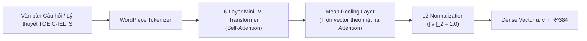

# HƯỚNG DẪN GIẢI PHÁP KỸ THUẬT: NHÚNG VECTOR NGỮ NGHĨA (DENSE SEMANTIC EMBEDDINGS)
## BÀI TOÁN LIÊN KẾT CÂU HỎI LUYỆN THI TOEIC / IELTS VỚI CHỦ ĐIỂM NGỮ PHÁP LÝ THUYẾT (QUESTION-TO-CONCEPT LINKING)
**Dự án:** EduSync — Nền tảng Đồng bộ Đa phương thức & Phân tích Sư phạm Bài giảng Tiếng Anh (TOEIC & IELTS)  
**Môn học:** Xử lý Ngôn ngữ Tự nhiên Nâng cao (NLP501)  

---

## 💡 Điểm nhấn Trình bày với Giảng viên

> - **Tại sao đây là điểm nhấn Technical NLP?** Trong đề thi TOEIC (Part 5/6) hay IELTS, câu hỏi thực hành chỉ chứa từ vựng tình huống đời sống (ví dụ: *"movie, cry, moved, moving"*), hoàn toàn không chứa tên thuật ngữ ngữ pháp trên slide lý thuyết (ví dụ: *"Participles as Adjectives"*).
> - **Hạn chế của phương pháp cũ:** Các thuật toán khớp từ khóa truyền thống (Exact Match, TF-IDF, BM25) cho điểm tương đồng bằng $0$ do **Hiện tượng Lệch từ vựng (Lexical Gap / Vocabulary Mismatch)**.
> - **Giải pháp của Nhóm:** Sử dụng mô hình **Siamese Bi-Encoder Transformer (`sentence-transformers/all-MiniLM-L6-v2`)** ánh xạ cả câu hỏi và chủ điểm lý thuyết vào không gian ngữ nghĩa liên tục $\mathbb{R}^{384}$ và tính độ tương đồng **Cosine Similarity**, hoàn thành toàn bộ 34 câu hỏi chỉ trong **~35–50 ms** trên máy cục bộ.

---

## 1. Đặt Vấn đề: Tại sao So khớp Từ khóa (Keyword Matching) Thất bại trên Đề thi TOEIC / IELTS?

Xét một ví dụ thực tế trong bài giảng luyện thi TOEIC Starter Unit 4:
- **Đề bài câu hỏi số 4 (`exercises.json`):**  
  `"I think the movie was _____ because it made me cry."` — Các lựa chọn: `(A) moved`, `(B) moving`, `(C) move`, `(D) movement`.
- **Chủ điểm lý thuyết tương ứng cô giảng ở đầu giờ (`grammar_points.json`):**  
  `"Participles as Adjectives: Present Participle (-ing) describes nature, Past Participle (-ed) describes feelings."`

| Phương pháp So khớp | Tập từ vựng đại diện (Tokens) | Điểm tương đồng | Kết quả |
| :--- | :--- | :---: | :--- |
| **TF-IDF / BM25 / Jaccard** | • Câu hỏi: `{think, movie, made, cry, moved, moving}`<br>• Lý thuyết: `{participle, adjective, present, past, nature, feeling}` | **$0.00$** | ❌ **Thất bại hoàn toàn** (Không có từ chung) |
| **Dense Semantic Embeddings (`all-MiniLM-L6-v2`)** | • Biểu diễn ngữ nghĩa của cấu trúc biến đổi hình thái `move / moved / moving` + ngữ cảnh cảm xúc `made me cry` nằm gần vector của khái niệm `Participles as Adjectives (-ing vs -ed)` trong $\mathbb{R}^{384}$ | **Cao (Top-1 Match)** | ✅ **Ghép cặp chính xác** câu hỏi với lý thuyết gốc |

---

## 2. Cơ sở Lý thuyết & Toán học của Dense Semantic Embeddings



### 2.1. Kiến trúc Bi-Encoder Siamese Network (`all-MiniLM-L6-v2`)
1. **Contextualized Token Representations:** Qua 6 tầng Multi-Head Self-Attention, mô hình nhận diện được mối tương quan giữa khoảng trống `_____`, ngữ cảnh cảm xúc `"made me cry"` và bộ 4 phương án chia từ loại `(moved / moving / move / movement)`.
2. **Attention-Masked Mean Pooling:** Gom các vector ẩn $\mathbf{h}_1, \dots, \mathbf{h}_L$ của từng subword token thành một vector câu duy nhất $\mathbf{u} \in \mathbb{R}^{384}$:
   $$\mathbf{u} = \frac{\sum_{t=1}^{L} m_t \cdot \mathbf{h}_t}{\sum_{t=1}^{L} m_t}$$
3. **Chuẩn hóa Đơn vị $L_2$ ($L_2$ Normalization):**
   $$\vec{v} = \frac{\mathbf{u}}{\|\mathbf{u}\|_2} = \frac{\mathbf{u}}{\sqrt{\sum_{i=1}^{384} u_i^2}} \implies \|\vec{v}\|_2 = 1.0$$

### 2.2. Ma trận Tương đồng Cosine (Cosine Similarity Matrix)
Với $N$ câu hỏi bài tập được biểu diễn bởi ma trận $Q \in \mathbb{R}^{N \times 384}$ và $M$ chủ điểm ngữ pháp được biểu diễn bởi ma trận $G \in \mathbb{R}^{M \times 384}$, toàn bộ độ tương đồng ngữ nghĩa giữa mọi cặp câu hỏi – lý thuyết được tính bằng một phép nhân ma trận duy nhất:
$$S = Q \cdot G^T \in \mathbb{R}^{N \times M}, \quad S_{k, j} = \cos(\vec{q}_k, \vec{g}_j) = \sum_{i=1}^{384} q_{k,i} \cdot g_{j,i}$$
Chủ điểm ngữ pháp phù hợp nhất với câu hỏi $Q_k$ là:
$$\hat{j}_k = \arg\max_{j \in \{1, \dots, M\}} S_{k, j}$$

---

## 3. Triển khai Thực tế trong Module `concept_link.py`

Module `concept_link.py` đã được tích hợp trực tiếp vào `pipeline.py` với cơ chế **Dual-Engine (Sentence-Transformers + Keyword/Heuristic Boost)** để vừa hiểu ngữ nghĩa sâu vừa tận dụng các dấu hiệu hình thái học đặc trưng của bài thi TOEIC/IELTS (như các phương án cùng gốc từ khác hậu tố `-ing/-ed`, cấu trúc `have/get + O + V3/ed`):

```python
# Trích đoạn cốt lõi trong concept_link.py
from sentence_transformers import SentenceTransformer, util
import numpy as np

model = SentenceTransformer("all-MiniLM-L6-v2")

# 1. Mã hóa đồng thời câu hỏi (Stem + Options + Teacher Explanation) và Chủ điểm Ngữ pháp
Q_emb = model.encode(q_texts, convert_to_tensor=True, normalize_embeddings=True)   # [N, 384]
GP_emb = model.encode(gp_texts, convert_to_tensor=True, normalize_embeddings=True) # [M, 384]

# 2. Tính ma trận Cosine Similarity S = Q * GP^T
sim_matrix = util.cos_sim(Q_emb, GP_emb).cpu().numpy()

# 3. Chọn argmax và phân tầng độ tin cậy (HIGH / MEDIUM / LOW)
best_idx = int(np.argmax(sim_matrix[i]))
best_score = float(sim_matrix[i][best_idx])
```

---

## 4. Giá trị Sư phạm trên Giao diện Web Demo (`demo/index.html`)

Kết quả từ tệp `exercise_concept_links.json` mang lại 2 tính năng trực tiếp cho học viên và giáo viên TOEIC/IELTS:
1. **Dành cho Học viên (Điều hướng 2 chiều Lý thuyết $\leftrightarrow$ Thực hành):**
   - Trên mỗi thẻ câu hỏi ở tab **📝 Exercises**, hệ thống gắn **Badge Chủ điểm Ngữ pháp màu tím** (ví dụ: `🏷️ Participles as Adjectives (-ing vs -ed)`).
   - Học viên bấm **`⏱ Xem Chữa bài (15:06)`** để xem cô chữa trực tiếp câu hỏi đó, hoặc bấm **`📖 Lý thuyết (08:13) ➔`** để video lập tức tua ngược về đầu giờ lúc cô giảng công thức gốc và tự động mở thẻ ngữ pháp tương ứng.
2. **Dành cho Giáo viên (Phát hiện Điểm nghẽn Kiến thức — Weakest Concept):**
   - Module `teacher_analytics.py` kết hợp dữ liệu trả lời sai của học viên với `exercise_concept_links.json` để tự động báo cáo cho giáo viên chủ điểm ngữ pháp nào cả lớp đang sai nhiều nhất.
