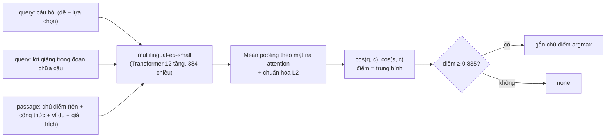

# HƯỚNG DẪN GIẢI PHÁP KỸ THUẬT: NHÚNG VECTOR NGỮ NGHĨA ĐA NGỮ (DENSE SEMANTIC EMBEDDINGS)
## BÀI TOÁN LIÊN KẾT CÂU HỎI BÀI TẬP VỚI CHỦ ĐIỂM NGỮ PHÁP ĐÃ GIẢNG (QUESTION-TO-CONCEPT LINKING)
**Dự án:** EduSync — Đồng bộ Đa phương thức & Phân tích Sư phạm Bài giảng Luyện thi Tiếng Anh (thử nghiệm trên TOEIC)  
**Môn học:** Xử lý Ngôn ngữ Tự nhiên Nâng cao (NLP501)  
**Module:** `concept_link.py` · **Đánh giá:** `eval/eval_concepts.py` · **Số liệu:** [`10_evaluation_results.md`](10_evaluation_results.md) §4

---

## 💡 Điểm nhấn Trình bày với Giảng viên

> - **Bài toán:** với mỗi câu hỏi trích từ màn hình (34 câu ở ECE TOEIC Starter Unit 4), chọn chủ điểm ngữ pháp cô đã giảng (4 chủ điểm `gp_1..gp_4`) mà câu đó luyện tập, **hoặc trả lời "none"** nếu câu chỉ kiểm tra từ vựng / đọc hiểu. Theo nhãn nháp, chỉ 12/34 câu có chủ điểm; 22 câu là "none".
> - **Phương pháp hiện tại:** bi-encoder đa ngữ **`intfloat/multilingual-e5-small`**; điểm của một cặp (câu hỏi, chủ điểm) là trung bình của cos(câu hỏi, chủ điểm) và cos(**lời giảng của cô trong đoạn chữa câu đó**, chủ điểm). Gắn chủ điểm khi điểm ≥ **0,835**, ngược lại "none". Không có mô hình thì dùng TF-IDF.
> - **Kết quả (34 câu U4):** độ chính xác **91,2%**, so với 73,5% của "luôn trả lời none", 82,4% của TF-IDF và 76,5% của bản v1 (MiniLM + từ khóa viết tay).
> - **Hạn chế cần nói trước:** mô hình và ngưỡng được chọn **trên chính 34 câu này**, nên con số có thể lạc quan; chưa có tập kiểm tra độc lập; nhãn gold là bản nháp (`verified: false`).

---

## 1. Đặt Vấn đề: Câu hỏi và Chủ điểm Dùng Từ Ngữ Khác nhau

Ví dụ thật trong ECE TOEIC Starter Unit 4:
- **Câu hỏi (`exercises.json`, card "Question 4", cô chữa ở `15:05`):**  
  `"The movie was very..."` — lựa chọn `(A) move`, `(B) moving`, `(C) moved`, `(D) movement`.
- **Chủ điểm `gp_1` (`grammar_points.json`, giảng ở `00:44`):**  
  `"Participles as Adjectives (-ing vs. -ed Participles) (Phân từ làm Tính từ)"`, công thức `S + be/linking verb + V-ing / V-ed`, giải thích bằng tiếng Việt.
- **Lời giảng của cô khi chữa câu này:** *"Bộ phim này thì rất là cảm động. Chúng ta có động từ MOVE. Từ MOVE này nó có 2 nghĩa..."*

Câu hỏi chứa từ vựng tình huống, còn chủ điểm dùng thuật ngữ tiếng Anh và lời giải thích tiếng Việt — hiện tượng **lệch từ vựng (lexical gap / vocabulary mismatch)**. Có hai điểm cần nói chính xác:
1. Khớp từ khóa **không** cho điểm 0 trong thực tế: phần mô tả chủ điểm có ví dụ tiếng Anh (*movie was moving, feel tired*), nên TF-IDF vẫn bắt được một phần và đạt 82,4% — một baseline mạnh.
2. Khó khăn lớn hơn là **biết khi nào trả lời "none"**: 22/34 câu không thuộc chủ điểm nào, nên một hệ thống luôn trả lời "none" đã đạt 73,5%. Vì vậy cần báo cả link precision / recall, không chỉ độ chính xác.

---

## 2. Cơ sở Lý thuyết của Bi-encoder



### 2.1. Mã hóa câu bằng bi-encoder
1. **Biểu diễn token theo ngữ cảnh:** văn bản (có tiền tố `query: ` hoặc `passage: ` theo cách huấn luyện của E5) được tách bằng tokenizer đa ngữ rồi qua các tầng self-attention, cho vector ẩn $\mathbf{h}_1, \dots, \mathbf{h}_L$.
2. **Mean pooling theo mặt nạ attention:**
   $$\mathbf{u} = \frac{\sum_{t=1}^{L} m_t \cdot \mathbf{h}_t}{\sum_{t=1}^{L} m_t}$$
3. **Chuẩn hóa $L_2$:** $\vec{v} = \mathbf{u} / \|\mathbf{u}\|_2$, nên tích vô hướng của hai vector chính là cosine.

Câu hỏi, lời giảng và chủ điểm được mã hóa **độc lập** (bi-encoder), nên chỉ cần mã hóa mỗi chủ điểm một lần rồi so với mọi câu hỏi bằng một phép nhân ma trận.

### 2.2. Hàm điểm và quy tắc quyết định
Với $N$ câu hỏi, $M$ chủ điểm; $Q, S \in \mathbb{R}^{N \times 384}$ là vector câu hỏi và vector lời giảng, $G \in \mathbb{R}^{M \times 384}$ là vector chủ điểm:
$$\text{score} = \tfrac{1}{2}\left(Q G^T + S G^T\right) \in \mathbb{R}^{N \times M}$$
$$\hat{j}_k = \arg\max_j \text{score}_{k,j}, \qquad \text{nhãn}_k = \begin{cases} \hat{j}_k & \text{nếu } \text{score}_{k,\hat{j}_k} \ge 0{,}835 \\ \text{none} & \text{ngược lại} \end{cases}$$
Độ tin cậy hiển thị: `HIGH` nếu đã gắn và hơn chủ điểm thứ hai ít nhất 0,01; `MEDIUM` nếu đã gắn nhưng sát chủ điểm thứ hai; `LOW` = không gắn.

---

## 3. Triển khai trong `concept_link.py`

Ba "góc nhìn" văn bản:
- **Câu hỏi** = đề OCR + các lựa chọn.
- **Lời giảng** = các đoạn transcript từ mốc bắt đầu chữa câu (lấy từ `exercise_alignment.json`) đến câu kế tiếp, tối đa 90 s. Đây là tín hiệu đa phương thức: khi chữa, cô thường gọi tên chủ điểm bằng tiếng Việt (*"thêm ing hay ed để làm tính từ"*, *"công thức nhờ vả"*).
- **Chủ điểm** = tên + công thức + ví dụ tiếng Anh + giải thích tiếng Việt từ `grammar_points.json`.

Trích đoạn cốt lõi (đúng như mã nguồn):

```python
MODEL_NAME = "intfloat/multilingual-e5-small"
QUERY_PREFIX, PASSAGE_PREFIX = "query: ", "passage: "
THRESHOLD = 0.835          # giữa vùng ổn định 0,830–0,840 trên Unit 4; cần hiệu chỉnh lại cho bài mới

def dense_scores(q_texts, s_texts, c_texts, model_name=MODEL_NAME):
    from sentence_transformers import SentenceTransformer
    model = SentenceTransformer(model_name)
    enc = lambda xs, p: model.encode([p + x for x in xs], normalize_embeddings=True)
    C = enc(c_texts, PASSAGE_PREFIX)
    return (enc(q_texts, QUERY_PREFIX) @ C.T + enc(s_texts, QUERY_PREFIX) @ C.T) / 2
```

**Phương án dự phòng:** nếu không nạp được `sentence-transformers` hoặc mô hình (ví dụ offline), module dùng cosine TF-IDF giữa (câu hỏi + lời giảng) và chủ điểm, ngưỡng 0,10. Trường `method` trong `exercise_concept_links.json` ghi rõ đã dùng cách nào (`multilingual-e5-small+speech` hoặc `tfidf+speech`).

---

## 4. Kết quả Thực nghiệm & Ablation (Unit 4, 34 câu, 4 chủ điểm)

Ngưỡng của mỗi phương pháp được chọn bằng **leave-one-out**: mỗi câu được chấm bằng ngưỡng tối ưu trên 33 câu còn lại, để không câu nào được chấm bằng ngưỡng chỉnh trên chính nó. Cột cuối chỉ xét 12 câu có chủ điểm và lấy argmax, không dùng ngưỡng.

| Phương pháp | Độ chính xác (34 câu) | Link precision | Link recall | acc@1 trên 12 câu có chủ điểm |
|---|---|---|---|---|
| Luôn trả lời "none" | 73,5% | — | — | — |
| TF-IDF | 82,4% | 85,7% | 58,3% | 83,3% |
| BM25 | 70,6% | 57,1% | 41,7% | 91,7% |
| **MiniLM + từ khóa viết tay (v1)** | 76,5% | 72,7% | 58,3% | 66,7% |
| MiniLM, bỏ từ khóa viết tay | 61,8% | 33,3% | 25,0% | 50,0% |
| paraphrase-multilingual-MiniLM | 76,5% | 71,4% | 50,0% | 75,0% |
| multilingual-e5-small | 85,3% | 80,0% | 75,0% | 91,7% |
| **multilingual-e5-small + lời giảng (bản hiện tại)** | **91,2%** | **83,3%** | **83,3%** | **91,7%** |

Đầu ra thực tế với ngưỡng cố định (đúng như demo hiển thị):

| | Độ chính xác | Link precision | Link recall | Số badge |
|---|---|---|---|---|
| v1 (demo cũ) | 58,8% | 39,1% | 66,7% | 23 |
| Bản hiện tại (ngưỡng 0,835) | **91,2%** | **90,0%** | **75,0%** | 10 |

Đọc bảng:
- Chuyển từ mô hình chỉ tiếng Anh (MiniLM, 61,8%) sang mô hình đa ngữ (e5-small, 85,3%) giúp nhiều nhất, vì phần giải thích chủ điểm và lời giảng là tiếng Việt.
- Thêm lời giảng của cô (+5,9 điểm độ chính xác, recall 75,0% → 83,3%) là phần đóng góp của tín hiệu đa phương thức.
- v1 gắn badge cho 23 câu với precision 39,1%; bản hiện tại chỉ gắn 10 câu nhưng 9/10 đúng.

Tái tạo: `python eval/run_all.py` (hoặc `python eval/eval_concepts.py`), kết quả ghi trong `eval/results/concepts_dev.json`.

---

## 5. Vì sao Bỏ Bộ Từ khóa Viết tay `KEYWORD_CUES` của v1

Bản v1 (commit `73d9a62`) dùng `all-MiniLM-L6-v2` và **nối thêm một danh sách từ khóa viết tay vào văn bản của mỗi chủ điểm** trước khi mã hóa, ví dụ:

```python
KEYWORD_CUES = {   # v1, đã xóa
    "gp_1": ["participle", "adjective", "bored", "boring", "moving", "moved", "annoying", "annoyed", "pleased", ...],
    "gp_2": ["causative", "have", "has", "had", "get", "shoes", "shine", "shined", "repair", "cut", "hair"],
    "gp_3": ["passive", "require", "demand", "suggest", "written", "papers", "ink", ...],
    "gp_4": ["modifier", "adjective", "noun", "central", "luxury", "hotel", "retail", "wholesale", "sales"],
}
```

Vấn đề:
1. **Rò rỉ đáp án:** nhiều từ trong danh sách chính là **đáp án hoặc từ trong đề của các câu cụ thể của Unit 4** (*moving, annoying, pleased, shined, written, central, luxury, shoes, ink...*). Khi các từ này nằm trong vector chủ điểm, câu hỏi chứa chúng tự nhiên giống chủ điểm đó — mô hình không cần hiểu ngữ pháp, chỉ cần "nhớ" đề. Đây là dùng thông tin của tập đánh giá trong biểu diễn.
2. **Không tổng quát:** danh sách được viết cho đúng bài này; sang bài khác (ví dụ Unit 5) các từ này không còn ý nghĩa.
3. **Che giấu điểm yếu của mô hình:** bỏ từ khóa thì MiniLM tụt từ 76,5% xuống 61,8% (precision 33,3%), cho thấy phần lớn kết quả v1 đến từ danh sách từ khóa chứ không từ embedding. MiniLM là mô hình chỉ tiếng Anh, trong khi giải thích chủ điểm bằng tiếng Việt.

Bản hiện tại không có từ khóa viết tay; test `tests/test_concept_link.py::test_no_hand_written_keyword_cues` kiểm tra module không còn thuộc tính `KEYWORD_CUES`. Thay vào đó, tín hiệu bổ sung đến từ **lời giảng thật của cô** trong đoạn chữa câu — thông tin có sẵn ở mọi bài, không cần viết tay.

---

## 6. Hạn chế

- **Chọn trên chính tập đánh giá:** mô hình (trong các cấu hình đã thử ở `eval/eval_concepts.py`) và ngưỡng 0,835 được chọn trên 34 câu của Unit 4. Leave-one-out chỉ tránh việc chỉnh ngưỡng trên chính từng câu, không loại được việc chọn mô hình trên cùng tập. Kết quả 91,2% vì vậy có thể lạc quan.
- **Chưa có tập kiểm tra độc lập** cho bài toán này (Unit 5 chưa có nhãn chủ điểm).
- **Ngưỡng nhạy:** điểm của hai nhóm "có chủ điểm" và "none" khá sát nhau (0,81–0,86); khi sang bài mới cần hiệu chỉnh lại ngưỡng.
- **Phụ thuộc bước trước:** cửa sổ lời giảng lấy từ mốc căn chỉnh (`exercise_align.py`); câu căn sai thì lời giảng cũng lệch. Danh sách chủ điểm lấy từ `neural_ie.py` (Gemini), chưa được đánh giá độ đầy đủ.
- **Nhãn gold là bản nháp** (do AI gán, không xem output hệ thống, `verified: false`), cần nhóm kiểm tra lại 34 nhãn.

---

## 7. Giá trị trên Web Demo (`demo/index.html`)

Kết quả trong `exercise_concept_links.json` được dùng ở hai chỗ:
1. **Học viên — điều hướng lý thuyết ↔ thực hành:** trên tab **📝 Exercises**, chỉ những câu được gắn chủ điểm (độ tin cậy `HIGH`/`MEDIUM`, **10/34 câu** ở Unit 4) mới có **badge màu tím** (ví dụ `🏷️ Participles as Adjectives (-ing vs. -ed Participles)`) và nút **`📖 Lý thuyết (00:44) ➔`**. Bấm vào thì video tua về đoạn cô giảng chủ điểm và mở tab **📖 Grammar** ở đúng thẻ. Các câu "none" không có badge — đó là thiết kế, không phải lỗi. Mốc lý thuyết của 4 chủ điểm là 00:44 / 15:38 / 13:18 / 07:35 (sai số TB 11,2 s so với nhãn nháp).
2. **Giáo viên — chủ điểm yếu nhất:** `teacher_analytics.py` đếm, theo `exercise_id`, số tin nhắn chat có lỗi được phát hiện ở các câu thuộc mỗi chủ điểm và báo chủ điểm có nhiều nhất; không có bằng chứng thì không báo. Với chat mô phỏng của Unit 4, đó là `gp_1` (2 tin nhắn có lỗi, ở câu 4 và 6).
