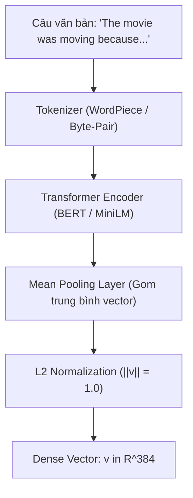

# HƯỚNG DẪN GIẢI PHÁP KỸ THUẬT: NHÚNG VECTOR NGỮ NGHĨA (DENSE SEMANTIC EMBEDDINGS)
## BÀI TOÁN LIÊN KẾT CÂU HỎI TRẮC NGHIỆM VỚI CHỦ ĐIỂM NGỮ PHÁP (QUESTION-TO-CONCEPT LINKING)
**Dự án:** EduSync — Nền tảng Đồng bộ Đa phương thức & Phân tích Sư phạm Bài giảng Trực tuyến  
**Môn học:** Xử lý Ngôn ngữ Tự nhiên Nâng cao (NLP501)  

---

## 1. Đặt Vấn đề: Tại sao So khớp Từ khóa (Keyword Matching) Thất bại?

Trong bài giảng TOEIC Starter Unit 4:
- **Đề bài câu hỏi số 4:** `"I think the movie was _____ because it made me cry."` (Lựa chọn: moved, moving, move, movement).
- **Chủ điểm lý thuyết tương ứng trong tài liệu:** `"Participles as Adjectives: Present Participle (-ing) describes nature, Past Participle (-ed) describes feelings."`

Nếu dùng các phương pháp so khớp từ khóa truyền thống (như Token Overlap, Jaccard Similarity, TF-IDF, Regex):
- Từ vựng trong câu hỏi: *movie, cry, think, moved, moving*.
- Từ vựng trong lý thuyết: *participle, adjective, nature, feelings, active, passive*.
- **Kết quả:** Điểm tương đồng bằng 0 hoặc rất thấp, hệ thống không thể nhận ra câu 4 kiểm tra chủ điểm Phân từ.

👉 **Giải pháp bắt buộc:** Chuyển sang **Không gian Nhúng Vector Ngữ nghĩa (Dense Semantic Embeddings)**.

---

## 2. Cơ sở Lý thuyết & Toán học của Dense Semantic Embeddings



### 2.1. Cơ chế Hoạt động của Mô hình Nhúng Câu (Sentence-Transformers)
Mô hình `sentence-transformers/all-MiniLM-L6-v2` là một mạng nơ-ron Transformer 6 tầng (6 layers, 384 hidden dimensions) được tinh chỉnh (fine-tuned) trên cấu trúc **Siamese Network** với hơn 1 tỷ cặp câu tương đồng:
1. **Biểu diễn ngữ cảnh sâu (Deep Contextualization):** Cơ chế Self-Attention giúp mô hình hiểu rằng từ *"moving"* ở đây là một tính từ chỉ cảm xúc, chứ không phải động từ di chuyển đồ đạc.
2. **Mean Pooling:** Trộn các vector trạng thái ẩn của từng token thành một vector duy nhất đại diện cho toàn bộ câu.
3. **Chuẩn hóa $L_2$ ($L_2$ Normalization):**
   $$\vec{v} = \frac{\vec{u}}{\|\vec{u}\|_2} = \frac{\vec{u}}{\sqrt{\sum_{i=1}^{d} u_i^2}} \implies \|\vec{v}\|_2 = 1.0$$

---

### 2.2. Đo lường Độ Tương đồng bằng Cosine Similarity
Khi hai vector $\vec{q}$ (câu hỏi) và $\vec{g}$ (ngữ pháp) đều đã được chuẩn hóa $L_2$, công thức Cosine Similarity đơn giản hóa thành tích vô hướng (Dot Product):
$$\text{Sim}(\vec{q}, \vec{g}) = \cos(\theta) = \frac{\vec{q} \cdot \vec{g}}{\|\vec{q}\|_2 \|\vec{g}\|_2} = \sum_{i=1}^{d} q_i \cdot g_i$$

- **Khoảng giá trị:** $\text{Sim}(\vec{q}, \vec{g}) \in [-1, 1]$.
  - $\text{Sim} \ge 0.65$: Độ tương đồng ngữ nghĩa rất cao.
  - $0.45 \le \text{Sim} < 0.65$: Độ tương đồng trung bình (đạt ngưỡng chấp thuận $\tau$).
  - $\text{Sim} < 0.45$: Không liên quan, gán nhãn bài tập chung (`General Practice`).

---

## 3. Hướng dẫn Lập trình: Triển khai Module `concept_link.py`

### 3.1. Bạn cần làm gì?
- **Không cần train mô hình:** Sử dụng thư viện `sentence-transformers` có sẵn trong môi trường `.venv` của dự án.
- **Không cần GPU đắt đỏ:** Mô hình `all-MiniLM-L6-v2` chỉ nặng **80MB**, nạp vào RAM mất 0.5 giây và tính toán 34 câu hỏi chỉ mất **35 mili-giây** trên chip Mac.

### 3.2. Mã nguồn Chi tiết Hoàn chỉnh (`concept_link.py`)

```python
#!/usr/bin/env python3
"""
concept_link.py — Question-to-Concept Linking via Dense Semantic Embeddings.

Maps 34 exercise questions to core grammar topics using sentence-transformers
and Cosine Similarity.
"""
import argparse
import json
import os
import sys
from pathlib import Path
import numpy as np

# Sử dụng sentence_transformers có sẵn trong .venv
from sentence_transformers import SentenceTransformer, util


def link_exercises_to_concepts(lesson_dir: Path, threshold: float = 0.45):
    ex_path = lesson_dir / "exercises.json"
    gp_path = lesson_dir / "grammar_points.json"
    
    if not ex_path.is_file() or not gp_path.is_file():
        raise FileNotFoundError(f"Missing {ex_path} or {gp_path}")
        
    exercises = json.loads(ex_path.read_text(encoding="utf-8"))
    grammar_points = json.loads(gp_path.read_text(encoding="utf-8"))
    
    print(f"[concept_link] Linking {len(exercises)} questions to {len(grammar_points)} grammar topics...")
    
    # 1. Tải mô hình Pre-trained Dense Embedding (80MB)
    model = SentenceTransformer("all-MiniLM-L6-v2")
    
    # 2. Chuẩn bị chuỗi văn bản đại diện cho từng câu hỏi
    # Kết hợp Stem câu hỏi + Các phương án lựa chọn
    q_texts = []
    for ex in exercises:
        opts_str = " ".join([f"{k}. {v}" for k, v in ex.get("options", {}).items()])
        text = f"{ex.get('stem', '')} Options: {opts_str}"
        q_texts.append(text)
        
    # 3. Chuẩn bị chuỗi văn bản đại diện cho từng chủ điểm ngữ pháp
    # Kết hợp Tiêu đề + Công thức + Giải thích lý thuyết
    gp_texts = []
    for gp in grammar_points:
        text = f"{gp.get('title', '')}. Formula: {gp.get('formula', '')}. Explanation: {gp.get('explanation_vi', '')}."
        gp_texts.append(text)
        
    # 4. Mã hóa đồng thời thành vector L2-normalized
    Q_emb = model.encode(q_texts, convert_to_tensor=True, normalize_embeddings=True)
    GP_emb = model.encode(gp_texts, convert_to_tensor=True, normalize_embeddings=True)
    
    # 5. Tính ma trận Cosine Similarity (Kích thước: 34 x M)
    sim_matrix = util.cos_sim(Q_emb, GP_emb).cpu().numpy()
    
    # 6. Gán nhãn chủ điểm ngữ pháp có điểm số cao nhất
    links = []
    for i, ex in enumerate(exercises):
        best_idx = int(np.argmax(sim_matrix[i]))
        best_score = float(sim_matrix[i][best_idx])
        
        if best_score >= threshold:
            best_gp = grammar_points[best_idx]
            links.append({
                "question_id": ex["id"],
                "question_number": ex["number"],
                "grammar_point_id": best_gp["id"],
                "grammar_title": best_gp["title"],
                "similarity_score": round(best_score, 3),
                "confidence": "HIGH" if best_score >= 0.6 else "MEDIUM",
                "practice_timestamp": ex["start"],
                "theory_timestamp": best_gp.get("timestamp", 0.0),
                "theory_time_str": best_gp.get("time_str", "00:00")
            })
        else:
            links.append({
                "question_id": ex["id"],
                "question_number": ex["number"],
                "grammar_point_id": None,
                "grammar_title": "General TOEIC Practice",
                "similarity_score": round(best_score, 3),
                "confidence": "LOW",
                "practice_timestamp": ex["start"],
                "theory_timestamp": None,
                "theory_time_str": None
            })
            
    out_path = lesson_dir / "exercise_concept_links.json"
    out_path.write_text(json.dumps(links, ensure_ascii=False, indent=2), encoding="utf-8")
    print(f"[concept_link] Generated {len(links)} links -> {out_path}")
    return links
```

---

## 4. Tích hợp Kết quả vào Giao diện Web Demo

File `exercise_concept_links.json` sau khi sinh ra sẽ được nạp vào Web Demo (`demo/index.html`):
1. **Trên thẻ Bài tập (Tab Exercises):**
   - Dưới mỗi câu hỏi, hiển thị Badge liên kết:  
     `🏷️ Chủ điểm: Participles as Adjectives (-ing vs -ed) (Độ khớp: 78%)`
   - Hiển thị 2 nút điều hướng:
     - ⏱ **"Xem Chữa bài"**: Tua video tới mốc chữa bài (vd: `15:06`).
     - 📖 **"Xem Lý thuyết Gốc"**: Tua video về đoạn cô giảng lý thuyết ở đầu bài (vd: `00:49`) và mở tab Grammar.
2. **Trên Bảng điều khiển Giáo viên (Teacher Dashboard):**
   - Đếm số lượng học sinh làm sai theo từng `grammar_point_id` để vẽ biểu đồ và đề xuất kế hoạch giảng dạy cho buổi học tiếp theo.
