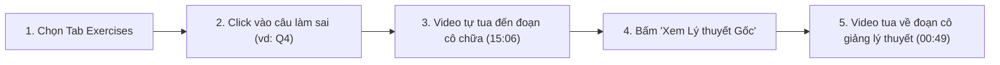
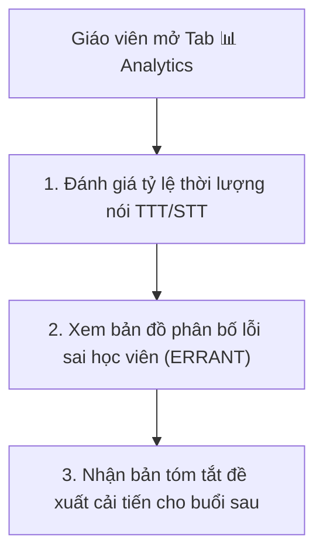

# HƯỚNG DẪN SỬ DỤNG HỆ THỐNG EDUSYNC
## DÀNH CHO HỌC SINH VÀ GIÁO VIÊN
**Dự án:** EduSync — Nền tảng Đồng bộ Đa phương thức & Phân tích Sư phạm Bài giảng Trực tuyến  
**Giao diện trực quan:** `http://localhost:8000/`  

---

## 1. Khởi chạy Hệ thống Demo

Chỉ cần thực hiện 2 lệnh đơn giản trong terminal:

```bash
# 1. Chạy pipeline đồng bộ bài học (nếu có bài học mới)
python demo/prepare.py --lesson lessons/ece-toeic-starter-u4

# 2. Khởi chạy máy chủ Web Demo
cd demo && ../.venv/bin/python -m RangeHTTPServer 8000
```
Mở trình duyệt web tại địa chỉ: `http://localhost:8000/`

---

## 2. Hướng dẫn dành cho Học sinh: Ôn bài Thông minh & Hiệu quả



### 2.1. Tua thông minh theo Câu hỏi Trắc nghiệm (Tab 📝 Exercises)
- Danh sách 34 câu hỏi hiển thị đầy đủ câu dẫn và các phương án A, B, C, D.
- **Thao tác:** Bấm vào bất kỳ thẻ câu hỏi nào $\to$ Video tự động nhảy đến đúng giây giáo viên chữa câu đó.
- Khi video phát đến câu nào, thẻ câu hỏi đó sẽ tự động sáng viền xanh và hiển thị nhãn **`NOW TEACHING`**.

### 2.2. Học Lý thuyết Ngữ pháp (Tab 📖 Grammar)
- Hiển thị 4 chủ điểm ngữ pháp trọng tâm được AI trích xuất.
- Xem công thức rút gọn, giải thích chi tiết bằng tiếng Việt, và các câu ví dụ thực tế.
- Đọc hộp cảnh báo: **💡 Mẹo thi TOEIC & Bẫy thường gặp**.
- Bấm vào nút **⏱ Thời gian** trên mỗi thẻ để xem cô giáo giảng điểm ngữ pháp đó trên video.

### 2.3. Luyện Từ vựng & Nghe Phát âm Mẫu (Tab 📚 Vocab)
- Lọc từ vựng theo trình độ quốc tế: **All**, **A1**, **A2**, **B1**, **B2**, **C1+**.
- Bấm nút **🔊 Nghe** để nghe clip âm thanh 1.5s giáo viên đọc mẫu từ vựng đó.
- Bấm nút **⏱ Thời gian** để tua video tới câu nói mà cô giải thích nghĩa của từ.
- Dùng ô tìm kiếm từ vựng để tra cứu nhanh nghĩa tiếng Việt hoặc từ tiếng Anh.

### 2.4. Xem lại Lỗi sai Ngữ pháp trong Chat (Tab 💬 Chat & GEC)
- Bấm vào nút lọc **⚠️ GEC Feedback (6)** để xem 6 lỗi ngữ pháp mà học sinh trong lớp từng mắc phải.
- Xem câu sửa màu xanh (`<ins>`) và phần gạch xóa màu đỏ (`<del>`).
- Đọc giải thích sư phạm tiếng Việt để hiểu rõ nguyên nhân lỗi sai (ví dụ: *nhầm phân từ -ing/-ed*, *thừa to be*).

### 2.5. Tra cứu Toàn bài qua Ô tìm kiếm (Omnibox Search)
- Gõ bất kỳ từ khóa nào vào ô tìm kiếm ở góc trên (ví dụ: *"depression"*, *"passive"*, *"câu 4"*).
- Hệ thống tìm kiếm đồng thời trên cả 5 nguồn dữ liệu và hiển thị danh sách kết quả kèm mốc thời gian để click nhảy video.

---

## 3. Hướng dẫn dành cho Giáo viên: Quản lý Lớp học & Đánh giá Sư phạm



### 3.1. Đánh giá Mức độ Tương tác (Tab 📊 Analytics)
- **Teacher Talk Time (TTT) vs. Student Talk Time (STT):**
  - Biểu đồ thanh phần trăm cho biết giáo viên đang nói bao nhiêu % thời lượng và học sinh tương tác bao nhiêu %.
  - Giúp giáo viên kiểm soát để tránh độc thoại quá mức trong các buổi học giao tiếp.
- **Tỷ lệ căn chỉnh thành công (Alignment Rate):** Đạt 95.6% - 99.4%, xác nhận toàn bộ học liệu đã được số hóa chính xác.

### 3.2. Quản lý Thảo luận Học viên & Lỗ hổng Kiến thức
- Vào tab **💬 Chat & GEC**, chọn bộ lọc **📝 Exercise Answers**: Giáo viên xem nhanh được học sinh nào gửi đáp án cho câu nào.
- Dựa trên các thẻ báo lỗi màu cam, giáo viên biết chính xác học sinh $S_1, S_2 \dots S_5$ đang gặp khó khăn ở cấu trúc ngữ pháp nào để có phương án phụ đạo riêng.

### 3.3. Sử dụng Đề xuất Cải tiến Buổi học (Action Plan)
- Đọc bản tóm tắt đề xuất hành động ở cuối bài báo cáo:
  1. Bài kiểm tra khởi động 5 phút đầu giờ cho buổi sau.
  2. Các chủ điểm ngữ pháp cần củng cố lại.
  3. Điều chỉnh nhịp độ giảng dạy (pacing) cho các bài đọc dài.
