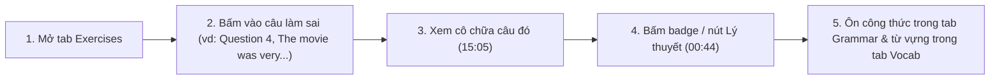

# SỔ TAY HƯỚNG DẪN SỬ DỤNG & KỊCH BẢN TRÌNH DIỄN WEB DEMO
## DÀNH CHO HỌC VIÊN LUYỆN THI TOEIC & HỘI ĐỒNG CHẤM ĐỒ ÁN
**Dự án:** EduSync — Đồng bộ Đa phương thức & Phân tích Sư phạm Bài giảng Luyện thi Tiếng Anh  
**Địa chỉ Web Demo:** `http://localhost:8000/` (bài ECE TOEIC Starter Unit 4, 58 phút)  
**Số liệu:** mọi con số lấy từ [`10_evaluation_results.md`](10_evaluation_results.md)

> **Cần nói rõ khi demo:** bài giảng chỉ có **một người nói** (giáo viên); **log chat (17 tin nhắn, 5 học viên) là dữ liệu mô phỏng** do nhóm soạn để minh họa luồng chat → phát hiện lỗi & phản hồi sửa lỗi, vì video YouTube không có chat.

---

## 💡 Kịch bản Demo 90 Giây Trước Giảng viên (Quick Demo Checklist)

> Mở `http://localhost:8000/` (tab **📝 Exercises** mở sẵn), rồi làm **5 thao tác** sau:
> 1. **Tab 📝 Exercises (15s):** cuộn tới thẻ **Question 4 — *"The movie was very..."*** (move / moving / moved / movement, nút `⏱ 15:05`) và bấm vào thẻ → video tua tới `15:05`, lúc cô nói *"Câu số 4"*. Lưu ý: số câu lặp lại giữa các phần (có 4 thẻ "Question 4"), hãy chọn đúng thẻ có đề về *movie*. Không lấy làm ví dụ: Question 1 đầu bài (mốc lệch 21 s so với nhãn), Question 5 *"He has his shoes..."* (không khớp được lời giảng) và Question 13 (badge chủ điểm gắn sai). Nhãn `NOW TEACHING` chỉ sáng trong vài giây ứng với đoạn lời giảng được căn.
> 2. **Badge chủ điểm → lý thuyết (20s):** ngay trên thẻ đó, chỉ vào **badge màu tím** `🏷️ Participles as Adjectives (-ing vs. -ed Participles)` (do `concept_link.py` gán bằng `multilingual-e5-small` + lời giảng) và bấm **`📖 Lý thuyết (00:44) ➔`** → video tua về `00:44` và chuyển sang **Tab 📖 Grammar** ở đúng thẻ chủ điểm. Nói rõ: chỉ **10/34 câu** có badge; các câu còn lại là câu từ vựng / đọc hiểu, hệ thống cố ý không gắn.
> 3. **Tab 📚 Vocab (15s):** bấm bộ lọc **`B1`** (18 từ) hoặc gõ *depression* vào ô tìm từ vựng, bấm **`🔊 Nghe giọng cô`** → nghe clip giọng cô cắt từ bài giảng, kèm nghĩa tiếng Việt khai thác từ lời giảng (*"Sự suy thoái."*).
> 4. **Tab 💬 Chat & GEC (20s):** bấm bộ lọc **`⚠️ GEC Feedback (6)`** → 6 tin nhắn có lỗi (7 lỗi), tên học viên đã ẩn danh hoá thành `S1..S5`. Chỉ vào tin của S3 *"Câu 4 I think movie was moved because it make me cry."*: phần gạch `<del>` / sửa `<ins>`, loại lỗi ERRANT `R:VERB:FORM` (nhóm PARTICIPLE) và `R:VERB:SVA` (nhóm SVA), giải thích tiếng Việt.
> 5. **Ô tìm kiếm 🔍 Search the lecture (15s):** gõ *shoes* để tìm tức thời đồng thời trong lời giảng, bài tập, từ vựng, chat và chủ điểm ngữ pháp.

---

## 1. Khởi chạy Hệ thống Web Demo

Chạy từ thư mục gốc `NLP501_edusync_mvp/` (đã cài `requirements.txt`, gồm `rangehttpserver`):

```bash
# 1. Nạp dữ liệu đã xử lý của bài TOEIC Unit 4 vào thư mục demo/
python demo/prepare.py --lesson lessons/ece-toeic-starter-u4

# 2. Khởi chạy máy chủ hỗ trợ HTTP Range (để trình duyệt tua được video)
cd demo && ../.venv/bin/python -m RangeHTTPServer 8000
```
Sau đó mở trình duyệt tại: **[http://localhost:8000/](http://localhost:8000/)**

**Mở thẳng một tab** (tiện khi trình bày và chụp màn hình): thêm `?tab=<id>` (hoặc `#<id>`) vào URL, ví dụ `http://localhost:8000/?tab=tab-exercises`. Các id: `tab-exercises`, `tab-grammar`, `tab-vocab`, `tab-chat`, `tab-screens`.

**Phím tắt video** (khi con trỏ không ở ô nhập liệu): `Space` phát/dừng, `←` / `→` lùi/tiến 5 giây.

---

## 2. Hướng dẫn Dành cho Học viên



### 2.1. Tua tới đoạn chữa từng câu hỏi (Tab 📝 Exercises)
- Hiển thị **34 thẻ câu hỏi** tách từ màn hình (TOEIC Part 5/6/7) kèm đề và các lựa chọn A–D mà OCR đọc được. Hai thẻ thực chất là đoạn văn chứ không phải câu hỏi; một số lựa chọn bị trống hoặc lẫn chữ do OCR.
- **Bấm để tua:** bấm thẻ → video nhảy tới mốc hệ thống căn cho câu đó. Đo trên nhãn nháp: mốc lệch ≤10 s ở 68,8% câu của Unit 4 và 80,0% câu của Unit 5 (sai số TB 10,0 s / 8,1 s). 33/34 câu khớp được với lời giảng; câu còn lại (Question 5, *"He has his shoes..."*) lấy thời điểm màn hình nên lệch hơn.
- Dòng chữ nghiêng dưới thẻ là câu lời giảng mà hệ thống dùng làm mốc (ví dụ *"Câu số 4."*).
- **Đồng bộ khi video chạy:** khi thời gian video nằm trong đoạn lời giảng được căn của một câu, thẻ đó được cuộn tới và sáng nhãn **`NOW TEACHING`** (chỉ vài giây, không phải suốt đoạn chữa).

### 2.2. Liên kết câu hỏi ↔ lý thuyết ngữ pháp (Tab 📖 Grammar)
- **10/34 câu** có **badge chủ điểm màu tím** và nút **`📖 Lý thuyết (mm:ss) ➔`**; 22 câu còn lại không có badge vì được xếp là câu từ vựng / đọc hiểu. Liên kết đúng 91,2% trên 34 câu (precision 90,0%, recall 75,0%), nhưng mô hình và ngưỡng được chọn trên chính tập này — xem [`05_solution_dense_embeddings_guide.md`](05_solution_dense_embeddings_guide.md).
- Bấm badge hoặc nút để tua về đoạn cô giảng chủ điểm và mở thẻ tương ứng trong tab Grammar. Mốc của 4 chủ điểm: **Participles 00:44**, **Causative 15:38**, **Passive / require that 13:18**, **Noun modifiers 07:35** (sai số TB 11,2 s so với nhãn nháp).
- Mỗi thẻ chủ điểm có công thức, giải thích tiếng Việt, ví dụ và hộp **💡 Mẹo thi TOEIC**. Nội dung này do `neural_ie.py` (Gemini, JSON mode) trích từ lời giảng và **chưa được đánh giá**; riêng mốc thời gian đã được neo lại vào lời giảng bằng embedding.

### 2.3. Từ vựng theo bậc CEFR & nghe giọng cô (Tab 📚 Vocab)
- 80 từ của bài, lọc theo **All**, **A1** (26), **A2** (26), **B1** (18), **B2** (9), **C1+** (1); có ô tìm theo từ hoặc nghĩa tiếng Việt.
- Bấm **`🔊 Nghe giọng cô`** để nghe clip giọng cô cắt từ bài giảng (79 clip, dài **0,7–2,2 s**), cắt theo ranh giới đoạn ASR có chứa từ (transcript không có timestamp từng từ), nên clip có thể dính vài tiếng xung quanh. Nút `⏱` tua video tới chỗ từ xuất hiện.
- 52/80 từ có **nghĩa tiếng Việt** khai thác từ lời giảng theo mẫu "X là / nghĩa là …". Độ đúng **chưa được kiểm tra** và có chỗ sai (ví dụ *retail* đang hiện "chi tiết"), nên đừng chọn từ đó khi demo.

### 2.4. Học từ lỗi sai trong chat (Tab 💬 Chat & GEC)
- Ba bộ lọc: **All Messages (17)**, **⚠️ GEC Feedback (6)**, **📝 Exercise Answers (15)** (tin nhắn nhắc tới số câu).
- Tên học viên được **ẩn danh hoá** (pseudonymization) thành `S1..S5`. Tin nhắn được nối với câu hỏi theo số câu ("câu 4") và thời điểm: câu gần nhất trước đó có số này (số câu bắt đầu lại ở mỗi phần).
- Mỗi lỗi hiển thị phần gạch bỏ (`<del>`), phần sửa (`<ins>`), loại lỗi ERRANT và giải thích tiếng Việt. Bộ phát hiện **dựa trên luật**, chỉ bắt 6 nhóm lỗi chuyển di L1 (BE_VERB, PARTICIPLE, CAUSATIVE, MODAL_TO, SVA, WH_DO); trên tập 70 câu viết độc lập: precision 100%, recall 72,7%. Các lỗi ngoài 6 nhóm không được bắt.

### 2.5. Tìm kiếm trong toàn bài (ô 🔍 Search the lecture)
- Gõ từ khóa tiếng Anh (ví dụ *shoes*, *depression*, *participle*). Kết quả gộp từ 5 nguồn: lời giảng, bài tập, từ vựng, chat và chủ điểm ngữ pháp; bấm kết quả để tua video.
- Đây là tìm theo chuỗi con với cắt hậu tố đơn giản (*-ing, -ed, -es, -s*), không phải tìm kiếm ngữ nghĩa. Từ tiếng Việt có dấu và số một chữ số (ví dụ *câu 4*) hiện chưa tìm được, vì ô tìm kiếm tách từ theo chữ cái Latin không dấu và bỏ từ một ký tự.

---

