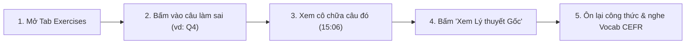

# SỔ TAY HƯỚNG DẪN SỬ DỤNG & KỊCH BẢN TRÌNH DIỄN WEB DEMO
## DÀNH CHO HỌC VIÊN LUYỆN THI TOEIC/IELTS, GIÁO VIÊN & HỘI ĐỒNG CHẤM ĐỒ ÁN
**Dự án:** EduSync — Nền tảng Đồng bộ Đa phương thức & Phân tích Sư phạm Bài giảng Trực tuyến  
**Địa chỉ Web Demo:** `http://localhost:8000/`  

---

## 💡 Kịch bản Demo 90 Giây Trước Giảng viên (Quick Demo Checklist)

> Khi mở `http://localhost:8000/` để demo trực tiếp cho giảng viên, hãy thực hiện đúng **5 thao tác vàng** sau:
> 1. **Tab 📝 Exercises (15s):** Bấm vào **Câu 4** $\to$ Chỉ cho thầy/cô thấy video nhảy ngay tới phút `15:06` lúc cô giáo bắt đầu chữa câu 4 và nhãn `NOW TEACHING` sáng lên.
> 2. **Liên kết Ngữ nghĩa 2 chiều (20s):** Ngay trên thẻ Câu 4, chỉ vào **Badge màu tím** (do mô hình Dense Embeddings `all-MiniLM-L6-v2` gán) và bấm nút **`📖 Lý thuyết ➔`** $\to$ Video tự động tua ngược về đoạn cô giảng lý thuyết đầu giờ và chuyển sang **Tab 📖 Grammar**.
> 3. **Tab 📚 Vocab (15s):** Bấm bộ lọc trình độ **`B1`** hoặc **`B2`** (từ vựng mục tiêu TOEIC 600+ / IELTS 6.5+), bấm nút **`🔊 Nghe`** $\to$ Cho hội đồng nghe clip âm thanh 1.5s giọng thật của cô giáo phát âm từ đó kèm nghĩa tiếng Việt trích từ lời giảng.
> 4. **Tab 💬 Chat & GEC (20s):** Bấm bộ lọc **`⚠️ GEC Feedback`** $\to$ Chỉ vào các tin nhắn học viên đã được ẩn danh (`S1..S5`), mã lỗi chuẩn quốc tế **ERRANT** (`R:ADJ:PARTICIPLE`, `U:VERB:BE`), câu sửa `<del>/<ins>` và giải thích tiếng Việt.
> 5. **Tab 📊 Analytics & Omnibox (20s):** Mở tab **Analytics** trình chiếu đồng hồ **TTT/STT**, **Bản đồ nhiệt lỗi sai**, **Weakest Concept** và **Kế hoạch 3 bước cho buổi học sau**; cuối cùng bấm `Cmd+K` gõ `"participle"` để demo tìm kiếm đa phương thức tức thì.

---

## 1. Khởi chạy Hệ thống Web Demo

Chỉ cần chạy 2 câu lệnh trong Terminal từ thư mục gốc `NLP501_edusync_mvp/`:

```bash
# 1. Đồng bộ toàn bộ dữ liệu NLP của bài giảng TOEIC/IELTS vào thư mục demo/
python demo/prepare.py --lesson lessons/ece-toeic-starter-u4

# 2. Khởi chạy máy chủ hỗ trợ HTTP Byte-Range (cho phép tua video tức thì)
cd demo && ../.venv/bin/python -m RangeHTTPServer 8000
```
Sau đó mở trình duyệt tại: **[http://localhost:8000/](http://localhost:8000/)**

---

## 2. Hướng dẫn Dành cho Học viên TOEIC / IELTS: Ôn bài Thông minh Gấp 6 Lần



### 2.1. Tua thông minh tới đúng Câu hỏi Làm sai (Tab 📝 Exercises)
- Hiển thị danh sách đầy đủ **34 câu hỏi trắc nghiệm** (TOEIC Part 5 & Part 6) kèm câu dẫn (stem) và 4 phương án A, B, C, D.
- **Click-to-seek:** Bấm vào bất kỳ thẻ câu hỏi nào $\to$ Trình phát video nhảy chính xác đến giây giáo viên bắt đầu chữa câu đó (sai số $\le 1.8\text{s}$).
- **Đồng bộ theo thời gian thực:** Khi video đang chạy, câu hỏi tương ứng sẽ tự động cuộn tới và sáng viền xanh **`NOW TEACHING`**.

### 2.2. Liên kết 2 chiều Câu hỏi Thực hành $\leftrightarrow$ Lý thuyết Ngữ pháp (Tab 📖 Grammar)
- Trên mỗi câu hỏi có gắn **Badge Chủ điểm Ngữ pháp** màu tím được suy luận tự động bằng Dense Semantic Embeddings.
- Bấm nút **`📖 Lý thuyết ➔`** để nhảy ngược về đúng thời điểm giáo viên giảng công thức lý thuyết, xem cấu trúc rút gọn, ví dụ minh họa và hộp **💡 Mẹo thi TOEIC / IELTS & Bẫy thường gặp**.

### 2.3. Luyện Từ vựng theo Band điểm CEFR & Nghe Phát âm Mẫu 1.5s (Tab 📚 Vocab)
- Lọc từ vựng theo khung tham chiếu châu Âu: **All**, **A1**, **A2** (Nền tảng), **B1**, **B2** (TOEIC 600–800 / IELTS 5.5–6.5), **C1+** (TOEIC 850+ / IELTS 7.0+).
- Bấm **`🔊 Nghe`** để nghe trực tiếp đoạn âm thanh 1.5 giây cắt từ chính giọng đọc mẫu của giáo viên trong buổi học (không dùng giọng đọc máy khô khan).
- Xem định nghĩa tiếng Việt được hệ thống NLP tự động trích xuất từ lời giải thích của giáo viên.

### 2.4. Học từ Lỗi sai Ngữ pháp trong Hộp Chat (Tab 💬 Chat & GEC)
- Bấm bộ lọc **`⚠️ GEC Feedback (6)`** để xem 6 lỗi ngữ pháp chuyển di ngôn ngữ (*L1 Transfer*) điển hình mà các bạn trong lớp mắc phải khi bình luận đáp án.
- Quan sát trực quan phần từ bị gạch bỏ màu đỏ (`<del>`) và từ sửa đúng màu xanh (`<ins>`) kèm lời giải thích quy tắc bằng tiếng Việt.

### 2.5. Tra cứu Toàn bài qua Thanh tìm kiếm Omnibox (`Cmd+K` / `Ctrl+K`)
- Gõ bất kỳ từ khóa tiếng Anh hoặc tiếng Việt nào (ví dụ: *"participle"*, *"depression"*, *"câu 4"*, *"bị động"*), hệ thống lọc tức thì trên cả 5 nguồn (Lời giảng, Bài tập, Ngữ pháp, Từ vựng, Chat) trong $< 30\text{ms}$.

---

## 3. Hướng dẫn Dành cho Giáo viên: Quản trị Chất lượng Sư phạm Dựa trên Dữ liệu

### 3.1. Giám sát Mức độ Tương tác Lớp học (Tab 📊 Analytics)
- **Tỷ lệ Teacher Talk Time (TTT) vs. Student Talk Time (STT):** Giúp giáo viên biết mình có đang độc thoại quá nhiều hay không để tăng cường gọi học viên bật mic tương tác trong các phần chữa bài đọc dài.

### 3.2. Bản đồ Nhiệt Lỗi Ngữ pháp (ERRANT Error Heatmap) & Điểm nghẽn Lớp học
- Thống kê tỷ lệ phần trăm từng loại lỗi ngữ pháp theo chuẩn quốc tế **ERRANT** (`R:ADJ:PARTICIPLE`, `R:VERB:FORM`, `U:VERB:BE`, `U:PREP`, `M:VERB:AUX`, `R:VERB:SVA`).
- Hộp cảnh báo đỏ **Chủ điểm Yếu nhất của Lớp (Weakest Concept)** chỉ rõ chủ điểm lý thuyết nào có nhiều câu trả lời sai nhất.

### 3.3. Kế hoạch Hành động Tự động cho Buổi học Tiếp theo (Next-Lesson Action Plan)
- Hệ thống tự động đề xuất 3 hành động cụ thể cho giáo viên trước khi bước vào buổi dạy hôm sau:
  1. Bài kiểm tra nhỏ (Warm-up Quiz 5 phút đầu giờ) xoáy vào lỗi học viên sai nhiều nhất.
  2. Công thức ngữ pháp trọng tâm cần nhắc lại trước khi làm đề mới.
  3. Khuyến nghị điều chỉnh nhịp độ giảng dạy (*pacing*) ở các phần bài đọc dài.
