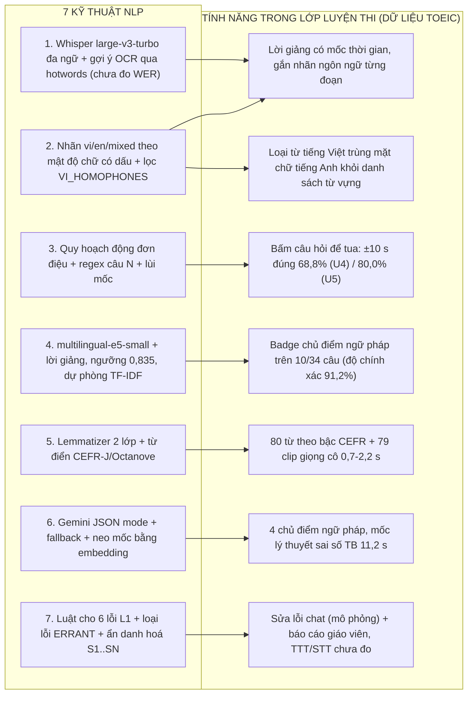

# MỤC LỤC TÀI LIỆU DỰ ÁN (DOCUMENTATION INDEX)
## EDUSYNC: ĐỒNG BỘ ĐA PHƯƠNG THỨC & PHÂN TÍCH SƯ PHẠM BÀI GIẢNG LUYỆN THI TIẾNG ANH (THỬ NGHIỆM TRÊN TOEIC)
**Môn học:** Xử lý Ngôn ngữ Tự nhiên Nâng cao (NLP501 - Master of Software Engineering)  
**Nhánh Git:** `edusync-v2`  
**Cập nhật lần cuối:** 10/11/2026  

---

## 1. Cấu trúc Bộ Tài liệu (`docs/`)

Đồ án xử lý bản ghi bài giảng luyện thi tiếng Anh. Dữ liệu thử nghiệm là 3 bài **ECE TOEIC Starter** (Unit 1, 4, 5; YouTube, CC BY); IELTS chỉ là hướng mở rộng, chưa có dữ liệu hay kết quả.

> **Nguồn số liệu duy nhất:** [`10_evaluation_results.md`](10_evaluation_results.md). Mọi con số trong slide và các tài liệu khác phải lấy từ file này; tái tạo bằng `python eval/run_all.py`. Nhãn gold dùng để đo đều là **bản nháp** (`verified: false`), nhóm cần kiểm tra trước khi bảo vệ.

```text
NLP501_edusync_mvp/docs/
├── README.md                                           # [Bạn đang xem] Mục lục & bản đồ kỹ thuật NLP ↔ tính năng
├── 01_project_proposal.md                              # Đề xuất đề tài: bài toán, câu hỏi nghiên cứu RQ1–RQ3, kết quả đo được
├── 02_nlp_architecture_and_literature.md               # Cơ sở lý thuyết NLP & tổng quan nghiên cứu
├── 03_requirements_analysis_srs.md                     # Đặc tả & phân tích yêu cầu phần mềm (SRS)
├── 04_detailed_design_and_qa_plan.md                   # Thiết kế chi tiết (SDD) & kế hoạch QA/QC
├── 05_solution_dense_embeddings_guide.md               # Chuyên đề: liên kết câu hỏi ↔ chủ điểm (multilingual-e5-small + lời giảng, ablation)
├── 06_user_guide_and_demo.md                           # Kịch bản demo 90 giây & hướng dẫn sử dụng web demo
├── 07_feature_detailed_design_matrix.md                # Ma trận 10 tính năng ↔ kỹ thuật NLP ↔ mã nguồn ↔ test (71 test)
├── 08_presentation_slides_and_speaker_notes.md         # Kịch bản slide thuyết trình & lời thoại 4 thành viên
├── 08_presentation_slides_marp.md                      # Slide thuyết trình định dạng Marp Markdown
├── 09_teacher_presentation_and_technical_nlp_guide.md  # Cẩm nang trình bày cho giảng viên & câu hỏi phản biện
├── 10_evaluation_results.md                            # ⭐ KẾT QUẢ ĐÁNH GIÁ THỰC NGHIỆM — NGUỒN SỐ LIỆU DUY NHẤT
├── slides.html                                         # Slide thuyết trình HTML (timer & lời thoại)
├── slides.pptx                                         # Slide PowerPoint
├── slides.pdf                                          # Slide PDF
├── esl_roadmap.md                                      # Lộ trình 7 gói công việc (WP1–WP7) cho bài giảng tiếng Anh
└── phase1_plan.md                                      # Báo cáo Phase 1 (hạ tầng đa phương thức, ASR trộn mã) trên bài giảng TOEIC; số liệu theo docs/10
```

---

## 2. Dùng Tài liệu Nào Khi Trình bày Trước Giảng viên

| Mục đích | Tài liệu cần mở | Nội dung cốt lõi |
| :--- | :--- | :--- |
| 📊 **Trích dẫn bất kỳ con số nào** | [**`10_evaluation_results.md`**](10_evaluation_results.md) | • Dữ liệu (U4 dev, U5 test độc lập), nhãn gold nháp.<br>• Căn chỉnh câu hỏi: ±10 s đúng 68,8% (U4) / 80,0% (U5).<br>• Liên kết chủ điểm: 91,2% trên 34 câu U4 (chọn trên chính tập này).<br>• Mốc lý thuyết: sai số TB 11,2 s; GEC: P 100% / R 72,7% trên 70 câu.<br>• ASR: chưa có WER thật; danh sách các con số cũ đã rút. |
| 🌟 **Ôn tập kiến thức NLP & trả lời phản biện** | [**`09_teacher_presentation_and_technical_nlp_guide.md`**](09_teacher_presentation_and_technical_nlp_guide.md) | • Cách dẫn dắt câu chuyện từ khó khăn của học viên luyện thi.<br>• 7 điểm áp dụng Technical NLP.<br>• Câu hỏi phản biện và câu trả lời mẫu. |
| 🎯 **Trình bày đề xuất & bối cảnh bài toán** | [**`01_project_proposal.md`**](01_project_proposal.md) | • 3 khó khăn của học viên và giáo viên (kèm nghiên cứu Guo 2014, Kim 2014, Horwitz 1986).<br>• Mô hình "nút tri thức đa phương thức" và 3 câu hỏi nghiên cứu RQ1–RQ3 với kết quả đo được và hạn chế. |
| 🧠 **Giải thích cơ sở toán học & kỹ thuật** | [**`02_nlp_architecture_and_literature.md`**](02_nlp_architecture_and_literature.md)<br>[**`05_solution_dense_embeddings_guide.md`**](05_solution_dense_embeddings_guide.md) | • Whisper + gợi ý OCR qua `hotwords`; WER (Levenshtein) — công cụ có sẵn, chưa có số đo thật.<br>• Nhận diện trộn mã theo mật độ chữ có dấu & lọc `VI_HOMOPHONES`.<br>• Quy hoạch động đơn điệu căn chỉnh câu hỏi.<br>• Bi-encoder `multilingual-e5-small` + lời giảng, cosine, ngưỡng 0,835; vì sao bỏ từ khóa viết tay.<br>• Lemmatizer 2 lớp, CEFR-J + Octanove (8.845 mục), loại lỗi ERRANT. |
| 🏗️ **Phân tích thiết kế hệ thống & kiểm thử** | [**`03_requirements_analysis_srs.md`**](03_requirements_analysis_srs.md)<br>[**`04_detailed_design_and_qa_plan.md`**](04_detailed_design_and_qa_plan.md)<br>[**`07_feature_detailed_design_matrix.md`**](07_feature_detailed_design_matrix.md) | • Yêu cầu chức năng & phi chức năng.<br>• Kiến trúc pipeline, định dạng JSON giữa các bước, cơ chế fallback khi offline.<br>• Ma trận 10 tính năng ↔ file ↔ test (71 test pass) ↔ kết quả đo. |
| 🖥️ **Trình chiếu slide & demo trực tiếp** | [**`slides.html`**](slides.html)<br>[**`08_presentation_slides_and_speaker_notes.md`**](08_presentation_slides_and_speaker_notes.md)<br>[**`06_user_guide_and_demo.md`**](06_user_guide_and_demo.md) | • Slide HTML có đồng hồ và lời thoại (phím `N`).<br>• Kịch bản demo 5 bước trên `http://localhost:8000/` (mở thẳng tab bằng `?tab=tab-stats`). |

---

## 3. Bản đồ 7 Kỹ thuật NLP sang Tính năng Sản phẩm

Số liệu trong sơ đồ lấy từ [`10_evaluation_results.md`](10_evaluation_results.md).


