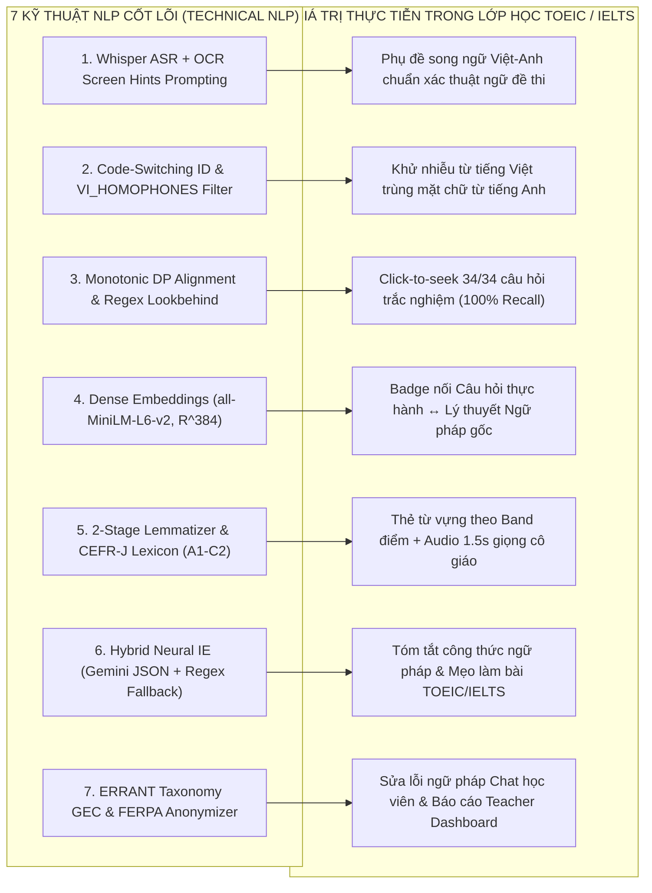

# MỤC LỤC TÀI LIỆU DỰ ÁN (DOCUMENTATION INDEX)
## EDUSYNC: NỀN TẢNG ĐỒNG BỘ ĐA PHƯƠNG THỨC & PHÂN TÍCH SƯ PHẠM BÀI GIẢNG TIẾNG ANH (TOEIC & IELTS)
**Môn học:** Xử lý Ngôn ngữ Tự nhiên Nâng cao (NLP501 - Master of Software Engineering)  
**Nhánh Git:** `edusync-v2`  
**Cập nhật lần cuối:** Tháng 11/2026  

---

## 1. Cấu trúc Bộ Tài liệu Chuẩn hóa (`docs/`)

Toàn bộ tài liệu của đồ án EduSync đã được chuẩn hóa xuyên suốt theo định hướng **Xử lý và Phân tích Bài giảng Luyện thi Tiếng Anh (TOEIC & IELTS)**, thiết kế trực quan để dễ dàng trình bày và bảo vệ trước giảng viên:

```text
NLP501_edusync_mvp/docs/
├── README.md                                           # [Bạn đang xem] Mục lục trung tâm & Bản đồ Technical NLP
├── 01_project_proposal.md                              # Đề xuất Đề tài: Bài toán lớp học TOEIC/IELTS & 4 Trụ cột NLP
├── 02_nlp_architecture_and_literature.md               # Cơ sở Lý thuyết NLP sâu (7 kỹ thuật NLP) & Literature Review
├── 03_requirements_analysis_srs.md                     # Đặc tả & Phân tích Yêu cầu Phần mềm (SRS - IEEE 830)
├── 04_detailed_design_and_qa_plan.md                   # Thiết kế Chi tiết Hệ thống (SDD) & Kế hoạch QA/QC (45/45 Tests)
├── 05_solution_dense_embeddings_guide.md               # Chuyên đề: Giải pháp Dense Semantic Embeddings nối Câu hỏi ↔ Ngữ pháp
├── 06_user_guide_and_demo.md                           # Kịch bản Demo 90 giây trước Giảng viên & Hướng dẫn sử dụng
├── 07_feature_detailed_design_matrix.md                # Ma trận Ánh xạ 10 Tính năng ↔ Kỹ thuật NLP ↔ Code & Unit Tests
├── 08_presentation_slides_and_speaker_notes.md         # Kịch bản Thuyết trình 18 Slides & Lời thoại 4 Thành viên
├── 08_presentation_slides_marp.md                      # Slide thuyết trình định dạng Marp Markdown
├── 09_teacher_presentation_and_technical_nlp_guide.md  # ⭐ CẨM NANG TRÌNH BÀY CHO GIẢNG VIÊN & BỘ CÂU HỎI PHẢN BIỆN NLP
├── slides.html                                         # Slide thuyết trình HTML tương tác (Có Timer & Presenter Notes)
├── slides.pptx                                         # 📊 Tệp Slide Microsoft PowerPoint (.pptx) trình chiếu chính thức
├── slides.pdf                                          # 📄 Tệp Slide định dạng PDF chất lượng cao (A4 ngang / 16:9)
├── esl_roadmap.md                                      # Lộ trình 7 gói công việc (WP1–WP7) cho bài giảng tiếng Anh
└── phase1_plan.md                                      # Báo cáo thực nghiệm Phase 1 trên bộ dữ liệu bài giảng TOEIC
```

---

## 2. Hướng dẫn Sử dụng Tài liệu Khi Trình bày Trước Giảng viên

| Mục đích Trình bày / Bảo vệ | Tài liệu Cần Mở | Nội dung Cốt lõi để Báo cáo |
| :--- | :--- | :--- |
| 🌟 **Ôn tập nhanh toàn bộ Kiến thức NLP & Trả lời Phản biện** | [**`09_teacher_presentation_and_technical_nlp_guide.md`**](file:///Users/binhpham/Documents/Study/MSE/NLP/NLP501_edusync_mvp/docs/09_teacher_presentation_and_technical_nlp_guide.md) | • Cách dẫn dắt câu chuyện (Storytelling) từ nỗi đau học viên TOEIC/IELTS.<br>• Phân tích chi tiết **7 điểm áp dụng Technical NLP** kèm công thức toán.<br>• **8 câu hỏi phản biện chuyên sâu** của giảng viên và câu trả lời mẫu. |
| 🎯 **Trình bày Đề xuất & Bối cảnh Bài toán TOEIC/IELTS** | [**`01_project_proposal.md`**](file:///Users/binhpham/Documents/Study/MSE/NLP/NLP501_edusync_mvp/docs/01_project_proposal.md) | • 3 nỗi đau của học viên và giáo viên luyện thi TOEIC/IELTS.<br>• Mô hình "Nút tri thức đa phương thức" và 3 câu hỏi nghiên cứu (RQ1–RQ3).<br>• Kết quả định lượng trên bộ dữ liệu bài giảng thực tế. |
| 🧠 **Giải thích Sâu Cơ sở Toán học & Lý thuyết NLP** | [**`02_nlp_architecture_and_literature.md`**](file:///Users/binhpham/Documents/Study/MSE/NLP/NLP501_edusync_mvp/docs/02_nlp_architecture_and_literature.md)<br>[**`05_solution_dense_embeddings_guide.md`**](file:///Users/binhpham/Documents/Study/MSE/NLP/NLP501_edusync_mvp/docs/05_solution_dense_embeddings_guide.md) | • Contextual Biasing ASR ($P(Y \mid X, H)$), Levenshtein WER.<br>• Code-switching Diacritics Density & lọc đồng âm `VI_HOMOPHONES`.<br>• Monotonic DP ($t_{k+1} > t_k$) & Regex Negative Lookbehind.<br>• Siamese Bi-Encoder `all-MiniLM-L6-v2` ($\mathbb{R}^{384}$) & Cosine Similarity.<br>• Lemmatization 2 lớp, từ điển CEFR-J (8.845 từ) & chuẩn lỗi ERRANT. |
| 🏗️ **Báo cáo Phân tích Thiết kế Hệ thống & Kiểm thử** | [**`03_requirements_analysis_srs.md`**](file:///Users/binhpham/Documents/Study/MSE/NLP/NLP501_edusync_mvp/docs/03_requirements_analysis_srs.md)<br>[**`04_detailed_design_and_qa_plan.md`**](file:///Users/binhpham/Documents/Study/MSE/NLP/NLP501_edusync_mvp/docs/04_detailed_design_and_qa_plan.md)<br>[**`07_feature_detailed_design_matrix.md`**](file:///Users/binhpham/Documents/Study/MSE/NLP/NLP501_edusync_mvp/docs/07_feature_detailed_design_matrix.md) | • Đặc tả FR1–FR5 và NFR1–NFR4 chuẩn IEEE 830.<br>• Kiến trúc 4 tầng, lược đồ JSON Schema và cơ chế Offline Fallback.<br>• Ma trận đối chiếu 10 tính năng với 45/45 Unit Tests (100% PASS). |
| 🖥️ **Trình chiếu Slide & Demo Trực tiếp** | [**`slides.html`**](file:///Users/binhpham/Documents/Study/MSE/NLP/NLP501_edusync_mvp/docs/slides.html)<br>[**`08_presentation_slides_and_speaker_notes.md`**](file:///Users/binhpham/Documents/Study/MSE/NLP/NLP501_edusync_mvp/docs/08_presentation_slides_and_speaker_notes.md)<br>[**`06_user_guide_and_demo.md`**](file:///Users/binhpham/Documents/Study/MSE/NLP/NLP501_edusync_mvp/docs/06_user_guide_and_demo.md) | • Bộ slide HTML 18 trang tích hợp sẵn đồng hồ và lời thoại (bấm phím `N`).<br>• Kịch bản 5 bước Demo 90 giây trên `http://localhost:8000/`. |

---

## 3. Bản đồ Ánh xạ 7 Kỹ thuật NLP Cốt lõi sang Tính năng Sản phẩm TOEIC / IELTS


