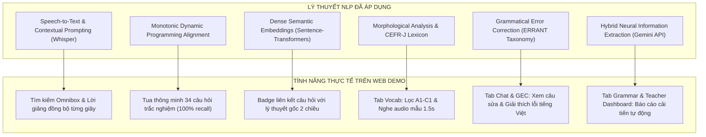

# MỤC LỤC TÀI LIỆU DỰ ÁN (DOCUMENTATION INDEX)
## EDUSYNC: NỀN TẢNG ĐỒNG BỘ ĐA PHƯƠNG THỨC & PHÂN TÍCH SƯ PHẠM BÀI GIẢNG TRỰC TUYẾN
**Môn học:** Xử lý Ngôn ngữ Tự nhiên Nâng cao (NLP501 - Master of Software Engineering)  
**Nhánh Git:** `edusync-v2`  
**Cập nhật lần cuối:** Tháng 11/2026  

---

## 1. Cấu trúc Cây Thư mục Tài liệu (`docs/`)

Toàn bộ tài liệu phân tích, kiến trúc học thuật, thiết kế kỹ thuật và hướng dẫn sử dụng của đồ án EduSync được chuẩn hóa theo chuẩn IEEE/ACM trong thư mục `docs/`:

```text
NLP501_edusync_mvp/docs/
├── README.md                              # [Bạn đang xem] Mục lục và điều hướng toàn bộ tài liệu
├── 01_project_proposal.md                 # Đề xuất Đề tài & Nghiên cứu Khả thi (Proposal)
├── 02_nlp_architecture_and_literature.md  # Cơ sở Lý thuyết NLP, Đa phương thức & Literature Review
├── 03_requirements_analysis_srs.md        # Đặc tả & Phân tích Yêu cầu Bài toán (SRS)
├── 04_detailed_design_and_qa_plan.md      # Thiết kế Chi tiết Hệ thống (SDD) & Kế hoạch QA/QC
├── 05_solution_dense_embeddings_guide.md  # Hướng dẫn Kỹ thuật Giải pháp Dense Semantic Embeddings
├── 06_user_guide_and_demo.md              # Hướng dẫn Sử dụng Web Demo cho Học sinh & Giáo viên
├── 07_feature_detailed_design_matrix.md   # Ma trận Thiết kế Chi tiết Từng Tính năng & Rà soát Mã nguồn
├── 08_presentation_slides_and_speaker_notes.md # Kịch bản Thuyết trình & Lời thoại 4 Thành viên
├── 08_presentation_slides_marp.md         # Slide thuyết trình định dạng Marp Markdown (Xuất PPTX/PDF)
└── slides.html                            # Slide thuyết trình HTML tương tác trực tiếp (Có Timer & Presenter Mode)
```

---

## 2. Tóm tắt Nội dung Từng Tài liệu

| Tên Tệp Tài liệu | Đối tượng Độc giả | Nội dung Trọng tâm |
| :--- | :--- | :--- |
| [**`01_project_proposal.md`**](file:///Users/binhpham/Documents/Study/MSE/NLP/NLP501_edusync_mvp/docs/01_project_proposal.md) | Giảng viên, Hội đồng bảo vệ | - Bối cảnh bài toán, lý do chọn đề tài.<br>- Mục tiêu nghiên cứu và phạm vi bài toán.<br>- Kế hoạch thực hiện tổng quan. |
| [**`02_nlp_architecture_and_literature.md`**](file:///Users/binhpham/Documents/Study/MSE/NLP/NLP501_edusync_mvp/docs/02_nlp_architecture_and_literature.md) | Giảng viên chấm điểm chuyên môn NLP | - Cơ sở toán học & lý thuyết NLP sâu (Whisper ASR Contextual Prompting, Levenshtein WER, Monotonic DP Sequence Alignment, Bilingual IE, CEFR profiling).<br>- Tổng quan các bài báo khoa học liên quan (*MaViLS 2024, Whisper ICML 2023, Code-Switching ASR, Cambridge EVP, ERRANT ACL 2019*).<br>- Phân tích SWOT học thuật. |
| [**`03_requirements_analysis_srs.md`**](file:///Users/binhpham/Documents/Study/MSE/NLP/NLP501_edusync_mvp/docs/03_requirements_analysis_srs.md) | Nhóm phát triển, Quản lý dự án | - Phân tích nỗi đau thực tế của Học sinh & Giáo viên.<br>- Đặc tả Yêu cầu Chức năng (FR1-FR5) & Phi chức năng (NFR1-NFR4).<br>- Sơ đồ Ca sử dụng (Use Case Diagram) & Sơ đồ Luồng Sequence.<br>- Tiêu chí chấp thuận và ma trận kiểm thử TC01–TC08. |
| [**`04_detailed_design_and_qa_plan.md`**](file:///Users/binhpham/Documents/Study/MSE/NLP/NLP501_edusync_mvp/docs/04_detailed_design_and_qa_plan.md) | Kỹ sư phần mềm, Tester | - Thiết kế kiến trúc 4 tầng chi tiết.<br>- Cấu trúc dữ liệu JSON trung gian.<br>- Thuật toán mã giả (Pseudocode) cho từng module.<br>- Lộ trình triển khai (Gantt chart) & Kế hoạch QA/QC 45+ unit tests.<br>- Ma trận quản lý rủi ro và giải pháp khắc phục. |
| [**`05_solution_dense_embeddings_guide.md`**](file:///Users/binhpham/Documents/Study/MSE/NLP/NLP501_edusync_mvp/docs/05_solution_dense_embeddings_guide.md) | Lập trình viên NLP trong nhóm | - Giải thích trực quan tại sao Keyword Matching thất bại.<br>- Cơ sở toán học của Dense Vectors & Cosine Similarity.<br>- Hướng dẫn code chi tiết file `concept_link.py` bằng `sentence-transformers`.<br>- Cách tích hợp kết quả vào Web Demo. |
| [**`06_user_guide_and_demo.md`**](file:///Users/binhpham/Documents/Study/MSE/NLP/NLP501_edusync_mvp/docs/06_user_guide_and_demo.md) | Học sinh, Giáo viên, Người dùng thử nghiệm | - Hướng dẫn khởi chạy Web Demo với 2 câu lệnh.<br>- Hướng dẫn ôn tập 5 bước cho Học sinh (Click-to-seek, Vocab audio 1.5s, GEC error review, Omnibox search).<br>- Hướng dẫn quản lý lớp học cho Giáo viên (TTT/STT gauges, Error heatmap, Action Plan). |
| [**`07_feature_detailed_design_matrix.md`**](file:///Users/binhpham/Documents/Study/MSE/NLP/NLP501_edusync_mvp/docs/07_feature_detailed_design_matrix.md) | Giảng viên chấm code, Kỹ sư phần mềm | - Ma trận thiết kế chi tiết 10 tính năng cốt lõi.<br>- Rà soát mã nguồn thực tế đối chiếu với thiết kế.<br>- Thống kê khối lượng code (~4,900 LOC) và độ phủ unit test (45/45 tests passed 100%). |
| [**`08_presentation_slides_and_speaker_notes.md`**](file:///Users/binhpham/Documents/Study/MSE/NLP/NLP501_edusync_mvp/docs/08_presentation_slides_and_speaker_notes.md) | Cả 4 thành viên nhóm báo cáo | - Kịch bản 18 slide chi tiết kèm lời thoại từng giây.<br>- Bảng phân chia timeline và nhiệm vụ 4 người.<br>- Bảng dự đoán câu hỏi phản biện Q&A và người trả lời chính. |
| [**`slides.html`**](file:///Users/binhpham/Documents/Study/MSE/NLP/NLP501_edusync_mvp/docs/slides.html) | Người thuyết trình | - Bộ slide tương tác độc lập (Standalone HTML).<br>- Tích hợp đồng hồ đếm ngược, kịch bản ẩn (Phím N), chế độ Grid (Phím O) và Fullscreen (Phím F).<br>- Có thể In/Lưu PDF (Cmd+P) chuẩn 16:9. |

---

## 3. Bản đồ Chuyển dịch từ Lý thuyết NLP sang Sản phẩm Thực tiễn



---

## 4. Hướng dẫn Dành cho Người Chấm điểm / Báo cáo Đồ án

Khi nộp đồ án hoặc báo cáo môn học NLP501, đề xuất thứ tự trình bày và tham chiếu:
1. **Trình bày Slide Đề dẫn:** Dựa trên [`01_project_proposal.md`](file:///Users/binhpham/Documents/Study/MSE/NLP/NLP501_edusync_mvp/docs/01_project_proposal.md).
2. **Báo cáo Phân tích Yêu cầu:** Trích dẫn nội dung từ [`03_requirements_analysis_srs.md`](file:///Users/binhpham/Documents/Study/MSE/NLP/NLP501_edusync_mvp/docs/03_requirements_analysis_srs.md).
3. **Báo cáo Cơ sở Lý thuyết & Thuật toán:** Sử dụng [`02_nlp_architecture_and_literature.md`](file:///Users/binhpham/Documents/Study/MSE/NLP/NLP501_edusync_mvp/docs/02_nlp_architecture_and_literature.md) và [`05_solution_dense_embeddings_guide.md`](file:///Users/binhpham/Documents/Study/MSE/NLP/NLP501_edusync_mvp/docs/05_solution_dense_embeddings_guide.md).
4. **Báo cáo Thiết kế & Đảm bảo Chất lượng:** Sử dụng [`04_detailed_design_and_qa_plan.md`](file:///Users/binhpham/Documents/Study/MSE/NLP/NLP501_edusync_mvp/docs/04_detailed_design_and_qa_plan.md).
5. **Thuyết minh & Trình chiếu Demo:** Sử dụng [`06_user_guide_and_demo.md`](file:///Users/binhpham/Documents/Study/MSE/NLP/NLP501_edusync_mvp/docs/06_user_guide_and_demo.md) và mở trực tiếp máy chủ web tại `http://localhost:8000/`.

