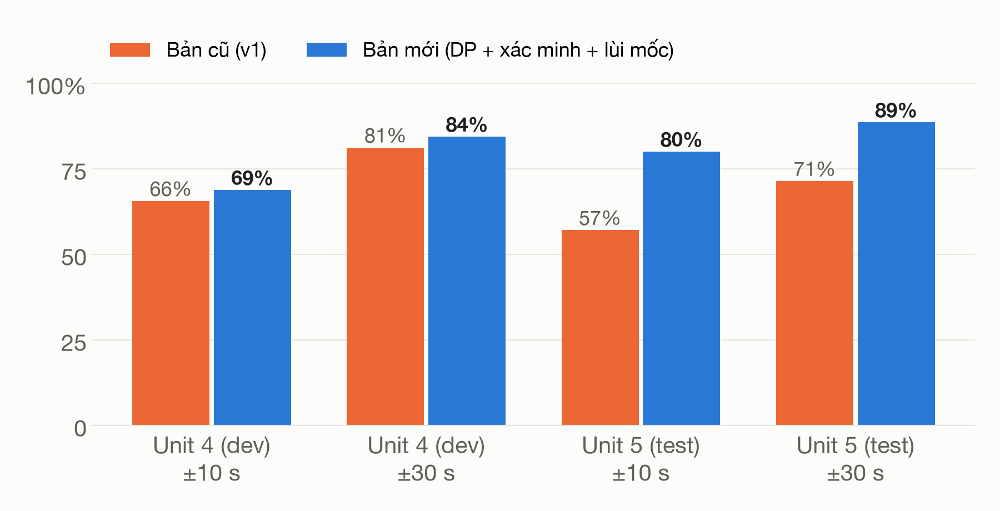
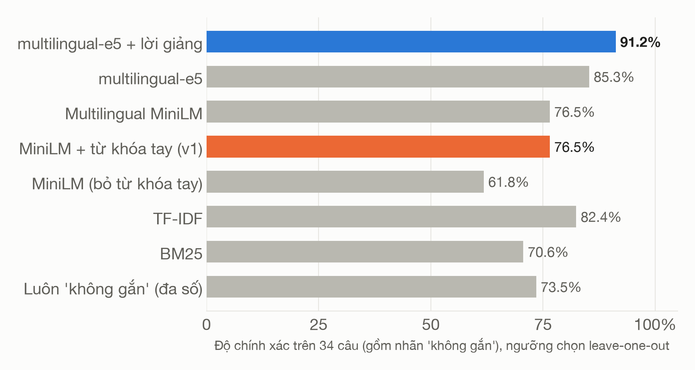
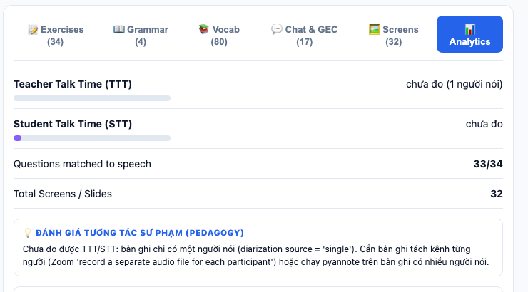
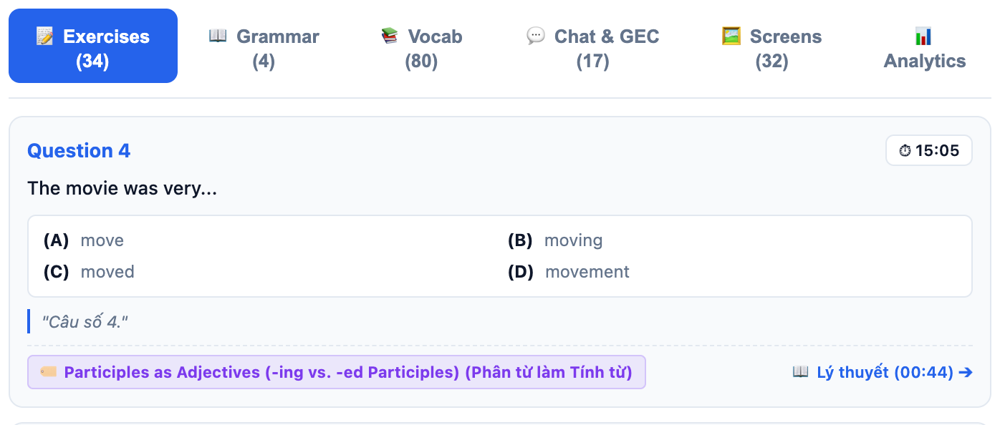

<!-- _class: lead -->

TV1 · 00:00

# EduSync
## Căn chỉnh đa phương thức và phân tích bài giảng luyện thi TOEIC (giảng Việt – Anh)

### Đề tài
- Đầu vào: video quay màn hình, lời giảng trộn mã Việt – Anh, log chat
- Đầu ra: **sổ tay học viên** (tua theo câu hỏi, chủ điểm, từ vựng) và **báo cáo cho giáo viên**
- Môn NLP501 · 20 phút trình bày + hỏi đáp

### Phân công
- **TV1** Bài toán, dữ liệu, kiến trúc
- **TV2** Nhận dạng tiếng nói, căn chỉnh câu hỏi
- **TV3** Liên kết chủ điểm, trích xuất, phát hiện lỗi
- **TV4** Báo cáo giáo viên, demo, đánh giá, kết luận

<!--
TV1: Chào thầy/cô. Nhóm em trình bày EduSync: từ bản ghi một buổi luyện thi TOEIC, hệ thống tạo sổ tay cho học viên và báo cáo cho giáo viên. Tất cả số liệu trong bài nằm ở docs/10 và tái tạo được bằng một lệnh.
-->

---

TV1

# Vấn đề
## Sau buổi học chỉ còn một video 60 phút và một file chat

### Học viên
- Muốn xem lại đoạn chữa một câu phải tua thủ công. Thời gian xem trung vị của video bài giảng chỉ khoảng **6 phút** (Guo et al., L@S 2014); các đỉnh tua tập trung quanh chỗ chuyển cảnh (Kim et al., L@S 2014).
- Ngại hỏi lại trước lớp: sợ bị đánh giá tiêu cực (Horwitz et al., 1986).

### Giáo viên
- Không biết lớp đang sai ở chủ điểm nào; lỗi trong chat trôi mất.

### Mục tiêu của EduSync
1. Bấm một câu hỏi → video tua đến lúc cô **bắt đầu chữa** câu đó
2. Câu hỏi → **chủ điểm ngữ pháp** → đoạn giảng lý thuyết
3. Từ vựng theo bậc **CEFR**, nghĩa tiếng Việt cô giảng, audio giọng cô
4. Chat: phát hiện **lỗi điển hình của người Việt**, giải thích bằng tiếng Việt
5. Báo cáo sau buổi học cho giáo viên

<!--
TV1: Ba khó khăn: tìm lại đoạn chữa bài, ngại hỏi lại, và giáo viên không có số liệu. Năm mục tiêu bên phải tương ứng với các bài toán NLP ở slide sau.
-->

---

TV1

# Bài toán NLP và dữ liệu

### Bốn bài toán con
1. **Căn chỉnh đơn điệu**: câu hỏi $e_k$ → thời điểm $t_k$, với $t_1 < t_2 < \dots$
2. **Liên kết** câu hỏi → chủ điểm $g \in G \cup \{\text{none}\}$
3. **Từ vựng**: lemma, bậc CEFR, nghĩa tiếng Việt lấy từ lời giảng
4. **Lỗi người học** trong chat: 6 mẫu chuyển di từ tiếng Việt

### Thách thức
- Lời giảng trộn mã: 73% đoạn tiếng Việt, 26% tiếng Anh
- OCR nhiễu; số câu đánh lại từ 1 ở mỗi phần
- Câu hỏi và tên chủ điểm thường không có từ chung

| Bài (ECE, CC BY) | Dài | Vai trò |
|---|---|---|
| TOEIC Starter U4 | 58′ · 34 câu | phát triển |
| TOEIC Starter U5 | 58′ · 35 câu | **kiểm tra độc lập** |
| TOEIC Starter U1 | 65′ | ASR |
| CS224N (BERT) | 54′ · 43 slide | hồi quy v1 |

Chỉ có <b>một người nói</b> (giáo viên). Chat của U4 (17 tin nhắn) là <b>dữ liệu mô phỏng</b>. Nhãn chuẩn là bản nháp do AI gán, chưa xem output hệ thống; nhóm đang kiểm tra lại với video.

<!--
TV1: Bốn bài toán con. Về dữ liệu: em nói rõ ba điểm giới hạn — một người nói, chat là mô phỏng, nhãn là bản nháp. Thuật toán được chỉnh trên Unit 4 và chỉ chạy một lần trên Unit 5 để kiểm tra.
-->

---

TV1

# Kiến trúc
## Bốn điểm kết hợp giữa các luồng dữ liệu (①–④)

<svg viewBox="0 0 1180 420" width="1170" height="400" xmlns="http://www.w3.org/2000/svg" font-family="Helvetica Neue, Arial" font-size="15">
  <defs><marker id="a" viewBox="0 0 10 10" refX="9" refY="5" markerWidth="7" markerHeight="7" orient="auto-start-reverse"><path d="M0,0 L10,5 L0,10 z" fill="#8a8980"/></marker></defs>
  <g fill="#eef4fc" stroke="#2a78d6" stroke-width="1.5">
    <rect x="10" y="40" width="170" height="56" rx="8"/><rect x="10" y="190" width="170" height="56" rx="8"/><rect x="10" y="340" width="170" height="56" rx="8"/>
  </g>
  <g fill="#1f1f1d" font-weight="600"><text x="95" y="73" text-anchor="middle">Video màn hình</text><text x="95" y="215" text-anchor="middle">Lời giảng</text><text x="95" y="234" text-anchor="middle" font-weight="400" font-size="13">Việt – Anh</text><text x="95" y="365" text-anchor="middle">Log chat</text><text x="95" y="384" text-anchor="middle" font-weight="400" font-size="13">(mô phỏng)</text></g>
  <g fill="#f4f4f1" stroke="#b9b8b0" stroke-width="1.2">
    <rect x="240" y="20" width="230" height="50" rx="8"/><rect x="240" y="92" width="230" height="50" rx="8"/><rect x="240" y="190" width="230" height="56" rx="8"/><rect x="240" y="268" width="230" height="50" rx="8"/><rect x="240" y="340" width="230" height="56" rx="8"/>
    <rect x="550" y="40" width="250" height="56" rx="8"/><rect x="550" y="118" width="250" height="56" rx="8"/><rect x="550" y="196" width="250" height="56" rx="8"/><rect x="550" y="274" width="250" height="50" rx="8"/><rect x="550" y="340" width="250" height="56" rx="8"/>
  </g>
  <g fill="#1f1f1d" text-anchor="middle">
    <text x="355" y="42">Tách màn hình + OCR</text><text x="355" y="60" font-size="12" fill="#5f5e58">extract_screens.py</text>
    <text x="355" y="114">Bóc câu hỏi A–D</text><text x="355" y="132" font-size="12" fill="#5f5e58">exercises.py</text>
    <text x="355" y="214">Whisper + nhãn vi/en</text><text x="355" y="234" font-size="12" fill="#5f5e58">transcribe.py</text>
    <text x="355" y="290">Phân vai người nói</text><text x="355" y="308" font-size="12" fill="#5f5e58">diarize.py</text>
    <text x="355" y="364">Ẩn danh S1…SN + đáp án</text><text x="355" y="384" font-size="12" fill="#5f5e58">chat_parser.py</text>
    <text x="675" y="64">Căn chỉnh câu hỏi (DP)</text><text x="675" y="84" font-size="12" fill="#5f5e58">exercise_align.py</text>
    <text x="675" y="142">Liên kết câu hỏi ↔ chủ điểm</text><text x="675" y="162" font-size="12" fill="#5f5e58">concept_link.py · e5 + lời giảng</text>
    <text x="675" y="220">Chủ điểm + neo mốc lý thuyết</text><text x="675" y="240" font-size="12" fill="#5f5e58">neural_ie.py · Gemini + e5</text>
    <text x="675" y="296">Từ vựng CEFR + audio</text><text x="675" y="314" font-size="12" fill="#5f5e58">vocab.py</text>
    <text x="675" y="364">Phát hiện 6 nhóm lỗi</text><text x="675" y="384" font-size="12" fill="#5f5e58">feedback.py</text>
  </g>
  <g fill="#e8f6ef" stroke="#1baf7a" stroke-width="1.5"><rect x="890" y="90" width="270" height="70" rx="8"/><rect x="890" y="290" width="270" height="70" rx="8"/></g>
  <g fill="#1f1f1d" text-anchor="middle" font-weight="600"><text x="1025" y="120">Sổ tay học viên</text><text x="1025" y="320">Báo cáo giáo viên</text></g>
  <g fill="#5f5e58" text-anchor="middle" font-size="12"><text x="1025" y="140">demo/index.html</text><text x="1025" y="340">teacher_analytics.py</text></g>
  <g stroke="#8a8980" stroke-width="1.4" fill="none" marker-end="url(#a)">
    <path d="M180,60 L238,48"/><path d="M355,70 L355,90"/><path d="M180,218 L238,218"/><path d="M180,230 L238,290"/><path d="M180,368 L238,368"/>
    <path d="M470,117 L548,74"/><path d="M470,210 L548,82"/><path d="M470,224 L548,226"/><path d="M470,236 L548,296"/><path d="M470,368 L548,368"/>
    <path d="M675,196 L675,176"/><path d="M800,66 L888,112"/><path d="M800,146 L888,128"/><path d="M800,298 L888,150"/><path d="M800,368 L888,336"/><path d="M800,160 L888,310"/>
  </g>
  <path d="M470,45 H490 V212 H472" stroke="#2a78d6" stroke-width="1.6" stroke-dasharray="6 4" fill="none" marker-end="url(#a)"/>
  <path d="M675,96 L675,116" stroke="#2a78d6" stroke-width="2" fill="none" marker-end="url(#a)"/>
  <g font-weight="700" font-size="15" fill="#fff">
    <circle cx="502" cy="130" r="12" fill="#2a78d6"/><text x="502" y="135" text-anchor="middle">1</text>
    <circle cx="522" cy="96" r="12" fill="#2a78d6"/><text x="522" y="101" text-anchor="middle">2</text>
    <circle cx="700" cy="106" r="12" fill="#2a78d6"/><text x="700" y="111" text-anchor="middle">3</text>
    <circle cx="845" cy="232" r="12" fill="#2a78d6"/><text x="845" y="237" text-anchor="middle">4</text>
  </g>
</svg>

① chữ OCR của màn hình đang chiếu làm gợi ý cho ASR (thử nghiệm) · ② thời điểm màn hình + lời giảng → căn chỉnh · ③ lời giảng trong đoạn chữa câu → liên kết chủ điểm · ④ lỗi trong chat → câu hỏi → chủ điểm yếu trong báo cáo

<!--
TV1: Ba luồng vào: video, lời giảng, chat. Điểm đáng chú ý là bốn chỗ các luồng kết hợp với nhau, đánh số 1 đến 4. Ví dụ số 3: lời cô giảng khi chữa một câu giúp xác định câu đó thuộc chủ điểm nào. Em mời TV2.
-->

---

TV1

# Nghiên cứu liên quan

| Công trình | Ý chính | EduSync dùng / khác gì |
|---|---|---|
| Anderer et al. 2024, MaViLS (arXiv 2409.16765) | Căn chỉnh video ↔ slide bằng ASR + OCR + đặc trưng hình ảnh, quy hoạch động | Không có slide gốc; căn chỉnh tới **từng câu hỏi** |
| Radford et al., ICML 2023 (Whisper) | ASR đa ngữ quy mô lớn, điều kiện hóa bằng văn bản đi trước | ASR lời giảng trộn mã; thử gợi ý từ màn hình |
| Peng et al., Interspeech 2023 | Dùng prompt để điều khiển Whisper zero-shot | Cơ sở cho gợi ý theo ngữ cảnh màn hình |
| Reimers & Gurevych 2019; Wang et al. 2022/2024 (E5, mE5) | Bi-encoder câu; embedding đa ngữ | Liên kết câu hỏi tiếng Anh ↔ chủ điểm giảng bằng tiếng Việt |
| Bryant, Felice & Briscoe, ACL 2017 (ERRANT) | Tự động gán loại lỗi cho cặp câu gốc / câu sửa | Gán loại lỗi; nhãn kiểm chứng bằng errant 3.0.2 |
| CEFR-J Wordlist; English Vocabulary Profile | Từ vựng phân bậc A1–C2 | Từ điển 8.845 mục (CEFR-J + Octanove) |

<!--
TV1: Gần nhất với nhóm là MaViLS: căn chỉnh video với slide bằng quy hoạch động. Khác biệt của nhóm là không có slide gốc và cần căn chỉnh tới từng câu hỏi trắc nghiệm.
-->

---

TV2 · 04:30

# Nhận dạng lời giảng trộn mã Việt – Anh

### Cách làm
- `faster-whisper large-v3-turbo`, chế độ đa ngữ, chạy trên máy cá nhân
- Gán ngôn ngữ cho từng đoạn theo **mật độ chữ có dấu**: > 0,3 → `vi`; 0 → `en`; còn lại → `mixed`
- Thử nghiệm: lấy từ tiếng Anh trên **màn hình đang chiếu** (OCR) làm `hotwords` cho Whisper ①

### Trạng thái đánh giá
- **Chưa có WER**: 5 clip tham chiếu (10 phút) vẫn là bản nháp, chưa sửa tay
- Pipeline hiện dùng bản **không gợi ý**

Chỉ số gián tiếp (Unit 4, toàn bài)

| Cấu hình | Lặp liên tiếp | Từ trên màn hình được nói ra |
|---|---|---|
| Không gợi ý | 6 | 47% |
| Cắt theo màn hình (đối chứng) | 3 | 48% |
| Gợi ý = từ | 20 | 52% |
| Gợi ý = dòng | 27 | 52% |

Gợi ý tăng proxy khoảng 4 điểm nhưng làm tăng số đoạn lặp (dấu hiệu ảo giác), và proxy có thể tăng chỉ vì Whisper chép lại từ gợi ý. Cần WER thật mới kết luận được.

<!--
TV2: Bọn em chưa có WER, vì bản chép tham chiếu chưa sửa tay xong. Chỉ số gián tiếp cho thấy gợi ý từ màn hình có tác dụng hai chiều: nhận được nhiều từ trên màn hình hơn, nhưng số đoạn lặp tăng. Vì vậy pipeline chưa bật gợi ý.
-->

---

TV2

# Căn chỉnh câu hỏi ↔ lời giảng
## Quy hoạch động đơn điệu với khẩu lệnh có xác minh ngữ cảnh

s(k, j) = 25·trigger + 2·|từ chung| + 3·đang_chiếu

- **trigger**: đoạn $j$ nói "câu (số/thứ) N", "câu hỏi số N", "câu thứ tư"; loại "text / page / part / trang N"
- **Xác minh**: nếu 60 s sau đó không có từ nào của câu hỏi thì trigger chỉ được **2** điểm thay vì 25

D[k][j] = s(k,j) + max(0, max D[k′][j′]) với k′ &lt; k, t(j′) &lt; t(j)

- Tối ưu toàn cục, cho phép bỏ qua câu; sau đó **lùi mốc** về các đoạn ngay trước có chung từ với câu hỏi

### Tình huống thật ở Unit 4
Màn hình chiếu **Exercise B**, nhưng cô chữa **Exercise A trong sách** trước:

> "…chúng ta sẽ bước vào làm câu số 1." (03:09): nói về Exercise A, không có từ nào của câu B1

Bản cũ gán câu B1 vào 03:09 (lệch 216 s). Bản mới bỏ qua khẩu lệnh không được xác minh này và chọn 07:05, trong đoạn cô chữa câu B1 (lệch 21 s so với nhãn 06:45).

<!--
TV2: Điểm của mỗi đoạn gồm khẩu lệnh "câu N", số từ trùng với câu hỏi, và việc màn hình câu đó có đang chiếu không. Thay đổi quan trọng nhất là xác minh khẩu lệnh: "câu số 1" chỉ được tính đủ điểm nếu ngay sau đó cô nói về đúng câu này. Bộ giải mã là DP đơn điệu tối ưu toàn cục.
-->

---

TV2

# Kết quả căn chỉnh

### Trên bài kiểm tra độc lập (U5)
- Đúng trong ±10 s: **57% → 80%**
- Sai số trung bình: **28,5 s → 8,1 s**
- Đảo thứ tự câu: **2 → 0**

### Ghi chú trung thực
- Trên cả hai bài, **DP chọn giống greedy**; phần cải thiện đến từ cách tính điểm, bước lùi mốc và cách xử lý câu không khớp
- Lỗi còn lại chủ yếu ở chỗ trống trong đoạn văn (Part 6/7): cô đọc liền cả đoạn nên khó xác định lúc bắt đầu
- Chuẩn so sánh: chỉ dùng thời điểm màn hình đạt 49% (±10 s)

<!--
TV2: Thuật toán được chỉnh trên Unit 4 và chỉ chạy một lần trên Unit 5. Trên Unit 5, độ chính xác trong 10 giây tăng từ 57 lên 80 phần trăm. Em nói rõ: DP và greedy cho cùng kết quả trên hai bài này. Em mời TV3.
-->

---

TV3 · 09:00

# Liên kết câu hỏi ↔ chủ điểm ngữ pháp

### Vấn đề
"The movie was very ___ (A) move (B) moving (C) moved" ↔ *Participles as Adjectives*: không có từ chung.

### Bản cũ (v1)
- `all-MiniLM-L6-v2`: chỉ hiểu tiếng Anh, trong khi phần giải thích chủ điểm bằng tiếng Việt
- Ghép thêm **từ khóa viết tay**, trong đó có cả từ đáp án (`central`, `luxury`, `shined`…) → **rò rỉ nhãn**
- Bỏ từ khóa: 76,5% → **61,8%**

### Bản hiện tại

score(q, c) = ½ [cos(E(câu hỏi), E(c)) + cos(E(lời giảng khi chữa q), E(c))]

- E = `multilingual-e5-small` (đa ngữ, 384 chiều)
- Lời giảng ③: *"chọn động từ thêm ing hay thêm ed để làm tính từ"*, *"công thức nhờ vả"*
- Gắn nếu score ≥ 0,835, ngược lại là "không gắn" (câu từ vựng / đọc hiểu)
- Không dùng từ khóa viết tay; dự phòng bằng TF-IDF

<!--
TV3: Bản cũ đạt điểm nhờ từ khóa viết tay có chứa cả đáp án; bỏ đi thì tụt xuống 62 phần trăm. Bản mới dùng mô hình đa ngữ, và quan trọng là dùng lời cô giảng trong lúc chữa câu đó — đây chính là tín hiệu đa phương thức.
-->

---

TV3

# Kết quả liên kết chủ điểm (Unit 4, 34 câu)

### Đầu ra thực tế trong demo

| | v1 | Hiện tại |
|---|---|---|
| Độ chính xác | 58,8% | **91,2%** |
| Badge đúng (precision) | 39,1% | **90,0%** |
| Câu có chủ điểm được gắn (recall) | 66,7% | **75,0%** |
| Số badge | 23 | 10 |

22/34 câu là từ vựng / đọc hiểu nên "luôn không gắn" đã đạt 73,5%. Mô hình và ngưỡng được chọn trên chính 34 câu này, và một số ví dụ chủ điểm do Gemini sinh chép gần nguyên câu hỏi, nên kết quả có thể lạc quan; chưa có tập kiểm tra độc lập cho bài toán này.

<!--
TV3: Cần so với mốc 73,5 phần trăm của cách "luôn không gắn", vì đa số câu là từ vựng hoặc đọc hiểu. Bản cũ chỉ hơn mốc này 3 điểm. Trong demo cũ, 61 phần trăm badge gắn sai; bản mới còn 1 trên 10.
-->

---

TV3

# Trích xuất chủ điểm và từ vựng

### Chủ điểm: Gemini (JSON mode) + neo mốc
Gemini chỉ thấy khoảng 30 đoạn lấy mẫu nên mốc thời gian nó trả về là đoán. Neo lại vào cửa sổ lời giảng giống chủ điểm nhất (e5):

| Chủ điểm | Nhãn | v1 | Hiện tại |
|---|---|---|---|
| Participles | 00:24 | 15:06 | **00:44** |
| Causative | 15:46 | 17:14 | **15:38** |
| Passive / require that | 13:16 | 55:02 | **13:18** |
| Noun modifiers | 07:20 | 08:13 | **07:35** |

Sai số trung bình: **882,5 s → 11,2 s**. Khi không có mạng: dùng bảng chủ điểm TOEIC và tìm từ khóa trong lời giảng.

### Từ vựng (`vocab.py`)
- Lemma 2 lớp (bảng bất quy tắc + bỏ hậu tố)
- Tra **CEFR-J + Octanove** (8.845 mục)
- Lọc từ tiếng Việt trùng mặt chữ tiếng Anh: *hay, con, cho, ra, nam, sau…*
- Lấy nghĩa từ lời giảng: "X là / nghĩa là …"

**Unit 4:** 80 từ (A1 26 · A2 26 · B1 18 · B2 9 · C1 1); 52 từ có nghĩa tiếng Việt; 79 clip audio 0,7–2,2 s giọng cô

Độ đúng của nghĩa và audio chưa được đánh giá.

<!--
TV3: Mốc "Lý thuyết" trước đây là do Gemini đoán và lệch gần 42 phút với phần bị động. Neo lại bằng embedding giảm sai số trung bình còn 11 giây.
-->

---

TV3

# Phát hiện lỗi người học trong chat
## Luật cho 6 mẫu lỗi chuyển di từ tiếng Việt; nhãn loại lỗi kiểm chứng bằng errant 3.0.2

| Nhóm | Ví dụ → sửa | Loại ERRANT | Recall |
|---|---|---|---|
| Thừa *be* | I am agree → I agree | U:VERB:TENSE | 50% |
| -ing / -ed | the movie was moved → moving | R:VERB:FORM | 88% |
| Nhờ vả | have my car repair → repaired | R:VERB:FORM | 75% |
| Modal + to | should to increase → should increase | U:VERB:FORM | 100% |
| Hòa hợp chủ vị | it make → it makes | R:VERB:SVA | 63% |
| Thiếu *do* | Why we use…? → Why do we use…? | M:VERB:TENSE | 43% |

**Tập độc lập 70 câu** (viết riêng, không xem luật): v1 P 90% / R 21% → hiện tại **P 100% / R 72,7% / F1 84,2%**

Không phải mô hình GEC tổng quát: bỏ qua mọi lỗi ngoài 6 nhóm. Tên học viên được ẩn danh thành S1…SN. Trước khi chốt, tập 70 câu được xem một lần để sửa 3 lỗi cài đặt.

<!--
TV3: Bản cũ khớp nguyên văn từng câu chat nên tỉ lệ 6/6 không có ý nghĩa. Bản mới dùng luật tổng quát và được đo trên 70 câu viết độc lập: precision 100 phần trăm, recall 73 phần trăm. Nhãn ERRANT chạy bằng thư viện chính thức. Em mời TV4.
-->

---

TV4 · 14:30

# Báo cáo cho giáo viên

- **Phân bố lỗi** trong chat theo 6 nhóm
- **Chủ điểm yếu nhất**: lỗi trong chat → câu hỏi (theo `exercise_id`) → chủ điểm. Unit 4: *Participles* (2 tin nhắn, câu 4 và 6)
- **Gợi ý buổi sau**: câu mẫu điền từ dữ liệu (không dùng LLM), mỗi dòng nêu căn cứ
- **TTT / STT: "chưa đo"**, vì bản ghi chỉ có một người nói. Cần ghi âm tách kênh từng người (Zoom) hoặc dùng pyannote

Bản cũ ghi TTT 100% / STT 0% và kế hoạch viết sẵn; demo cũ còn hiển thị cứng "tỷ lệ căn chỉnh 95,6%". Cả ba đã được bỏ.

<!--
TV4: Báo cáo giờ chỉ hiển thị những gì tính được từ dữ liệu. Với bản ghi một người nói, hệ thống ghi rõ là chưa đo được tỉ lệ nói, thay vì báo 100/0.
-->

---

TV4

# Demo

Bên trái của giao diện là video + transcript chạy theo; bên phải là danh sách câu hỏi với badge chủ điểm.

1. Tab **Exercises**: bấm Question 4 (*The movie was very…*) → video tua đến 15:05, lúc cô bắt đầu chữa
2. Badge *Participles* → **Lý thuyết (00:44)**: tua về đoạn giảng đầu giờ
3. Tab **Vocab**: lọc theo CEFR, nghe audio
4. Tab **Chat & GEC**: lỗi, câu sửa, giải thích tiếng Việt
5. Tab **Analytics** (mở thẳng bằng `?tab=tab-stats`)

Chạy: <code>python demo/prepare.py --lesson lessons/ece-toeic-starter-u4</code> rồi <code>cd demo && python -m RangeHTTPServer 8000</code>. Có video quay sẵn để dự phòng.

<!--
TV4: (Demo trực tiếp khoảng 2 phút.) Question 4 "The movie was very…": bấm vào, video tua đến 15:05; badge Participles tua về 00:44. Sau đó vào tab Vocab, Chat & GEC và Analytics.
-->

---

TV4

# Đánh giá tái lập được

### Một lệnh tạo lại mọi số liệu

python eval/run_all.py

- Baseline v1 chạy lại từ commit `73d9a62`
- Căn chỉnh: chỉnh trên U4, kiểm tra trên U5
- Hồi quy CS224N: 9/10 mốc chuyển slide, sai số TB 0,6 s
- `pytest`: **71/71** test; test không còn ghi vào dữ liệu bài học

### Nhãn chuẩn (đều là bản nháp)

| Bộ nhãn | Quy mô |
|---|---|
| Mốc chữa câu U4 / U5 | 32 / 35 câu |
| Mốc lý thuyết U4 | 4 chủ điểm |
| Chủ điểm của câu hỏi U4 | 34 câu |
| Câu kiểu chat (độc lập) | 70 câu (54 có lỗi, 16 đúng) |
| Bản chép ASR | 5 × 2 phút, **chưa sửa** |

Nhãn do AI gán, không xem output hệ thống; nhóm đang kiểm tra lại với video trước khi bảo vệ.

<!--
TV4: Mọi con số trong bài đều tái tạo được bằng một lệnh, baseline được chạy lại từ commit cũ. Nhãn chuẩn hiện là bản nháp; nhóm đang đối chiếu với video.
-->

---

TV4

# Hạn chế và hướng phát triển

### Hạn chế
- Dữ liệu nhỏ: 2 bài có nhãn, 1 giáo viên, 1 người nói
- Nhãn chuẩn do AI gán, chưa được người kiểm tra hết
- Chat là dữ liệu mô phỏng
- Chưa đo WER; gợi ý từ màn hình chưa chứng minh được hiệu quả
- Ngưỡng liên kết chủ điểm chọn trên tập phát triển
- Phát hiện lỗi dựa trên luật, chỉ 6 mẫu

### Hướng phát triển
- Sửa 5 clip ASR → WER thật cho 3 cấu hình
- Thu bản ghi lớp thật: tách kênh từng người + chat thật → đo TTT/STT
- Tập kiểm tra độc lập cho liên kết chủ điểm (U5)
- Phát hiện lỗi bằng mô hình sửa câu (seq2seq / LLM) + errant để gán loại
- Mở rộng sang bài giảng IELTS

<!--
TV4: Nhóm nêu rõ các giới hạn. Việc đầu tiên là sửa tay 5 clip để có WER thật, và thu bản ghi lớp học thật.
-->

---

TV4

# Kết luận

1. **Căn chỉnh câu hỏi ↔ lời giảng** với khẩu lệnh có xác minh ngữ cảnh: **80%** câu đúng trong ±10 s trên bài kiểm tra độc lập (v1: 57%)
2. **Lời giảng làm tín hiệu liên kết chủ điểm** (e5 đa ngữ): **91,2%** trên 34 câu (v1: 58,8%), không dùng từ khóa viết tay
3. **Đánh giá tái lập được**: nhãn, script, baseline; số liệu chưa đo được ghi rõ là chưa đo

### Tài liệu
- `docs/10_evaluation_results.md`: toàn bộ số liệu
- `eval/run_all.py`: tái tạo số liệu
- `demo/`: sổ tay học viên và báo cáo giáo viên

Hỏi – đáp

<!--
TV4: Ba đóng góp chính, mỗi đóng góp đi kèm số liệu đo được. Cảm ơn thầy/cô, nhóm em sẵn sàng trả lời câu hỏi.
-->
