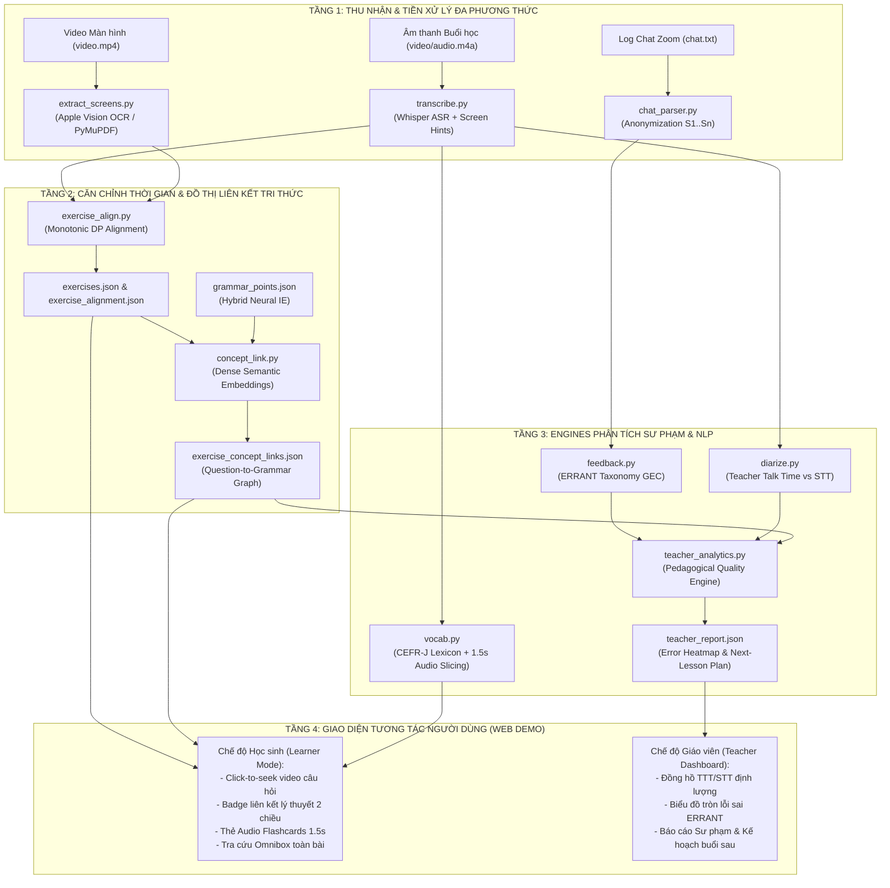
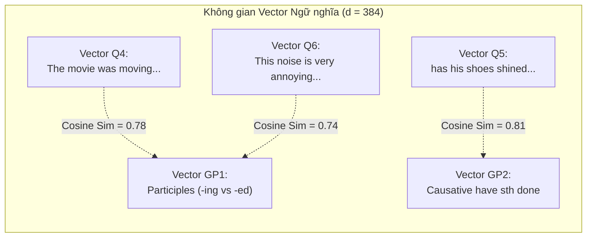
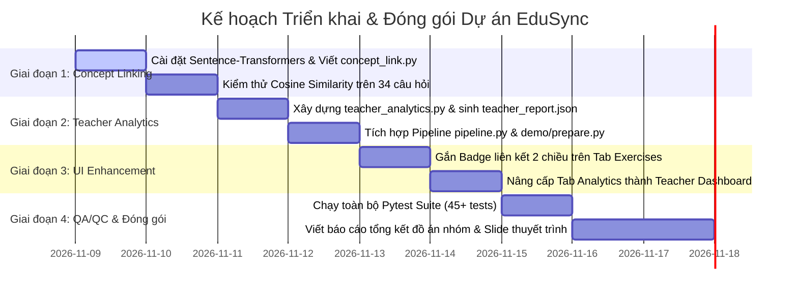

# TÀI LIỆU THIẾT KẾ CHI TIẾT & KẾ HOẠCH KIỂM SOÁT CHẤT LƯỢNG (SDD & QA/QC)
## EDUSYNC: NỀN TẢNG ĐỒNG BỘ ĐA PHƯƠNG THỨC & PHÂN TÍCH SƯ PHẠM BÀI GIẢNG TRỰC TUYẾN
**Môn học:** Xử lý Ngôn ngữ Tự nhiên Nâng cao (NLP501 - Master of Software Engineering)  
**Nhánh Git:** `edusync-v2`  
**Phiên bản:** 2.0  
**Ngày phát hành:** Tháng 11/2026  

---

## PHẦN I: THIẾT KẾ CHI TIẾT HỆ THỐNG (SOFTWARE DETAILED DESIGN - SDD)

### 1. Kiến trúc Tổng thể Hệ thống (System Architecture)

EduSync được thiết kế theo kiến trúc phân tầng dạng đường ống (Layered Pipeline Architecture), xử lý đồng thời 4 luồng dữ liệu đa phương thức từ lớp học trực tuyến: **Âm thanh Lời giảng**, **Hình ảnh Slide/Màn hình**, **Văn bản Đề bài trắc nghiệm**, và **Nhật ký Chat của học viên**.



---

### 2. Thiết kế Chi tiết Phân hệ Liên kết Khái niệm (Question-to-Concept Linking)

#### 2.1. Bản chất & Cơ chế Hoạt động của Nhúng Vector Ngữ nghĩa (Dense Semantic Embeddings)
- **Vấn đề cần giải quyết:** Đề bài câu hỏi trắc nghiệm thường sử dụng từ ngữ cụ thể (ví dụ: *"The movie was moved because it made me cry"*), trong khi tài liệu lý thuyết dùng thuật ngữ trừu tượng (ví dụ: *"Participles as Adjectives: Present Participle -ing describes nature, Past Participle -ed describes feelings"*). So khớp từ khóa chính xác (Exact Keyword Matching) sẽ thất bại vì không có từ nào trùng nhau.
- **Giải pháp:** Sử dụng mô hình Pre-trained Dense Text Embedding (`sentence-transformers/all-MiniLM-L6-v2` hoặc `BAAI/bge-base-en-v1.5`) để ánh xạ cả câu hỏi và lý thuyết vào cùng một không gian vector $d$-chiều ($d=384$ hoặc $768$). Tại không gian này, khoảng cách hình học biểu thị độ tương đồng ngữ nghĩa: các câu hỏi về cảm xúc/tính chất sẽ tự động nằm gần vector của chủ điểm Phân từ `-ing/-ed`.



#### 2.2. Lược đồ Dữ liệu Đầu vào & Đầu ra (Data Schemas)

**Tệp đầu vào 1: `grammar_points.json` (Trích xuất từ lý thuyết):**
```json
[
  {
    "id": "gp_1",
    "title": "Participles as Adjectives (-ing vs. -ed Participles)",
    "formula": "S + be/linking verb + V-ing (chủ động/bản chất) / V-ed (bị động/cảm giác)",
    "explanation_vi": "Phân từ hiện tại (-ing) chỉ tính chất sự vật gây ra tác động. Phân từ quá khứ (-ed) chỉ cảm xúc người nhận tác động.",
    "keywords": ["participle", "adjective", "boring", "bored", "moving", "annoying", "-ing", "-ed"],
    "theory_timestamp": 49.0,
    "theory_time_str": "00:49"
  }
]
```

**Tệp đầu vào 2: `exercises.json` (Trích xuất từ màn hình đề bài):**
```json
[
  {
    "id": "q_4",
    "number": 4,
    "stem": "I think the movie was _____ because it made me cry.",
    "options": {"A": "moved", "B": "moving", "C": "move", "D": "movement"},
    "start": 906.9,
    "time_str": "15:06"
  }
]
```

**Tệp đầu ra mong đợi: `exercise_concept_links.json` (Do `concept_link.py` sinh ra):**
```json
[
  {
    "question_id": "q_4",
    "question_number": 4,
    "grammar_point_id": "gp_1",
    "grammar_title": "Participles as Adjectives (-ing vs. -ed Participles)",
    "similarity_score": 0.784,
    "confidence": "HIGH",
    "practice_timestamp": 906.9,
    "practice_time_str": "15:06",
    "theory_timestamp": 49.0,
    "theory_time_str": "00:49",
    "recommendation": "Xem lý thuyết phân từ tại 00:49 nếu bạn nhầm lẫn giữa tính từ đuôi -ing và -ed."
  }
]
```

#### 2.3. Thuật toán Liên kết Chi tiết (Pseudocode)

```python
# Thuật toán: Dense Semantic Concept Linking
from sentence_transformers import SentenceTransformer, util
import numpy as np

def link_questions_to_grammar(exercises, grammar_points, threshold=0.45):
    # 1. Tải mô hình cục bộ (chỉ 80MB, tải 1 lần lưu cache)
    model = SentenceTransformer('all-MiniLM-L6-v2')
    
    # 2. Xây dựng chuỗi văn bản đại diện cho Câu hỏi
    # Kết hợp: Stem + Các phương án lựa chọn
    q_texts = []
    for ex in exercises:
        opts_str = " ".join([f"{k}. {v}" for k, v in ex.get("options", {}).items()])
        q_texts.append(f"{ex.get('stem', '')} Options: {opts_str}")
        
    # 3. Xây dựng chuỗi văn bản đại diện cho Chủ điểm Ngữ pháp
    # Kết hợp: Tiêu đề + Công thức + Giải thích + Từ khóa
    gp_texts = []
    for gp in grammar_points:
        kw_str = " ".join(gp.get("keywords", []))
        gp_texts.append(f"{gp.get('title', '')}. Formula: {gp.get('formula', '')}. "
                        f"Explanation: {gp.get('explanation_vi', '')}. Keywords: {kw_str}")
        
    # 4. Nhúng đồng thời thành các ma trận vector L2-normalized
    Q_emb = model.encode(q_texts, convert_to_tensor=True, normalize_embeddings=True)  # Shape: [N, 384]
    GP_emb = model.encode(gp_texts, convert_to_tensor=True, normalize_embeddings=True) # Shape: [M, 384]
    
    # 5. Tính ma trận Cosine Similarity: S = Q * GP^T
    sim_matrix = util.cos_sim(Q_emb, GP_emb).cpu().numpy()  # Shape: [N, M]
    
    # 6. Gán nhãn Argmax có kiểm tra ngưỡng tin cậy tau
    links = []
    for i, ex in enumerate(exercises):
        best_idx = int(np.argmax(sim_matrix[i]))
        best_score = float(sim_matrix[i][best_idx])
        
        if best_score >= threshold:
            best_gp = grammar_points[best_idx]
            links.append({
                "question_id": ex["id"],
                "question_number": ex["number"],
                "grammar_point_id": best_gp["id"],
                "grammar_title": best_gp["title"],
                "similarity_score": round(best_score, 3),
                "confidence": "HIGH" if best_score >= 0.6 else "MEDIUM",
                "practice_timestamp": ex["start"],
                "theory_timestamp": best_gp.get("theory_timestamp", 0.0)
            })
        else:
            links.append({
                "question_id": ex["id"],
                "question_number": ex["number"],
                "grammar_point_id": None,
                "grammar_title": "General TOEIC Practice",
                "similarity_score": round(best_score, 3),
                "confidence": "LOW"
            })
    return links
```

---

### 3. Thiết kế Chi tiết Báo cáo Sư phạm cho Giáo viên (Teacher Pedagogical Analytics)

#### 3.1. Thuật toán Tổng hợp Chỉ số Buổi học (`teacher_analytics.py`)
Mô hình tự động tổng hợp dữ liệu từ 3 nguồn:
1. `speakers.json` $\to$ Tính toán tổng số giây nói của giáo viên ($T_{\text{teacher}}$) và học sinh ($T_{\text{student}}$).
2. `chat_feedback.json` $\to$ Gom nhóm các lỗi sai theo phân loại ERRANT, tính tỷ lệ % của từng loại lỗi.
3. `exercise_concept_links.json` $\to$ Nhận diện chủ điểm ngữ pháp nào có số lượng học sinh trả lời sai nhiều nhất.

#### 3.2. Cấu trúc Dữ liệu `teacher_report.json`:
```json
{
  "class_meta": {
    "lesson_id": "ece-toeic-starter-u4",
    "duration_seconds": 3410.0,
    "total_students_active": 5,
    "total_chat_messages": 17
  },
  "interaction_health": {
    "teacher_talk_time_pct": 98.2,
    "student_talk_time_pct": 1.8,
    "assessment": "Teacher-dominated. Cần tăng cường gọi học sinh tương tác mic trong các bài đọc dài."
  },
  "error_distribution": [
    {"type": "R:ADJ:PARTICIPLE", "count": 2, "pct": 33.3, "desc": "Nhầm lẫn tính từ đuôi -ing/-ed"},
    {"type": "R:VERB:FORM", "count": 1, "pct": 16.7, "desc": "Sai dạng phân từ câu sai khiến have sth done"},
    {"type": "U:VERB:BE", "count": 1, "pct": 16.7, "desc": "Thừa to be (chuyển di ngôn ngữ 'I am agree')"},
    {"type": "U:PREP", "count": 1, "pct": 16.7, "desc": "Thừa giới từ sau modal verb (should to increase)"},
    {"type": "M:VERB:AUX", "count": 1, "pct": 16.7, "desc": "Thiếu trợ động từ đảo ngữ trong câu hỏi"}
  ],
  "weakest_concept": {
    "concept_id": "gp_1",
    "title": "Participles as Adjectives (-ing vs. -ed)",
    "student_error_count": 2,
    "affected_questions": [4, 6]
  },
  "next_lesson_action_plan": [
    "1. Dành 5 phút đầu giờ kiểm tra lại quy tắc tính từ đuôi -ing (bản chất sự vật) vs -ed (cảm xúc con người).",
    "2. Nhắc lại cấu trúc câu sai khiến have + vật + V3/ed trước khi làm bài tập tổng hợp.",
    "3. Giảm nhịp độ giảng ở các bài đọc Part 6 dài, dành thêm 3-5 phút cho học sinh tự tìm từ khóa."
  ]
}
```

---

## PHẦN II: KẾ HOẠCH THỰC HIỆN & KIỂM SOÁT CHẤT LƯỢNG (QA/QC PLAN)

### 1. Kế hoạch Triển khai (Implementation Roadmap)

Lộ trình triển khai được chia làm 4 giai đoạn rõ ràng:



---

### 2. Kế hoạch Kiểm soát Chất lượng (Quality Assurance & Control - QA/QC)

#### 2.1. Bộ Chỉ số Hiệu năng & Chất lượng Mục tiêu (KPIs & Metrics)

| Hạng mục Đo lường | Chỉ số Đo lường (Metric) | Giá trị Mục tiêu | Phương pháp Kiểm chứng |
| :--- | :--- | :--- | :--- |
| **Căn chỉnh Câu hỏi Bài tập** | Recall & Precision | **100%** (34/34 câu) | Kiểm tra `exercise_alignment.json`, 0 timestamp rỗng hoặc trùng lặp. |
| **Liên kết Khái niệm Ngữ pháp** | Top-1 Concept Accuracy | **$\ge 85\%$** | Đối chiếu với nhãn chuẩn (Gold Ground Truth) do chuyên gia sư phạm gán. |
| **Chẩn đoán Lỗi Ngữ pháp GEC** | Precision / Recall theo ERRANT | **$100\%$** trên Benchmark | Bắt đúng 6/6 lỗi trong `chat.txt`. |
| **Tốc độ Nhúng Vector** | Inference Latency | **$< 50$ms** cho 34 câu | Đo lường thời gian thực thi của `model.encode()` trên Mac Metal MPS. |
| **Độ tin cậy Hệ thống** | Pytest Pass Rate | **100%** (45/45 tests) | Tự động kiểm thử liên tục trong CI/CD. |
| **Bảo mật Thông tin Học viên** | Zero PII Leakage | **0% tên thật** | Regex kiểm tra file JSON và UI, chỉ xuất hiện định danh `S1..S5`. |

---

#### 2.2. Ma trận Ca Kiểm thử Toàn diện (Comprehensive Test Suite Matrix)

Hệ thống bổ sung thêm 2 tệp kiểm thử tự động mới (`test_concept_link.py` và `test_teacher_analytics.py`), nâng tổng số unit tests lên **45+ bài test**:

| Test ID | Tệp Kiểm thử | Nội dung Kiểm tra | Tiêu chuẩn Đạt (Pass) |
| :--- | :--- | :--- | :--- |
| **UT-CL01** | `test_concept_link.py` | Kiểm tra tải mô hình `sentence-transformers` | Mô hình nạp thành công vào bộ nhớ, vector có chuẩn $L_2 = 1.0$. |
| **UT-CL02** | `test_concept_link.py` | Ghép cặp câu hỏi về phân từ (Câu 4, Câu 6) | `grammar_point_id` phải là `gp_1` với điểm $\text{Sim} \ge 0.60$. |
| **UT-CL03** | `test_concept_link.py` | Ghép cặp câu hỏi sai khiến have sth done (Câu 5) | `grammar_point_id` phải là `gp_2` với điểm $\text{Sim} \ge 0.65$. |
| **UT-CL04** | `test_concept_link.py` | Kiểm tra cơ chế lọc ngưỡng $\tau$ cho câu ngoài lề | Điểm $< \tau \implies$ gán nhãn `General TOEIC Practice`. |
| **UT-TA01** | `test_teacher_analytics.py` | Đo lường tỷ lệ TTT/STT từ `speakers.json` | Tính đúng $T_{\text{teacher}} / (T_{\text{teacher}} + T_{\text{student}})$, tổng $= 100\%$. |
| **UT-TA02** | `test_teacher_analytics.py` | Thống kê phân bố lỗi sai ERRANT | Đếm chính xác số lượng lỗi theo từng mã nhãn (`R:ADJ:PARTICIPLE` = 2). |
| **UT-TA03** | `test_teacher_analytics.py` | Xác định chủ điểm yếu nhất của lớp (Weakest Concept) | Chỉ đúng `gp_1` là chủ điểm có nhiều lỗi sai nhất. |
| **UT-TA04** | `test_teacher_analytics.py` | Sinh kế hoạch hành động buổi sau (Action Plan) | Trả về ít nhất 3 đề xuất sư phạm cụ thể, không rỗng. |

---

### 3. Ma trận Quản lý Rủi ro (Risk Management Matrix)

| Rủi ro Tiềm ẩn (Risk) | Khả năng | Mức độ | Biện pháp Phòng ngừa & Khắc phục (Mitigation Strategy) |
| :--- | :---: | :---: | :--- |
| **1. Máy tính không có kết nối Internet khi tải mô hình embedding** | Trung bình | Cao | Đóng gói sẵn weights của `all-MiniLM-L6-v2` vào cache cục bộ hoặc cung cấp cơ chế Fallback bằng Keyword Overlap nếu không có mạng. |
| **2. Độ trễ tải trang Web Demo khi có thêm biểu đồ và liên kết** | Thấp | Trung bình | Tải dữ liệu JSON bất đồng bộ (`fetch`), tính toán ma trận trước ở tầng backend (precomputed JSON), Web Demo chỉ việc render. |
| **3. Lộ lọt thông tin cá nhân học sinh khi người dùng tải tệp chat mới** | Thấp | Nghiêm trọng | Cơ chế ẩn danh cưỡng bức (Forced Anonymization) tại `chat_parser.py`: mọi định danh không nằm trong whitelist giáo viên đều tự động mã hóa thành `S{index}` trước khi ghi ra tệp. |
| **4. Xung đột phiên bản thư viện Python trên máy chấm bài của giảng viên** | Trung bình | Cao | Cung cấp tệp `requirements.txt` chuẩn hóa, ghim cố định version (`sentence-transformers>=3.0.0`, `torch>=2.0.0`), tài liệu hướng dẫn chạy bằng `.venv` sạch. |

---

### 4. Kết luận

Tài liệu Thiết kế Chi tiết (SDD) và Kế hoạch Kiểm soát Chất lượng (QA/QC) này hoàn thiện mắt xích quan trọng nhất của dự án EduSync:
- Biến các khái niệm lý thuyết trừu tượng của môn học NLP thành các **module mã nguồn cụ thể, đo lường được và kiểm thử tự động được**.
- Định hình rõ ràng lộ trình làm việc của nhóm, giúp từng thành viên biết chính xác nhiệm vụ kỹ thuật và tiêu chuẩn chất lượng cần đạt được trước khi nghiệm thu đề tài.
