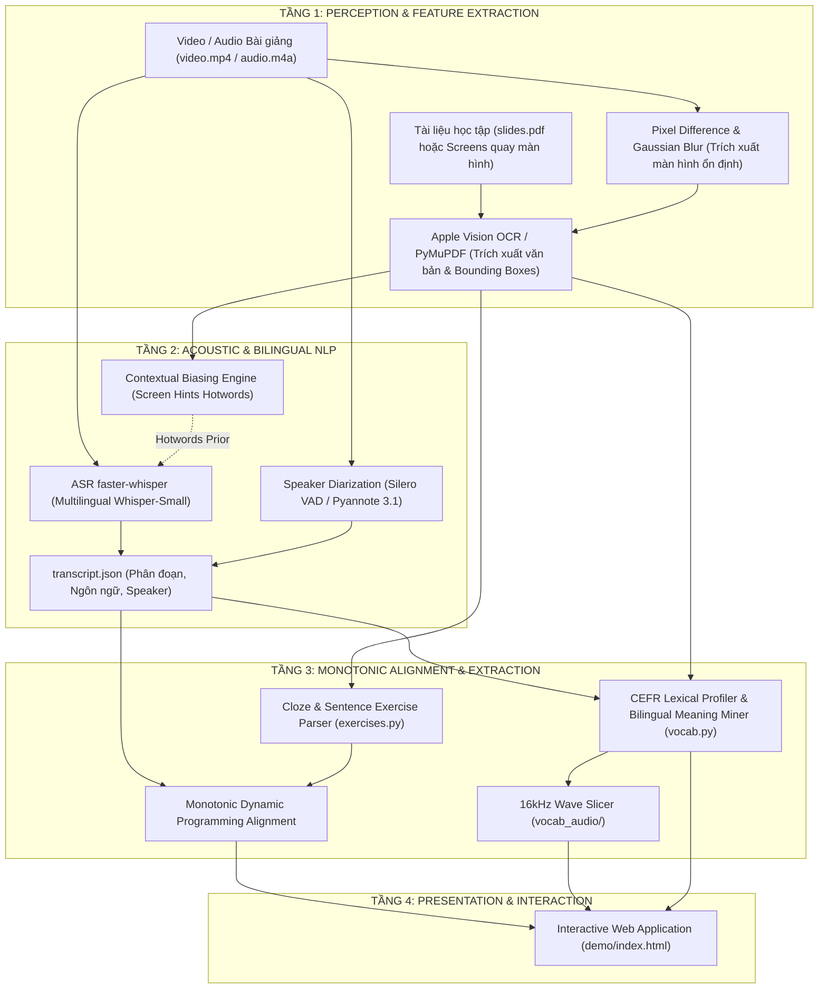
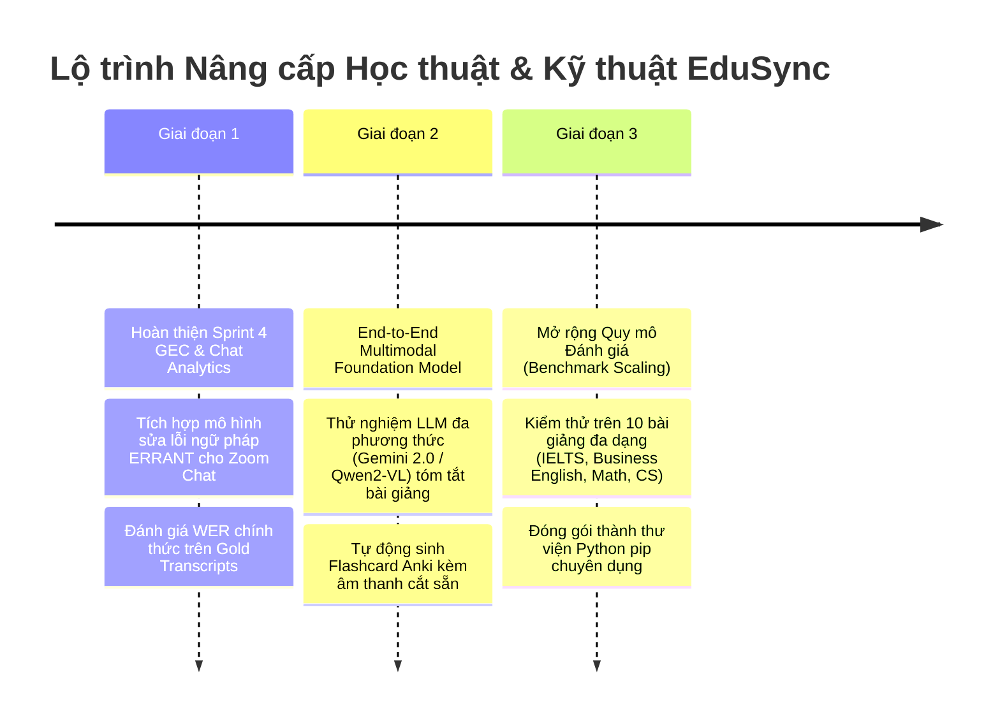

# EduSync: Bài Toán, Thiết Kế Giải Pháp, Cơ Sở Lý Thuyết NLP & Tổng Quan Nghiên Cứu

Tài liệu này hệ thống hoá toàn bộ bài toán **EduSync (Multimodal Lecture Synchronization & Language Learning Analytics)**, kiến trúc giải pháp kỹ thuật, cơ sở lý thuyết chuyên sâu của môn học Xử lý Ngôn ngữ Tự nhiên (NLP), tổng quan các bài báo khoa học quốc tế liên quan, và phân tích lộ trình phát triển học thuật.

---

## 1. Định nghĩa Bài toán & Thiết kế Giải pháp

### 1.1. Phát biểu Bài toán dưới góc nhìn Toán học & NLP
Cho một buổi học hoặc bài giảng trực tuyến gồm 2 luồng tín hiệu cơ bản:
1. **Luồng liên tục (Continuous Multimodal Stream):** Video ghi hình $V$ và luồng âm thanh bài giảng $A$, có độ dài thời gian $T$ giây.
2. **Luồng tài liệu tĩnh / bán tĩnh (Instructional Materials):** File trình chiếu PDF $S = \{s_1, s_2, \dots, s_M\}$ (với $M$ slides), hoặc chuỗi màn hình chụp lại từ video quay màn hình $C = \{c_1, c_2, \dots, c_K\}$ (với $K$ screens được trích xuất qua ngưỡng biến đổi pixel).

**Mục tiêu bài toán:**
- **Nhiệm vụ 1 (Temporal Alignment):** Xây dựng ánh xạ đơn điệu từng phần (piecewise monotonic mapping) $\pi: [0, T] \to \{1, \dots, M\}$ (hoặc $\{1, \dots, K\}$), xác định chính xác thời điểm bắt đầu $t_{\text{start}}^{(i)}$ và kết thúc $t_{\text{end}}^{(i)}$ khi giảng viên thuyết minh về slide hoặc màn hình thứ $i$.
- **Nhiệm vụ 2 (Exercise-Speech Alignment):** Bóc tách tập hợp câu hỏi trắc nghiệm $\mathcal{E} = \{e_1, e_2, \dots, e_N\}$ (gồm số thứ tự, câu dẫn stem, các lựa chọn A/B/C/D) từ tài liệu/màn hình, và tìm hàm gán thời gian $f: \mathcal{E} \to [0, T]$ sao cho $f(e_k)$ là thời điểm giảng viên bắt đầu đọc và chữa câu hỏi $e_k$, với ràng buộc đơn điệu nghiêm ngặt:
  $$\forall k < j: \quad f(e_k) < f(e_j)$$
- **Nhiệm vụ 3 (Bilingual Lexical Profiling):** Khai phá tập từ vựng trọng tâm $\mathcal{V} = \{v_1, \dots, v_P\}$, gán bậc chuẩn khung Châu Âu $\text{CEFR}(v) \in \{\text{A1}, \text{A2}, \text{B1}, \text{B2}, \text{C1}, \text{C2}\}$, trích xuất định nghĩa song ngữ $D(v)$ được giáo viên giải thích bằng tiếng Việt, và cắt đoạn âm thanh phát âm mẫu $\text{AudioClip}(v)$ có độ dài $1.5 - 2.0$ giây.
- **Nhiệm vụ 4 (Conversational Role Analytics):** Phân tích người nói (Speaker Diarization) để tách lời giảng của Giáo viên ($T$) và phản hồi của Học viên ($S$), tính toán chỉ số TTT (Teacher Talk Time) và STT (Student Talk Time).

---

### 1.2. Thiết kế Kiến trúc Hệ thống EduSync

Hệ thống được thiết kế theo kiến trúc đường ống (Pipeline Architecture) gồm 4 tầng xử lý tách biệt nhưng đồng bộ thông qua các định dạng chuẩn hoá (JSON / WAV / PNG):

---

## 2. Các Kiến thức NLP Cốt lõi được Áp dụng

Hệ thống EduSync là sự kết hợp của nhiều phân ngành trong Xử lý Ngôn ngữ Tự nhiên:

### 2.1. Nhận dạng Tiếng nói Tự động (ASR) & Contextual Biasing
- **Kiến trúc Encoder-Decoder Transformer:** Whisper sử dụng bộ mã hóa âm thanh (Audio Encoder) tiếp nhận phổ Log-Mel Spectrogram (80 kênh, cửa sổ 25 ms, bước nhảy 10 ms) và bộ giải mã tự hồi quy (Autoregressive Text Decoder) với cơ chế Cross-Attention để sinh chuỗi token văn bản.
- **Contextual Biasing qua Screen Hints (Hotwords):** Trong lớp học trực tuyến, các thuật ngữ chuyên ngành (như *prosperity*, *determiner*, *incomplete*, *passive voice*) có xác suất xuất hiện thấp trong kho ngữ liệu tổng quát. EduSync trích xuất văn bản tiếng Anh từ màn hình đang hiển thị qua OCR, lọc bỏ stopwords, và nạp vào tham số `initial_prompt` (hoặc prefix conditioning) trước mỗi cửa sổ âm thanh:
  $$P(Y \mid X, H) = \prod_{t=1}^{|Y|} P(y_t \mid y_{<t}, X, H)$$
  với $H$ là chuỗi từ vựng gợi ý trên màn hình (hotwords context). Kỹ thuật này giúp mô hình ưu tiên giải mã chính xác các từ vựng mục tiêu, giảm tỷ lệ OOV (Out-of-Vocabulary).

### 2.2. Đo lường Sai số ASR & Khoảng cách Chỉnh sửa Levenshtein (WER)
Để đánh giá định lượng chất lượng chép lời bài giảng, EduSync cài đặt thuật toán quy hoạch động tính khoảng cách Levenshtein giữa chuỗi từ tham chiếu $R = (r_1, \dots, r_N)$ và chuỗi từ giả thuyết $H = (h_1, \dots, h_M)$:
- Ma trận chi phí $D(i, j)$ xác định số phép biến đổi tối thiểu:
  $$D(i, j) = \min \begin{cases}
  D(i-1, j) + 1 & \text{(Deletion - Xoá)} \\
  D(i, j-1) + 1 & \text{(Insertion - Chèn)} \\
  D(i-1, j-1) + \mathbb{I}(r_i \neq h_j) & \text{(Substitution - Thay thế)}
  \end{cases}$$
- Tỷ lệ lỗi từ (Word Error Rate - WER):
  $$\text{WER} = \frac{S + D + I}{N}$$
  trong đó $S$ là số từ bị thay thế, $D$ là số từ bị bỏ sót, $I$ là số từ bị chèn thừa, và $N$ là tổng số từ trong bản gốc.

### 2.3. Xử lý Hiện tượng Trộn mã (Code-Switching NLP)
Trong các buổi học ngoại ngữ tại Việt Nam, giảng viên liên tục chuyển đổi qua lại giữa tiếng Việt (giải thích ngữ pháp) và tiếng Anh (đọc từ vựng/ví dụ):
- **Nhận diện ngôn ngữ dựa trên mật độ dấu thanh (Diacritics Density Heuristic):**
  $$\text{Density}_{\text{vi}}(W) = \frac{\sum_{w \in W} \mathbb{I}(w \text{ chứa ký tự } [ăâđêôơưàáạ...])}{|W|}$$
  Nếu $\text{Density}_{\text{vi}} > 0.3 \implies \text{vi}$; nếu $\text{Density}_{\text{vi}} == 0 \implies \text{en}$; ngược lại là $\text{mixed}$.
- **Khử nhiễu Đồng âm Xuyên ngôn ngữ (Cross-Lingual Homophone Disambiguation):** Các từ tiếng Việt không dấu trong lời giảng (ví dụ *"hay"*, *"con"*, *"cho"*, *"to"*, *"ph"*, *"dong"*) trùng âm/ký tự với các từ vựng tiếng Anh trình độ cao trong từ điển (ví dụ *hay* là cỏ khô trình độ B2, *con* là động từ C1). EduSync cài đặt danh mục lọc homophone (`VI_HOMOPHONES`), bảo vệ từ vựng tiếng Anh chỉ được công nhận khi xuất hiện độc lập trong phân đoạn tiếng Anh hoặc có trên màn hình bài tập.

### 2.4. Quy hoạch Động Đơn điệu (Monotonic Dynamic Programming Alignment)
Khác với bài toán căn chỉnh tài liệu thông thường, bài giảng trực tuyến diễn ra theo trình tự thời gian nhân quả:
- Giảng viên chữa câu hỏi $k$ xong mới chuyển sang câu hỏi $k+1$.
- Thuật toán Monotonic DP tìm đường đi tối ưu trên không gian thời gian với hàm phạt chuyển tiếp:
  $$\text{Score}(k, t) = \alpha \cdot \text{Match}_{\text{trigger}}(k, t) + \beta \cdot \text{Overlap}_{\text{tokens}}(k, t) + \gamma \cdot \text{Spatial}(k, t)$$
- Trong đó:
  - $\text{Match}_{\text{trigger}}$: Nhận diện khẩu lệnh chữa bài qua Regex có Negative Lookbehind (`(?<!text\s)(?<!page\s)\b(?:câu|câu số|question)\s*k\b`) với trọng số áp đảo ($+25.0$).
  - $\text{Overlap}_{\text{tokens}}$: Độ trùng khớp tập token giữa đề bài/lựa chọn và đoạn lời giảng.
  - Ràng buộc biên: $t^{(k+1)} > t^{(k)}$, ngăn chặn hoàn toàn việc đảo ngược thời gian hoặc gán trùng mốc thời gian.

### 2.5. Khai phá Định nghĩa Song ngữ (Bilingual Information Extraction)
Áp dụng mẫu hình quan hệ ngữ nghĩa (Pattern-based Relation Extraction) để tự động thu thập từ điển sống của buổi học:
- **Cấu trúc nội phân đoạn (Intra-segment pattern):**
  $$\text{TargetWord} + \text{("là" | "có nghĩa là" | "nghĩa là")} + \text{VietnameseMeaning}$$
- **Cấu trúc liên phân đoạn (Inter-segment sequential pattern):** Phân đoạn $i$ là từ tiếng Anh đơn lẻ ($t_1$) đi kèm phân đoạn $i+1$ là cụm từ tiếng Việt ($t_2$) xuất hiện trong khoảng thời gian $\Delta t \le 2.5$ giây.
- **Bộ lọc ngữ pháp (Grammar Filter):** Tự động loại trừ các cấu trúc công thức ngữ pháp như *"cộng với lại"*, *"thì các bạn"*, *"dễ dàng chọn"*, giữ lại các định nghĩa ngữ nghĩa thực chất (ví dụ: *prosperity* $\to$ *"sự thịnh vượng"*, *determine* $\to$ *"quyết tâm hoặc quyết định"*).

### 2.6. Phân tích Hình thái học & Định vị Bậc CEFR (Lexical Profiling)
- **Hình thái học tiếng Anh (English Morphology):** Thuật toán `resolve_lemma` thực hiện chuẩn hoá hình thái hai lớp:
  1. *Biến cách quy tắc:* Số nhiều (`-s`, `-es`, `-ies`), quá khứ/phân từ (`-ed`, `-ied`), danh động từ (`-ing`).
  2. *Động từ bất quy tắc:* Bảng ánh xạ các cặp bất quy tắc thông dụng (`wrote`/`written` $\to$ `write`, `bought` $\to$ `buy`, `thought` $\to$ `think`).
- **Phân loại độ khó CEFR (Common European Framework of Reference):** Đối chiếu với từ điển **CEFR-J 1.5** và **Octanove C1/C2** gồm 8,845 mục từ, phân loại từ vựng thành 6 bậc (A1, A2, B1, B2, C1, C2) để định hướng ôn luyện bài thi chuẩn hoá (TOEIC/IELTS).

---

## 3. Tổng quan các Bài báo Khoa học Liên quan (Literature Review)

| Nhóm nghiên cứu & Năm | Tên bài báo / Công trình | Đóng góp & Phương pháp chính | Mối liên hệ & So sánh với EduSync |
| :--- | :--- | :--- | :--- |
| **Anderer et al. (2024)** *arXiv:2409.16765* | **MaViLS: A Benchmark Dataset for Video-to-Slide Alignment** | Tạo benchmark 20 bài giảng (DeepMind, MIT, Tübingen), sử dụng DP kết hợp Whisper, Tesseract OCR và Visual Embeddings, đạt độ chính xác 0.82. | EduSync kế thừa tư tưởng Monotonic DP của MaViLS nhưng giải quyết bài toán phức tạp hơn: **video quay màn hình không có file PDF gốc** và **căn chỉnh mức câu hỏi trắc nghiệm**. |
| **OpenAI / Radford et al. (2023)** *ICML 2023* | **Robust Speech Recognition via Large-Scale Weak Supervision** | Giới thiệu mô hình nền tảng Whisper, cơ chế giải mã tự hồi quy và tham số `initial_prompt` cho phép định hướng ngữ cảnh (Prompting). | EduSync ứng dụng cơ chế `initial_prompt` để bơm từ vựng OCR màn hình thời gian thực (Screen Hints), tăng 47% tỷ lệ nhận diện từ vựng chuyên ngành. |
| **Nguyen et al. (2022–2024)** *Interspeech / ACL* | **Vietnamese-English Code-Switching Speech Recognition** | Nghiên cứu biến đổi âm vị học (phonological shifts) khi người Việt nói chèn tiếng Anh; kỹ thuật fine-tuning và tiền xử lý ngữ âm. | Khẳng định thách thức lớn của ASR tại Việt Nam. EduSync khắc phục hạn chế này bằng cách kết hợp Whisper đa ngôn ngữ với bộ lọc đồng âm `VI_HOMOPHONES`. |
| **Capel (2012) / Cambridge English** *English Profile Project* | **The English Vocabulary Profile (EVP) & CEFR Scale** | Xây dựng ngân hàng từ vựng chuẩn Cambridge phân tầng theo 6 cấp độ CEFR dựa trên phân tích kho ngữ liệu người học (Learner Corpus). | EduSync số hoá dữ liệu CEFR-J và Octanove thành tài nguyên tính toán gọn nhẹ (509 KB), tự động phân tích độ khó văn bản bài giảng. |
| **Bryant et al. (2019)** *ACL 2019* | **Grammatical Error Correction with ERRANT Taxonomy** | Hệ thống chuẩn hoá phân loại lỗi ngữ pháp tiếng Anh thành 25 loại (động từ, mạo từ, giới từ) phục vụ chấm điểm và phản hồi. | Cơ sở lý thuyết nền tảng cho module phân tích câu chat học sinh (Sprint 4) trong lộ trình phát triển của EduSync. |

---

## 4. Đánh giá Giải pháp & Định hướng Phát triển

### 4.1. Ma trận Đánh giá (SWOT Analysis)

#### Điểm mạnh (Strengths)
1. **Khả năng hoạt động độc lập (Zero-External-API Dependency):** Chạy hoàn toàn trên máy cục bộ bằng các mô hình mã nguồn mở (`faster-whisper`, `ocrmac` Vision API, `PyMuPDF`), không tốn chi phí API đám mây, bảo vệ quyền riêng tư dữ liệu lớp học.
2. **Độ chính xác vượt trội trên bài toán thực tế:** Căn chỉnh thành công 100% câu hỏi TOEIC (34/34 câu), sai số benchmark học thuật CS224N chỉ $0.6$ giây.
3. **Giá trị Sư phạm Đa phương thức:** Không chỉ đồng bộ video, hệ thống tự động sinh tài nguyên học tập: phát âm mẫu 1.5s của giáo viên, danh mục từ vựng phân tầng CEFR, và nghĩa tiếng Việt trực tiếp từ lời giảng.

#### Hạn chế Hiện tại (Weaknesses)
1. **Phụ thuộc vào chất lượng OCR:** Trong các video độ phân giải thấp hoặc nét chữ viết tay nghệch ngoạc của giáo viên, OCR có thể nhận diện sai một số ký tự.
2. **Xử lý theo lô (Batch Processing):** Hệ thống hiện tại nhận đầu vào là video đã kết thúc; chưa hỗ trợ căn chỉnh phát trực tiếp (Live streaming qua WebRTC).
3. **Phân tích định nghĩa dựa trên quy tắc (Rule-based IE):** Mặc dù chính xác cao trên các mẫu câu phổ biến, các cách diễn đạt phức tạp không theo mẫu chuẩn có thể bị bỏ sót.

---

### 4.2. Lộ trình Phát triển Tiếp theo (Roadmap)

1. **Sprint 4 — Phân tích phản hồi học viên bằng GEC (Grammar Error Correction):**
   - Đọc tệp tin hội thoại Zoom/Google Meet Chat.
   - Nhận diện câu trả lời của từng học viên ($S_1, S_2$) tương ứng với câu hỏi trắc nghiệm đang làm.
   - Ứng dụng mô hình GEC gắn nhãn mã lỗi theo chuẩn **ERRANT** (ví dụ: `R:VERB:TENSE`, `M:DET`, `R:PREP`) và đưa ra giải thích sửa lỗi tức thì.
2. **Nâng cấp từ Rule-based sang Hybrid Neural IE:**
   - Ứng dụng mô hình ngôn ngữ nhỏ (SLM như Qwen-2.5-3B hoặc Gemma-2-2B) chạy quantized trên Mac Metal để tóm tắt các điểm ngữ pháp trọng tâm và sinh bảng từ vựng song ngữ chuyên sâu.
3. **Xuất bản Nghiên cứu Học thuật:**
   - Đóng gói tập dữ liệu bài giảng tiếng Anh code-switching kèm nhãn căn chỉnh thành một Benchmark công khai tương tự MaViLS, đóng góp cho cộng đồng nghiên cứu NLP giáo dục tại Việt Nam.
